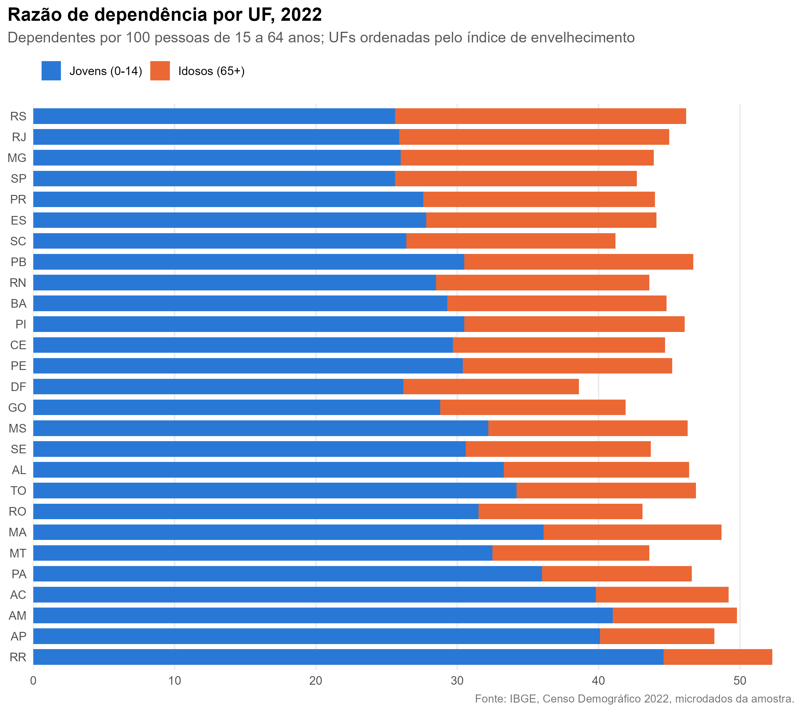
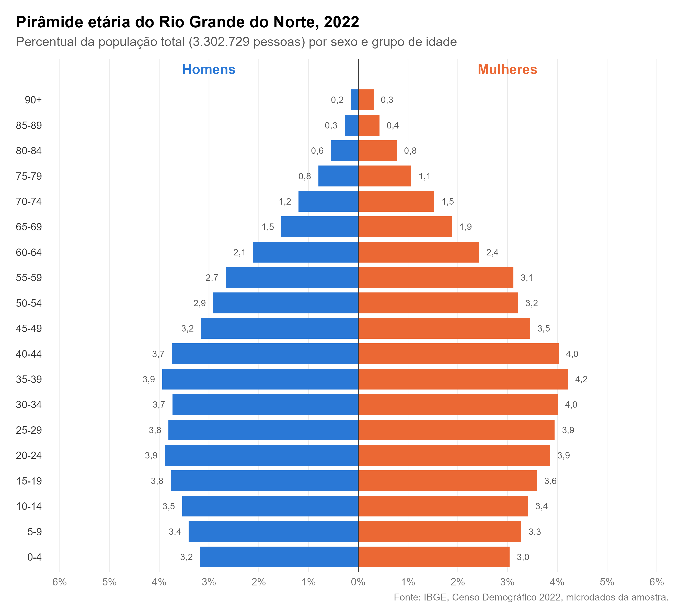
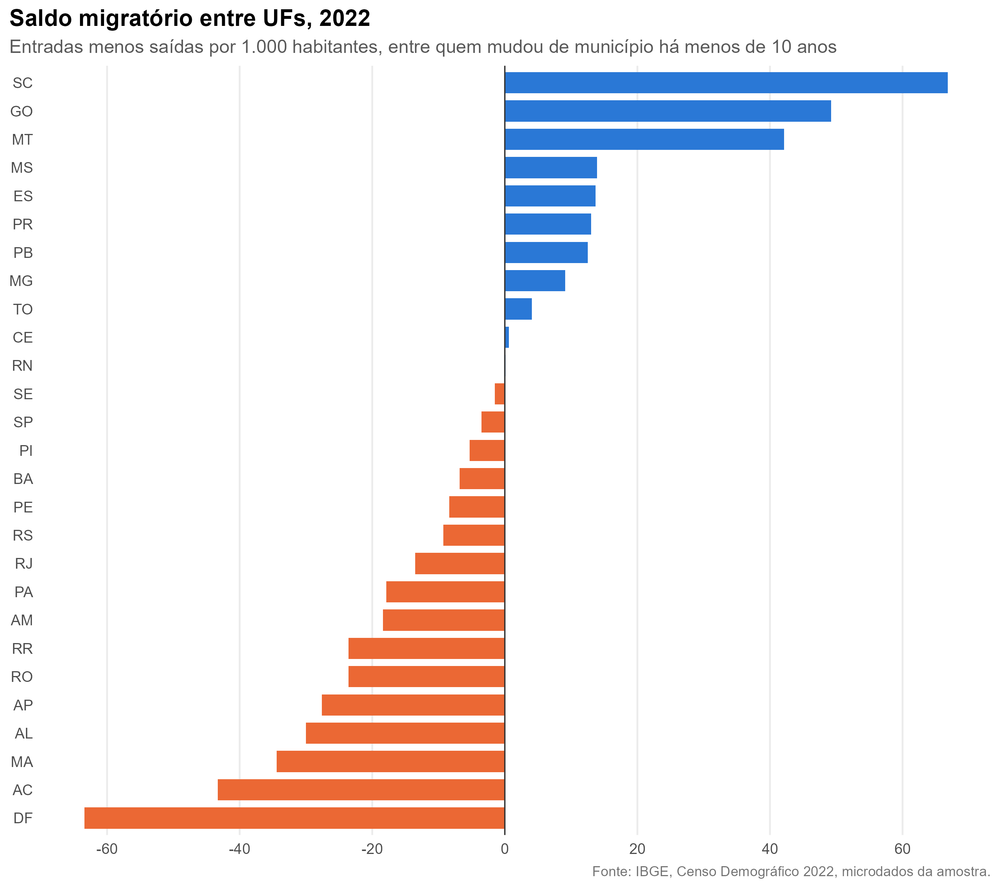
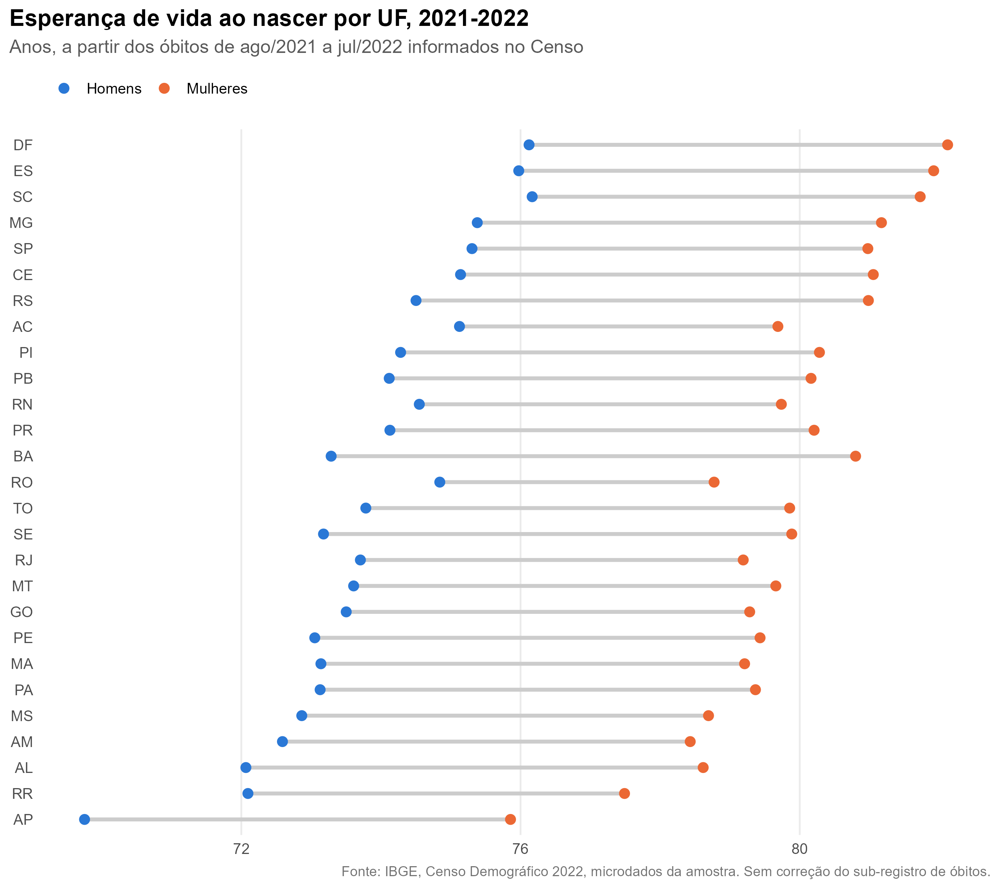
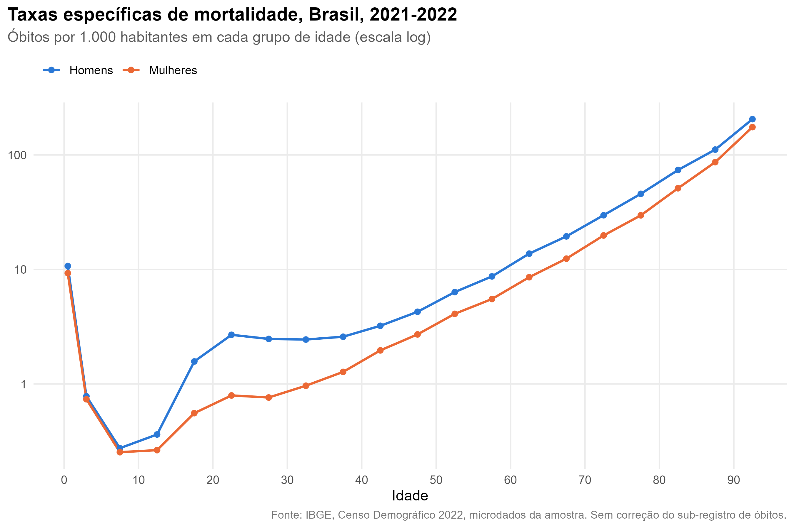

# Análise da tendência futura da população brasileira

Projeto de Iniciação Científica em Ciências Atuariais que estuda a estrutura
etária da população brasileira a partir do Censo Demográfico 2022, como base
para analisar sua tendência futura.

A análise começou pelo **Rio Grande do Norte** e foi automatizada para as
**27 unidades da federação**. Cada UF tem sua própria pasta em `ufs/`, com
gráficos, tabelas e um README com seus resultados:

[AC](ufs/ac/) · [AL](ufs/al/) · [AM](ufs/am/) · [AP](ufs/ap/) · [BA](ufs/ba/) · [CE](ufs/ce/) · [DF](ufs/df/) · [ES](ufs/es/) · [GO](ufs/go/) · [MA](ufs/ma/) · [MG](ufs/mg/) · [MS](ufs/ms/) · [MT](ufs/mt/) · [PA](ufs/pa/) · [PB](ufs/pb/) · [PE](ufs/pe/) · [PI](ufs/pi/) · [PR](ufs/pr/) · [RJ](ufs/rj/) · [RN](ufs/rn/) · [RO](ufs/ro/) · [RR](ufs/rr/) · [RS](ufs/rs/) · [SC](ufs/sc/) · [SE](ufs/se/) · [SP](ufs/sp/) · [TO](ufs/to/)

Este README traz a comparação entre as UFs e os totais do Brasil, que
ficam na pasta [`brasil/`](brasil/).

A análise também desce ao **nível de município**, começando pelo Rio Grande
do Norte: [os 167 municípios do RN](ufs/rn/municipios/), com mapas e uma
página para cada município.

## Resultados por UF

### Razões de dependência e índice de envelhecimento

| UF | População | RD jovem | RD idosa | RD total | Índice de envelhecimento |
|---|--:|--:|--:|--:|--:|
| Rondônia | 1.581.196 | 31,5 | 11,6 | 43,1 | 36,7 |
| Acre | 830.018 | 39,8 | 9,4 | 49,3 | 23,7 |
| Amazonas | 3.941.613 | 41,0 | 8,8 | 49,8 | 21,6 |
| Roraima | 636.707 | 44,6 | 7,7 | 52,3 | 17,3 |
| Pará | 8.120.131 | 36,0 | 10,6 | 46,6 | 29,5 |
| Amapá | 733.759 | 40,1 | 8,1 | 48,2 | 20,3 |
| Tocantins | 1.511.460 | 34,2 | 12,7 | 46,9 | 37,2 |
| Maranhão | 6.776.699 | 36,1 | 12,6 | 48,7 | 34,9 |
| Piauí | 3.271.199 | 30,5 | 15,6 | 46,0 | 51,1 |
| Ceará | 8.794.957 | 29,7 | 15,0 | 44,7 | 50,7 |
| Rio Grande do Norte | 3.302.729 | 28,5 | 15,1 | 43,6 | 52,9 |
| Paraíba | 3.974.687 | 30,5 | 16,2 | 46,8 | 53,2 |
| Pernambuco | 9.058.931 | 30,4 | 14,8 | 45,2 | 48,7 |
| Alagoas | 3.127.683 | 33,3 | 13,1 | 46,3 | 39,3 |
| Sergipe | 2.210.004 | 30,6 | 13,1 | 43,7 | 42,8 |
| Bahia | 14.141.626 | 29,3 | 15,5 | 44,8 | 52,9 |
| Minas Gerais | 20.539.989 | 26,0 | 17,9 | 43,8 | 68,8 |
| Espírito Santo | 3.833.712 | 27,8 | 16,3 | 44,1 | 58,4 |
| Rio de Janeiro | 16.055.174 | 25,9 | 19,1 | 45,0 | 73,7 |
| São Paulo | 44.411.238 | 25,6 | 17,1 | 42,8 | 66,8 |
| Paraná | 11.444.380 | 27,6 | 16,4 | 44,0 | 59,5 |
| Santa Catarina | 7.610.361 | 26,4 | 14,8 | 41,2 | 56,1 |
| Rio Grande do Sul | 10.882.965 | 25,6 | 20,6 | 46,2 | 80,5 |
| Mato Grosso do Sul | 2.757.013 | 32,2 | 14,1 | 46,4 | 43,8 |
| Mato Grosso | 3.658.649 | 32,5 | 11,1 | 43,6 | 34,1 |
| Goiás | 7.056.495 | 28,8 | 13,1 | 41,8 | 45,4 |
| Distrito Federal | 2.817.381 | 26,2 | 12,4 | 38,6 | 47,4 |
| **Brasil** | 203.080.756 | 28,5 | 15,8 | 44,4 | 55,5 |

Valores por 100 pessoas. RD = razão de dependência. Jovens: 0 a 14 anos.
Idade ativa: 15 a 64 anos. Idosos: 65 anos ou mais. Tabela completa em
[`brasil/resultados/indicadores_ufs.csv`](brasil/resultados/indicadores_ufs.csv).



### Pirâmides etárias

Uma pirâmide por UF, na pasta de cada UF (`ufs/<uf>/graficos/`), todas na
mesma escala para facilitar a comparação. Os percentuais estão em
[`brasil/resultados/piramides_ufs.csv`](brasil/resultados/piramides_ufs.csv).



### Migração

**Naturalidade:** percentual da população de cada UF que nasceu nela ou em
outra UF. **Migração recente:** pessoas que moram no município há menos de 10
anos e vieram de outra UF (entradas), pessoas que saíram da UF nesse período
e hoje moram em outra (saídas) e o saldo entre as duas. Quem saiu do Brasil
não é captado pelo Censo e não entra nas saídas.

| UF | Naturais da UF (%) | Nascidos em outra UF (%) | Entradas | Saídas | Saldo | Saldo por mil hab. |
|---|--:|--:|--:|--:|--:|--:|
| Rondônia | 63,6 | 35,7 | 97.904 | 135.243 | -37.339 | -23,6 |
| Acre | 91,0 | 8,6 | 25.543 | 61.488 | -35.946 | -43,3 |
| Amazonas | 89,6 | 8,8 | 116.949 | 189.635 | -72.686 | -18,4 |
| Roraima | 59,6 | 27,5 | 43.507 | 58.532 | -15.025 | -23,6 |
| Pará | 86,5 | 13,3 | 357.809 | 503.124 | -145.315 | -17,9 |
| Amapá | 74,5 | 25,2 | 45.663 | 65.944 | -20.282 | -27,6 |
| Tocantins | 71,6 | 28,2 | 151.221 | 144.994 | 6.227 | 4,1 |
| Maranhão | 92,3 | 7,6 | 310.766 | 544.085 | -233.319 | -34,4 |
| Piauí | 90,6 | 9,3 | 208.798 | 226.029 | -17.231 | -5,3 |
| Ceará | 94,5 | 5,4 | 316.551 | 310.889 | 5.662 | 0,6 |
| Rio Grande do Norte | 90,8 | 9,0 | 136.812 | 136.563 | 249 | 0,1 |
| Paraíba | 90,5 | 9,4 | 256.603 | 206.813 | 49.790 | 12,5 |
| Pernambuco | 92,7 | 7,1 | 342.863 | 418.848 | -75.985 | -8,4 |
| Alagoas | 91,3 | 8,5 | 171.491 | 265.246 | -93.755 | -30,0 |
| Sergipe | 88,0 | 11,9 | 116.668 | 119.943 | -3.275 | -1,5 |
| Bahia | 93,0 | 6,8 | 667.296 | 763.028 | -95.732 | -6,8 |
| Minas Gerais | 91,4 | 8,3 | 906.498 | 720.516 | 185.982 | 9,1 |
| Espírito Santo | 81,8 | 18,0 | 217.998 | 165.436 | 52.562 | 13,7 |
| Rio de Janeiro | 87,2 | 12,2 | 444.759 | 662.273 | -217.514 | -13,5 |
| São Paulo | 79,7 | 19,4 | 1.684.787 | 1.839.025 | -154.238 | -3,5 |
| Paraná | 83,4 | 15,6 | 661.826 | 512.842 | 148.983 | 13,0 |
| Santa Catarina | 75,6 | 23,2 | 869.750 | 361.268 | 508.482 | 66,8 |
| Rio Grande do Sul | 95,1 | 4,2 | 283.378 | 384.872 | -101.494 | -9,3 |
| Mato Grosso do Sul | 75,9 | 22,9 | 214.351 | 175.910 | 38.441 | 13,9 |
| Mato Grosso | 65,1 | 34,2 | 379.051 | 225.022 | 154.029 | 42,1 |
| Goiás | 70,8 | 28,8 | 762.381 | 414.974 | 347.407 | 49,2 |
| Distrito Federal | 57,8 | 41,6 | 292.019 | 470.698 | -178.678 | -63,4 |

Tabelas completas em
[`brasil/resultados/migracao_ufs.csv`](brasil/resultados/migracao_ufs.csv), com os fluxos
entre cada par de UFs em
[`brasil/resultados/fluxos_migracao_recente.csv`](brasil/resultados/fluxos_migracao_recente.csv)
e a matriz UF de nascimento × UF de residência em
[`brasil/resultados/matriz_naturalidade.csv`](brasil/resultados/matriz_naturalidade.csv).



### Mortalidade

Óbitos de moradores informados no Censo nos 12 meses anteriores à data de
referência (agosto de 2021 a julho de 2022), com as taxas específicas de
mortalidade e a tábua de vida abreviada de cada UF, por sexo. e0 é a
esperança de vida ao nascer e e60, aos 60 anos.

| UF | Óbitos (12 meses) | Taxa bruta (por mil) | e0 total | e0 homens | e0 mulheres | e60 total |
|---|--:|--:|--:|--:|--:|--:|
| Rondônia | 8.566 | 5,4 | 76,8 | 74,8 | 78,8 | 22,8 |
| Acre | 3.674 | 4,4 | 77,3 | 75,1 | 79,7 | 23,3 |
| Amazonas | 19.239 | 4,9 | 75,5 | 72,6 | 78,4 | 21,9 |
| Roraima | 2.978 | 4,7 | 74,7 | 72,1 | 77,5 | 21,8 |
| Pará | 43.115 | 5,3 | 76,1 | 73,1 | 79,4 | 22,6 |
| Amapá | 4.252 | 5,8 | 72,7 | 69,8 | 75,9 | 20,5 |
| Tocantins | 8.955 | 5,9 | 76,7 | 73,8 | 79,9 | 23,3 |
| Maranhão | 40.328 | 6,0 | 76,1 | 73,1 | 79,2 | 23,1 |
| Piauí | 21.083 | 6,4 | 77,3 | 74,3 | 80,3 | 24,2 |
| Ceará | 54.599 | 6,2 | 78,1 | 75,1 | 81,1 | 24,3 |
| Rio Grande do Norte | 22.488 | 6,8 | 77,2 | 74,5 | 79,7 | 23,4 |
| Paraíba | 27.647 | 7,0 | 77,2 | 74,1 | 80,2 | 23,4 |
| Pernambuco | 61.935 | 6,8 | 76,3 | 73,1 | 79,4 | 22,6 |
| Alagoas | 20.542 | 6,6 | 75,4 | 72,1 | 78,6 | 22,2 |
| Sergipe | 13.758 | 6,2 | 76,6 | 73,2 | 79,9 | 22,9 |
| Bahia | 93.697 | 6,6 | 77,0 | 73,3 | 80,8 | 24,2 |
| Minas Gerais | 141.253 | 6,9 | 78,3 | 75,4 | 81,2 | 24,1 |
| Espírito Santo | 22.905 | 6,0 | 79,0 | 76,0 | 81,9 | 24,6 |
| Rio de Janeiro | 125.600 | 7,8 | 76,6 | 73,7 | 79,2 | 23,3 |
| São Paulo | 298.527 | 6,7 | 78,3 | 75,3 | 81,0 | 23,5 |
| Paraná | 78.255 | 6,8 | 77,2 | 74,1 | 80,2 | 22,9 |
| Santa Catarina | 43.191 | 5,7 | 79,0 | 76,2 | 81,7 | 23,5 |
| Rio Grande do Sul | 84.530 | 7,8 | 77,8 | 74,5 | 81,0 | 23,2 |
| Mato Grosso do Sul | 18.579 | 6,7 | 75,7 | 72,9 | 78,7 | 22,3 |
| Mato Grosso | 19.647 | 5,4 | 76,5 | 73,6 | 79,7 | 23,1 |
| Goiás | 43.787 | 6,2 | 76,3 | 73,5 | 79,3 | 22,7 |
| Distrito Federal | 14.313 | 5,1 | 79,2 | 76,1 | 82,1 | 23,6 |
| **Brasil** | 1.337.441 | 6,6 | 77,4 | 74,3 | 80,4 | 23,4 |

**Atenção:** os óbitos do Censo são informados pelos moradores que ficaram no
domicílio, e por isso o Censo capta menos mortes que o registro civil (não
aparecem, por exemplo, as de quem morava sozinho). Os valores acima não têm
correção desse sub-registro: a mortalidade sai subestimada e a esperança de
vida, superestimada. O período também inclui meses ainda afetados pela
pandemia de covid-19.

Tábuas de vida completas em
[`brasil/resultados/tabuas_vida_ufs.csv`](brasil/resultados/tabuas_vida_ufs.csv) e série
mensal de óbitos de janeiro de 2019 a julho de 2022 em
[`brasil/resultados/obitos_mensais_ufs.csv`](brasil/resultados/obitos_mensais_ufs.csv).





## Estrutura

```
R/                             # código, compartilhado por todas as UFs
  rodar_tudo.R                 # roda os cinco passos abaixo, em ordem
  01_populacao.R               # passo 1: população, pirâmides e dependência
  02_migracao.R                # passo 2: migração
  03_mortalidade.R             # passo 3: óbitos, taxas e tábuas de vida
  04_municipios.R              # passo 4: os mesmos resultados por município
  05_readmes.R                 # passo 5: README de cada UF e município
  carregar_funcoes.R           # carrega os pacotes e as funções abaixo
  funcoes/
    configuracao.R             # lista de UFs, pastas, opções e cache
    leitura.R                  # leitura dos CSVs de dentro do zip
    populacao.R                # agregação, pirâmide e dependência
    migracao.R                 # filtro das variáveis de migração
    mortalidade.R              # óbitos e tábua de vida
    municipios.R               # nomes, mapas e indicadores por município
    graficos.R                 # tema e funções de todos os gráficos
ufs/
  <uf>/                        # uma pasta por UF (ac, al, ..., to)
    README.md                  # resultados da UF
    graficos/                  # pirâmide etária e curva de mortalidade
    resultados/                # tabelas da UF (CSV)
    dados/                     # bases da UF (local, fora do git)
  rn/municipios/               # municípios do RN: README com mapas e tabela,
    graficos/, resultados/     #   mapas e tabelas de todos os municípios
    <municipio>/               #   uma pasta por município (README e gráficos)
  rn/roteiro/                  # primeira etapa: análise passo a passo do RN
brasil/
  graficos/                    # gráficos comparativos entre UFs
  resultados/                  # tabelas com todas as UFs e o Brasil (CSV)
```

## Como reproduzir

1. Solicite ao IBGE os microdados da amostra do Censo 2022 (acesso controlado)
   em formato CSV, em <https://microdados.ibge.gov.br/>.
2. Coloque o arquivo `.zip` recebido na raiz do projeto, sem descompactar.
3. Com a raiz do projeto como diretório de trabalho, rode:

   ```bash
   Rscript R/rodar_tudo.R
   ```

   Ele roda os passos `R/01_populacao.R` a `R/05_readmes.R`, nesta ordem.
   Os passos também podem ser rodados um a um, desde que o passo 1 venha
   primeiro: os outros usam a população que ele salva. Para ler dos
   microdados só algumas UFs, passe as siglas (`Rscript R/rodar_tudo.R PB
   PE`); para refazer a leitura, use `--refazer`.

   O passo 4 (municípios) roda por padrão para o Rio Grande do Norte. Para
   outra UF: `Rscript R/04_municipios.R PB` e depois
   `Rscript R/05_readmes.R`.

A primeira execução leva cerca de 7 minutos para o Brasil todo: de cada UF é
extraído do zip só o arquivo necessário, lido apenas nas colunas usadas
(`data.table::fread`) e agregado ou filtrado na hora. O resultado fica
guardado em `ufs/<uf>/dados/`, e as execuções seguintes levam menos de um
minuto. A soma dos pesos de cada UF confere com a população do Censo 2022.

O filtro de migração lê as colunas P0480 a P0590 do dicionário de variáveis
(naturalidade, nacionalidade e residência anterior), com nomes legíveis e os
códigos de "não sabe"/"ignorado" como `NA`, e salva uma base Parquet por UF
(`ufs/<uf>/dados/migracao.parquet`). Os resumos são calculados com `arrow`
direto sobre essas bases, sem carregar os registros na memória.

A mortalidade lê o arquivo de óbitos de cada UF (sexo, idade, mês e peso) e o
agrega na hora por sexo, idade e mês (`ufs/<uf>/dados/obitos.rds`). Óbitos
com sexo ou idade ignorados são redistribuídos proporcionalmente. A tábua de
vida usa grupos 0, 1-4, 5-9, ..., 85-89 e 90+, com os fatores de separação
de Coale-Demeny nas idades 0 e 1-4.

Nos municípios, os mesmos cálculos são feitos com as bases já salvas, sem
ler os microdados de novo. As entradas e saídas contam só as mudanças com
município de origem conhecido; as saídas usam as bases de todas as UFs, para
incluir quem foi morar fora do estado. A mortalidade municipal traz a taxa
bruta e a taxa padronizada por idade (com a população da UF como padrão);
como a maioria dos municípios tem poucos óbitos na amostra, a tábua de vida
só é feita para os que têm 100 mil habitantes ou mais. Os contornos dos
municípios para os mapas vêm do pacote [geobr](https://ipeagit.github.io/geobr/).

Os scripts da primeira etapa, em [`ufs/rn/roteiro/`](ufs/rn/roteiro/),
continuam disponíveis como roteiro passo a passo e também são rodados a
partir da raiz do projeto.

Pacotes utilizados: [arrow](https://arrow.apache.org/docs/r/),
[censobr](https://ipeagit.github.io/censobr/),
[data.table](https://rdatatable.gitlab.io/data.table/) e
[tidyverse](https://www.tidyverse.org/).

## Sobre os dados

Os microdados de acesso controlado do Censo 2022 são sigilosos e **não fazem
parte deste repositório**. O `.gitignore` impede o envio do arquivo do IBGE e
das bases geradas a partir dele (as pastas `ufs/<uf>/dados/` e
`ufs/rn/roteiro/dados_rn/`). Aqui são publicados apenas o código e resultados
agregados por estado.

Fonte: IBGE, Censo Demográfico 2022.
