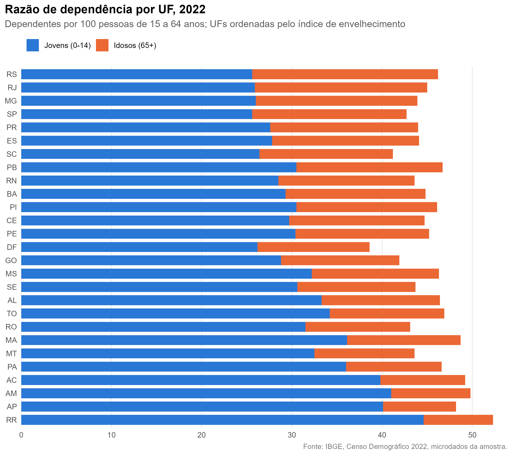
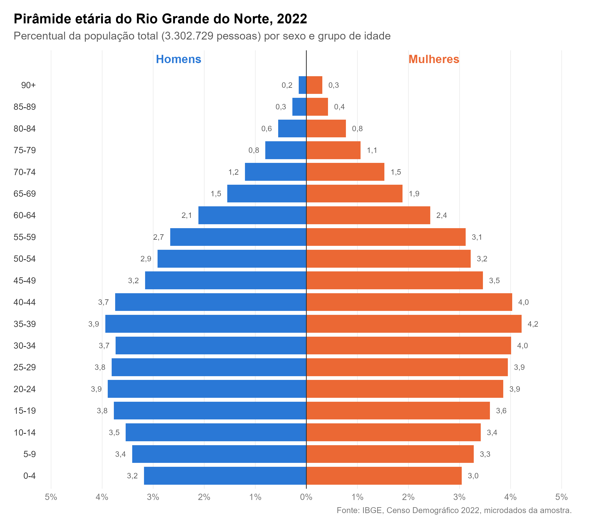

# Análise da tendência futura da população brasileira

Projeto de Iniciação Científica em Ciências Atuariais que estuda a estrutura
etária da população brasileira a partir do Censo Demográfico 2022, como base
para analisar sua tendência futura.

A análise começou pelo **Rio Grande do Norte** e foi automatizada para as
**27 unidades da federação**.

## Resultados por UF

### Razões de dependência e índice de envelhecimento

| UF | População | RD jovem | RD idosa | RD total | Índice de envelhecimento |
|---|--:|--:|--:|--:|--:|
| Rondônia | 1.581.196 | 31,5 | 11,6 | 43,1 | 36,7 |
| Acre | 830.018 | 39,8 | 9,4 | 49,3 | 23,7 |
| Amazonas | 3.941.613 | 41,0 | 8,8 | 49,8 | 21,6 |
| Roraima | 636.707 | 44,6 | 7,7 | 52,3 | 17,3 |
| Pará | 8.120.131 | 36,0 | 10,6 | 46,6 | 29,5 |
| Amapá | 733.759 | 40,1 | 8,1 | 48,2 | 20,3 |
| Tocantins | 1.511.460 | 34,2 | 12,7 | 46,9 | 37,2 |
| Maranhão | 6.776.699 | 36,1 | 12,6 | 48,7 | 34,9 |
| Piauí | 3.271.199 | 30,5 | 15,6 | 46,0 | 51,1 |
| Ceará | 8.794.957 | 29,7 | 15,0 | 44,7 | 50,7 |
| Rio Grande do Norte | 3.302.729 | 28,5 | 15,1 | 43,6 | 52,9 |
| Paraíba | 3.974.687 | 30,5 | 16,2 | 46,8 | 53,2 |
| Pernambuco | 9.058.931 | 30,4 | 14,8 | 45,2 | 48,7 |
| Alagoas | 3.127.683 | 33,3 | 13,1 | 46,3 | 39,3 |
| Sergipe | 2.210.004 | 30,6 | 13,1 | 43,7 | 42,8 |
| Bahia | 14.141.626 | 29,3 | 15,5 | 44,8 | 52,9 |
| Minas Gerais | 20.539.989 | 26,0 | 17,9 | 43,8 | 68,8 |
| Espírito Santo | 3.833.712 | 27,8 | 16,3 | 44,1 | 58,4 |
| Rio de Janeiro | 16.055.174 | 25,9 | 19,1 | 45,0 | 73,7 |
| São Paulo | 44.411.238 | 25,6 | 17,1 | 42,8 | 66,8 |
| Paraná | 11.444.380 | 27,6 | 16,4 | 44,0 | 59,5 |
| Santa Catarina | 7.610.361 | 26,4 | 14,8 | 41,2 | 56,1 |
| Rio Grande do Sul | 10.882.965 | 25,6 | 20,6 | 46,2 | 80,5 |
| Mato Grosso do Sul | 2.757.013 | 32,2 | 14,1 | 46,4 | 43,8 |
| Mato Grosso | 3.658.649 | 32,5 | 11,1 | 43,6 | 34,1 |
| Goiás | 7.056.495 | 28,8 | 13,1 | 41,8 | 45,4 |
| Distrito Federal | 2.817.381 | 26,2 | 12,4 | 38,6 | 47,4 |
| **Brasil** | 203.080.756 | 28,5 | 15,8 | 44,4 | 55,5 |

Valores por 100 pessoas. RD = razão de dependência. Jovens: 0 a 14 anos.
Idade ativa: 15 a 64 anos. Idosos: 65 anos ou mais. Tabela completa em
[`resultados/indicadores_ufs.csv`](resultados/indicadores_ufs.csv).



### Pirâmides etárias

Uma pirâmide por UF em [`graficos/piramides/`](graficos/piramides/), todas
na mesma escala para facilitar a comparação. Os percentuais estão em
[`resultados/piramides_ufs.csv`](resultados/piramides_ufs.csv).



## Estrutura

```
rn/                            # primeira etapa: análise do Rio Grande do Norte
  R/
    filtrar_rn.R               # passo 1: filtra as pessoas do RN
    piramide_etaria.R          # passo 2: pirâmide etária
    indicadores_dependencia.R  # passo 3: razões de dependência
  graficos/                    # pirâmide etária do RN
  dados_rn/                    # base do RN (local, fora do git)
R/
  funcoes_uf.R                 # os passos 1 a 3 como funções, para qualquer UF
  analise_todas_ufs.R          # roda os passos para todas as UFs
graficos/                      # gráficos comparativos
  piramides/                   # uma pirâmide etária por UF
resultados/                    # tabelas agregadas por UF (CSV)
dados_ufs/                     # agregação por UF (local, fora do git)
```

## Como reproduzir

1. Solicite ao IBGE os microdados da amostra do Censo 2022 (acesso controlado)
   em formato CSV, em <https://microdados.ibge.gov.br/>.
2. Coloque o arquivo `.zip` recebido na raiz do projeto, sem descompactar.
3. Com a raiz do projeto como diretório de trabalho, rode:

   ```bash
   Rscript R/analise_todas_ufs.R
   ```

   Para processar só algumas UFs, passe as siglas (`Rscript
   R/analise_todas_ufs.R PB PE`); para refazer a leitura dos microdados, use
   `--refazer`.

A primeira execução leva cerca de 2 minutos para o Brasil todo: de cada UF é
extraído do zip só o arquivo de pessoas, lido apenas nas 5 colunas usadas
(`data.table::fread`) e agregado na hora por município, sexo e idade. Essa
agregação fica guardada em `dados_ufs/`, e as execuções seguintes levam
segundos. A soma dos pesos de cada UF confere com a população do Censo 2022.

Os scripts do RN, em `rn/R/`, continuam disponíveis como roteiro passo a passo
e também são rodados a partir da raiz do projeto.

Pacotes utilizados: [censobr](https://ipeagit.github.io/censobr/),
[data.table](https://rdatatable.gitlab.io/data.table/) e
[tidyverse](https://www.tidyverse.org/).

## Sobre os dados

Os microdados de acesso controlado do Censo 2022 são sigilosos e **não fazem
parte deste repositório**. O `.gitignore` impede o envio do arquivo do IBGE e
das bases geradas a partir dele (pastas `rn/dados_rn/` e `dados_ufs/`). Aqui
são publicados apenas o código e resultados agregados por estado.

Fonte: IBGE, Censo Demográfico 2022.
