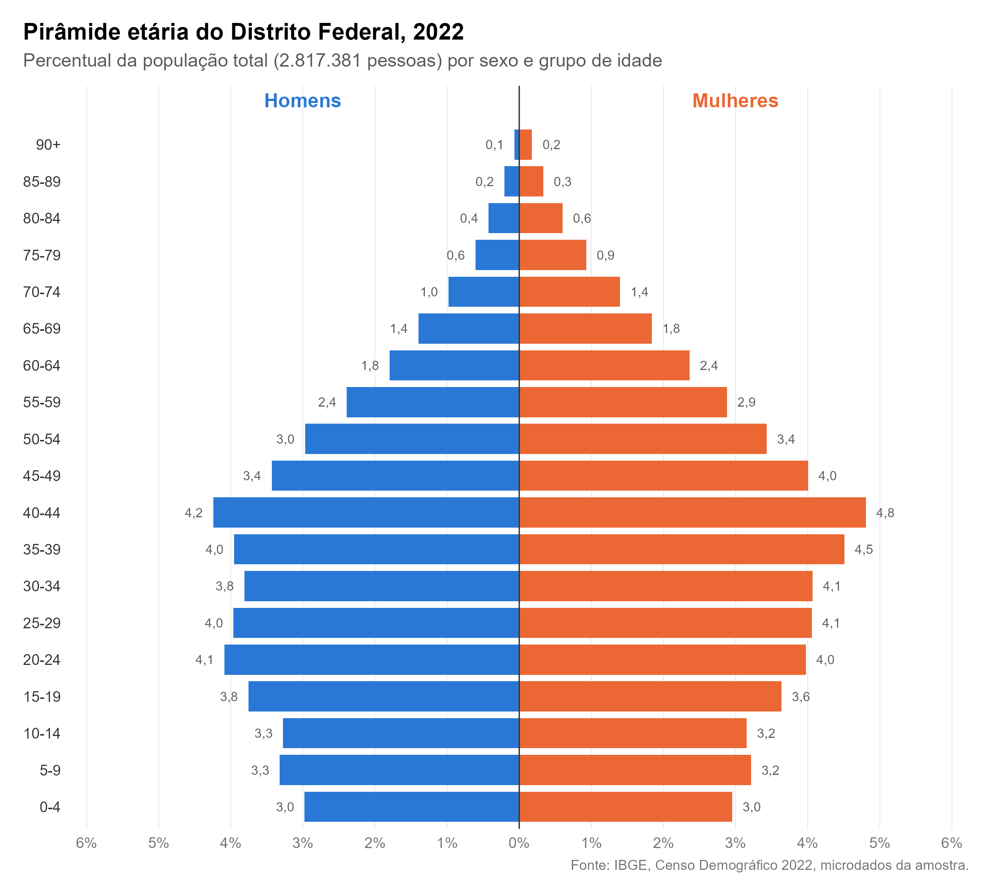
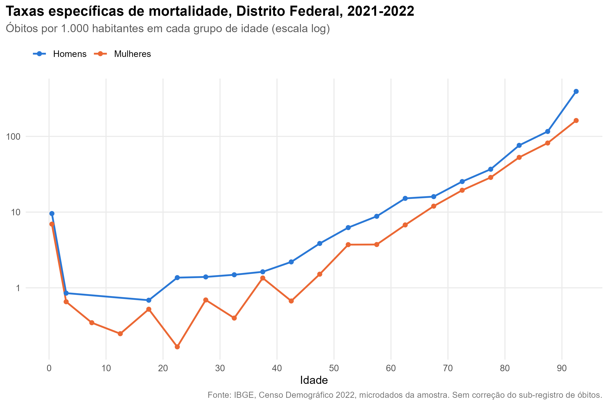

# Distrito Federal (DF)

Resultados do Censo Demográfico 2022 (microdados da amostra) para esta UF. Gerado por `R/05_readmes.R`; veja o [README principal](../../README.md) para a metodologia.

População: **2.817.381** pessoas.

## Estrutura etária

| Indicador | DF | Brasil |
|---|--:|--:|
| Razão de dependência jovem | 26,2 | 28,5 |
| Razão de dependência idosa | 12,4 | 15,8 |
| Razão de dependência total | 38,6 | 44,4 |
| Índice de envelhecimento | 47,4 | 55,5 |

Valores por 100 pessoas. Jovens: 0 a 14 anos; idade ativa: 15 a 64;
idosos: 65 ou mais.

## Migração

| Indicador | Valor |
|---|--:|
| Nascidos na própria UF | 57,8% |
| Nascidos em outra UF | 41,6% |
| Nascidos no exterior | 0,5% |
| Entradas de outras UFs (últimos 10 anos) | 292.019 |
| Saídas para outras UFs (últimos 10 anos) | 470.698 |
| Saldo migratório entre UFs | -178.678 |
| Saldo por 1.000 habitantes | -63,4 |

Principais origens de quem chegou e destinos de quem saiu (últimos 10
anos):

| Origem | Chegaram | Destino | Saíram |
|---|--:|---|--:|
| GO | 61.510 | GO | 218.369 |
| MG | 31.344 | MG | 38.813 |
| BA | 30.456 | BA | 33.562 |
| MA | 25.051 | SP | 27.646 |
| RJ | 22.865 | PI | 26.402 |

## Mortalidade

Óbitos de agosto de 2021 a julho de 2022 informados no Censo.

| Indicador | DF | Brasil |
|---|--:|--:|
| Óbitos no período | 14.313 | 1.337.441 |
| Taxa bruta de mortalidade (por mil) | 5,1 | 6,6 |
| Esperança de vida ao nascer, total | 79,2 | 77,4 |
| Esperança de vida ao nascer, homens | 76,1 | 74,3 |
| Esperança de vida ao nascer, mulheres | 82,1 | 80,4 |
| Esperança de vida aos 60 anos, total | 23,6 | 23,4 |

**Atenção:** sem correção do sub-registro de óbitos do Censo; a mortalidade está subestimada e a esperança de vida, superestimada.

## Arquivos

- [`resultados/indicadores.csv`](resultados/indicadores.csv): razões de dependência e índice de envelhecimento
- [`resultados/piramides.csv`](resultados/piramides.csv): população por sexo e grupo de idade (pirâmide)
- [`resultados/migracao.csv`](resultados/migracao.csv): naturalidade e saldo migratório
- [`resultados/naturalidade.csv`](resultados/naturalidade.csv): moradores por UF de nascimento
- [`resultados/fluxos_migracao.csv`](resultados/fluxos_migracao.csv): entradas e saídas por UF de origem/destino
- [`resultados/mortalidade.csv`](resultados/mortalidade.csv): óbitos, taxa bruta e esperança de vida
- [`resultados/tabuas_vida.csv`](resultados/tabuas_vida.csv): tábuas de vida abreviadas por sexo
- [`resultados/obitos_mensais.csv`](resultados/obitos_mensais.csv): óbitos por mês, jan/2019 a jul/2022
