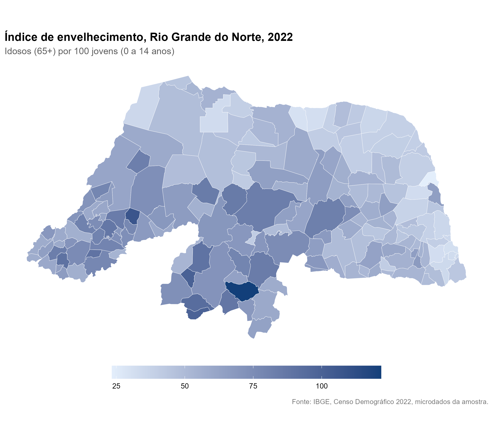
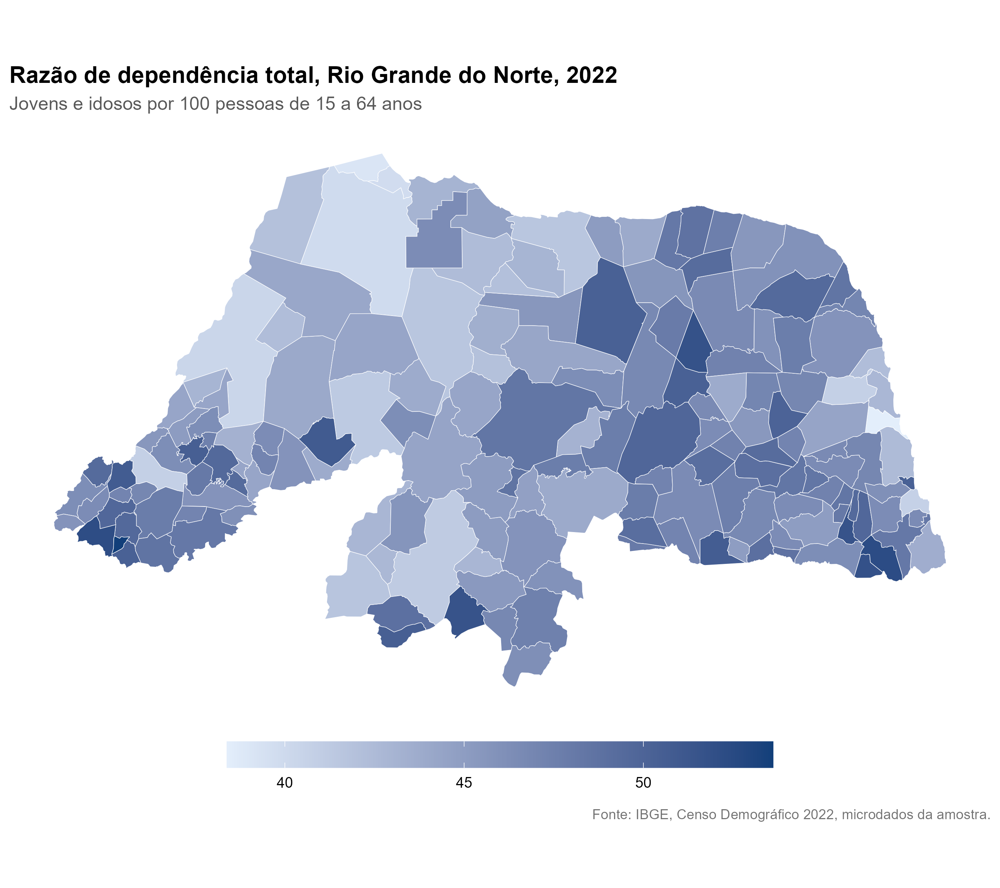
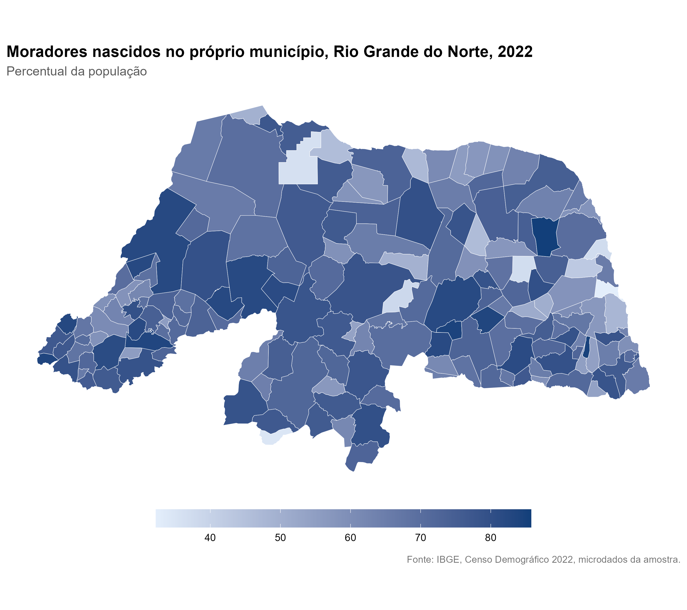
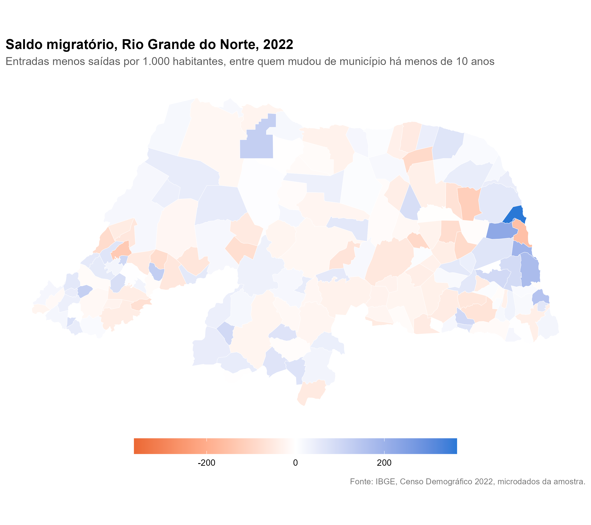

# Municípios do Rio Grande do Norte

Resultados do Censo Demográfico 2022 (microdados da amostra) para os 167 municípios do Rio Grande do Norte. Gerado por `R/05_readmes.R`. Cada município tem sua própria página, com pirâmide etária, migração e mortalidade.

**Cuidados:** nos municípios pequenos os valores vêm de poucos registros da amostra (as tabelas mostram quantos). A mortalidade municipal varia muito por acaso e não tem correção do sub-registro de óbitos; por isso ela não está nos mapas, e a tábua de vida só foi feita para os municípios com 100 mil habitantes ou mais.

## Mapas

## Todos os municípios

| Município | População | Dependência total | Índice de envelhecimento | Nascidos no município (%) | Saldo migratório por mil | Óbitos (12 meses) |
|---|--:|--:|--:|--:|--:|--:|
| [Acari](acari/) | 10.597 | 45,8 | 84,5 | 77,7 | -24,3 | 76 |
| [Açu](acu/) | 56.496 | 41,6 | 47,8 | 76,3 | +4,3 | 433 |
| [Afonso Bezerra](afonso_bezerra/) | 10.839 | 45,5 | 51,2 | 73,7 | +36,6 | 119 |
| [Água Nova](agua_nova/) | 2.946 | 47,1 | 58,8 | 70,7 | +46,9 | 21 |
| [Alexandria](alexandria/) | 13.640 | 48,2 | 78,2 | 78,8 | -44,6 | 82 |
| [Almino Afonso](almino_afonso/) | 4.687 | 44,3 | 73,6 | 71,2 | -10,6 | 45 |
| [Alto do Rodrigues](alto_do_rodrigues/) | 12.484 | 42,1 | 42,2 | 58,1 | -11,8 | 88 |
| [Angicos](angicos/) | 11.632 | 44,2 | 64,5 | 65,3 | -23,6 | 82 |
| [Antônio Martins](antonio_martins/) | 6.577 | 45,8 | 79,7 | 83,3 | -43,9 | 68 |
| [Apodi](apodi/) | 36.093 | 40,3 | 61,5 | 82,1 | +18,8 | 192 |
| [Areia Branca](areia_branca/) | 24.093 | 43,1 | 54,5 | 75,4 | -27,1 | 223 |
| [Arês](ares/) | 13.251 | 46,1 | 39,9 | 78,3 | +13,6 | 122 |
| [Baía Formosa](baia_formosa/) | 8.825 | 43,6 | 43,3 | 65,7 | +25,7 | 98 |
| [Baraúna](barauna/) | 26.913 | 42,0 | 35,1 | 65,8 | +18,0 | 63 |
| [Barcelona](barcelona/) | 3.986 | 46,4 | 74,6 | 73,5 | +7,5 | 21 |
| [Bento Fernandes](bento_fernandes/) | 4.807 | 47,3 | 55,5 | 57,5 | -2,9 | 6 |
| [Bodó](bodo/) | 2.306 | 43,2 | 64,5 | 38,4 | -64,2 | 11 |
| [Bom Jesus](bom_jesus/) | 9.952 | 47,1 | 53,9 | 50,4 | +41,3 | 102 |
| [Brejinho](brejinho/) | 12.202 | 48,4 | 50,7 | 63,6 | -8,1 | 60 |
| [Caiçara do Norte](caicara_do_norte/) | 6.293 | 48,2 | 38,7 | 55,7 | -35,9 | 19 |
| [Caiçara do Rio do Vento](caicara_do_rio_do_vento/) | 3.268 | 50,3 | 54,3 | 58,9 | -16,2 | 21 |
| [Caicó](caico/) | 61.146 | 41,2 | 71,3 | 72,3 | -24,8 | 299 |
| [Campo Grande](campo_grande/) | 9.730 | 41,3 | 66,7 | 81,9 | +19,7 | 75 |
| [Campo Redondo](campo_redondo/) | 10.215 | 47,8 | 65,4 | 81,8 | -30,3 | 58 |
| [Canguaretama](canguaretama/) | 29.668 | 48,2 | 34,4 | 76,2 | -38,4 | 246 |
| [Caraúbas](caraubas/) | 19.727 | 44,0 | 73,7 | 79,4 | -20,7 | 145 |
| [Carnaúba dos Dantas](carnauba_dos_dantas/) | 7.992 | 45,9 | 58,1 | 70,9 | +41,1 | 59 |
| [Carnaubais](carnaubais/) | 9.714 | 42,4 | 45,9 | 75,8 | -2,3 | 94 |
| [Ceará-Mirim](ceara_mirim/) | 79.115 | 45,8 | 39,4 | 70,1 | +57,6 | 383 |
| [Cerro Corá](cerro_cora/) | 11.000 | 47,7 | 61,4 | 71,3 | +17,2 | 128 |
| [Coronel Ezequiel](coronel_ezequiel/) | 5.117 | 49,1 | 69,1 | 61,5 | -23,1 | 28 |
| [Coronel João Pessoa](coronel_joao_pessoa/) | 4.237 | 46,4 | 65,1 | 77,0 | -14,2 | 19 |
| [Cruzeta](cruzeta/) | 8.005 | 45,1 | 79,6 | 72,3 | -16,8 | 65 |
| [Currais Novos](currais_novos/) | 41.313 | 43,9 | 75,4 | 69,9 | -31,2 | 303 |
| [Doutor Severiano](doutor_severiano/) | 7.044 | 49,4 | 69,1 | 82,6 | +0,8 | 47 |
| [Encanto](encanto/) | 6.016 | 50,8 | 59,1 | 67,4 | +58,4 | 60 |
| [Equador](equador/) | 5.360 | 46,2 | 63,4 | 73,0 | -50,8 | 47 |
| [Espírito Santo](espirito_santo/) | 10.620 | 49,7 | 53,1 | 54,4 | +30,4 | 59 |
| [Extremoz](extremoz/) | 61.635 | 42,3 | 23,5 | 37,4 | +362,6 | 284 |
| [Felipe Guerra](felipe_guerra/) | 5.944 | 42,3 | 82,6 | 71,4 | +40,7 | 28 |
| [Fernando Pedroza](fernando_pedroza/) | 2.938 | 46,3 | 55,8 | 49,4 | +58,9 | 18 |
| [Florânia](florania/) | 10.196 | 45,1 | 69,1 | 76,4 | +19,6 | 74 |
| [Francisco Dantas](francisco_dantas/) | 2.700 | 46,3 | 81,1 | 62,9 | +53,4 | 23 |
| [Frutuoso Gomes](frutuoso_gomes/) | 4.122 | 49,4 | 73,6 | 69,7 | +26,9 | 19 |
| [Galinhos](galinhos/) | 2.104 | 43,9 | 31,6 | 61,1 | +8,2 | 11 |
| [Goianinha](goianinha/) | 26.741 | 46,4 | 31,9 | 65,0 | +15,5 | 160 |
| [Governador Dix-Sept Rosado](governador_dix_sept_rosado/) | 11.938 | 44,1 | 59,0 | 65,7 | +48,9 | 70 |
| [Grossos](grossos/) | 9.924 | 39,8 | 52,7 | 77,5 | +17,0 | 69 |
| [Guamaré](guamare/) | 15.295 | 45,1 | 30,0 | 47,1 | +21,4 | 76 |
| [Ielmo Marinho](ielmo_marinho/) | 11.615 | 46,9 | 45,6 | 74,5 | -7,2 | 89 |
| [Ipanguaçu](ipanguacu/) | 14.131 | 43,5 | 43,8 | 76,5 | -9,1 | 84 |
| [Ipueira](ipueira/) | 2.035 | 50,5 | 99,7 | 34,5 | -2,1 | 34 |
| [Itajá](itaja/) | 7.292 | 42,0 | 41,5 | 59,0 | +22,5 | 29 |
| [Itaú](itau/) | 5.320 | 44,3 | 66,2 | 69,1 | -58,2 | 32 |
| [Jaçanã](jacana/) | 7.834 | 48,0 | 67,1 | 64,3 | -48,5 | 46 |
| [Jandaíra](jandaira/) | 6.562 | 45,6 | 40,3 | 65,2 | +17,4 | 39 |
| [Janduís](janduis/) | 4.746 | 50,9 | 68,9 | 82,1 | -60,3 | 15 |
| [Januário Cicco](januario_cicco/) | 9.051 | 48,4 | 51,6 | 75,2 | +57,4 | 76 |
| [Japi](japi/) | 5.117 | 50,7 | 53,6 | 71,8 | -47,5 | 32 |
| [Jardim de Angicos](jardim_de_angicos/) | 2.437 | 51,7 | 56,5 | 46,3 | +83,9 | 5 |
| [Jardim de Piranhas](jardim_de_piranhas/) | 13.977 | 42,9 | 52,8 | 64,5 | +40,6 | 119 |
| [Jardim do Seridó](jardim_do_serido/) | 11.655 | 45,3 | 121,6 | 76,2 | -7,3 | 104 |
| [João Câmara](joao_camara/) | 33.290 | 46,6 | 39,7 | 74,3 | -36,5 | 150 |
| [João Dias](joao_dias/) | 2.076 | 46,1 | 53,8 | 73,1 | -74,8 | 25 |
| [José da Penha](jose_da_penha/) | 5.803 | 49,6 | 90,5 | 72,2 | -0,4 | 58 |
| [Jucurutu](jucurutu/) | 17.793 | 44,4 | 69,4 | 78,1 | +35,9 | 154 |
| [Jundiá](jundia/) | 3.739 | 49,5 | 54,7 | 84,8 | -34,3 | 25 |
| [Lagoa d'Anta](lagoa_d_anta/) | 6.654 | 46,4 | 40,4 | 65,3 | +98,1 | 60 |
| [Lagoa de Pedras](lagoa_de_pedras/) | 7.338 | 47,3 | 52,9 | 79,2 | +7,8 | 45 |
| [Lagoa de Velhos](lagoa_de_velhos/) | 2.567 | 47,3 | 53,4 | 66,2 | -33,0 | 15 |
| [Lagoa Nova](lagoa_nova/) | 15.573 | 47,7 | 49,5 | 67,7 | +54,6 | 147 |
| [Lagoa Salgada](lagoa_salgada/) | 8.319 | 48,4 | 44,3 | 68,8 | -45,7 | 58 |
| [Lajes](lajes/) | 9.866 | 46,7 | 65,9 | 71,0 | -8,5 | 44 |
| [Lajes Pintadas](lajes_pintadas/) | 4.787 | 47,2 | 67,6 | 84,2 | -31,0 | 25 |
| [Lucrécia](lucrecia/) | 3.490 | 44,3 | 68,9 | 55,5 | +0,4 | 14 |
| [Luís Gomes](luis_gomes/) | 9.070 | 52,2 | 60,1 | 79,2 | +22,7 | 89 |
| [Macaíba](macaiba/) | 82.249 | 44,4 | 37,5 | 58,3 | +65,7 | 449 |
| [Macau](macau/) | 27.369 | 41,6 | 54,6 | 73,4 | -31,5 | 242 |
| [Major Sales](major_sales/) | 3.924 | 53,6 | 64,7 | 65,8 | +79,4 | 36 |
| [Marcelino Vieira](marcelino_vieira/) | 7.896 | 47,8 | 75,8 | 81,3 | -17,3 | 63 |
| [Martins](martins/) | 8.179 | 49,6 | 87,5 | 74,5 | +1,4 | 89 |
| [Maxaranguape](maxaranguape/) | 10.255 | 47,0 | 42,0 | 58,4 | +43,9 | 125 |
| [Messias Targino](messias_targino/) | 4.274 | 43,8 | 58,8 | 70,8 | +56,2 | 23 |
| [Montanhas](montanhas/) | 11.444 | 51,8 | 49,3 | 54,0 | +21,3 | 105 |
| [Monte Alegre](monte_alegre/) | 23.031 | 46,5 | 44,1 | 67,2 | +95,5 | 212 |
| [Monte das Gameleiras](monte_das_gameleiras/) | 2.276 | 45,0 | 51,8 | 66,8 | -0,1 | 24 |
| [Mossoró](mossoro/) | 264.577 | 39,9 | 48,2 | 69,8 | -19,5 | 1.809 |
| [Natal](natal/) | 751.300 | 42,8 | 65,1 | 65,5 | -151,8 | 5.490 |
| [Nísia Floresta](nisia_floresta/) | 31.942 | 42,5 | 35,2 | 48,1 | +172,2 | 203 |
| [Nova Cruz](nova_cruz/) | 34.269 | 46,3 | 53,0 | 71,6 | -11,7 | 270 |
| [Olho d'Água do Borges](olho_d_agua_do_borges/) | 3.905 | 46,4 | 107,4 | 69,1 | -83,5 | 62 |
| [Ouro Branco](ouro_branco/) | 4.913 | 51,6 | 87,9 | 76,2 | +67,6 | 40 |
| [Paraná](parana/) | 3.934 | 50,3 | 66,7 | 75,6 | +47,0 | 22 |
| [Paraú](parau/) | 3.579 | 43,8 | 84,7 | 73,1 | -50,9 | 15 |
| [Parazinho](parazinho/) | 4.801 | 49,3 | 44,4 | 72,2 | -90,0 | 47 |
| [Parelhas](parelhas/) | 21.499 | 47,4 | 59,7 | 79,8 | +27,4 | 217 |
| [Parnamirim](parnamirim/) | 252.716 | 38,4 | 44,3 | 32,3 | +195,0 | 1.311 |
| [Passa e Fica](passa_e_fica/) | 10.896 | 48,7 | 51,0 | 59,0 | +68,6 | 34 |
| [Passagem](passagem/) | 3.115 | 48,1 | 65,4 | 72,7 | +8,6 | 32 |
| [Patu](patu/) | 11.007 | 45,8 | 67,6 | 73,5 | -58,1 | 83 |
| [Pau dos Ferros](pau_dos_ferros/) | 30.479 | 40,8 | 55,9 | 60,8 | -10,5 | 255 |
| [Pedra Grande](pedra_grande/) | 3.618 | 47,6 | 42,0 | 58,8 | +42,3 | 22 |
| [Pedra Preta](pedra_preta/) | 2.441 | 47,9 | 61,4 | 78,5 | -40,9 | 24 |
| [Pedro Avelino](pedro_avelino/) | 6.242 | 50,3 | 59,0 | 79,7 | +7,8 | 56 |
| [Pedro Velho](pedro_velho/) | 13.824 | 52,3 | 48,4 | 78,4 | +1,7 | 135 |
| [Pendências](pendencias/) | 12.278 | 43,0 | 51,8 | 57,2 | -10,1 | 98 |
| [Pilões](piloes/) | 2.965 | 47,1 | 89,4 | 55,5 | -29,3 | 10 |
| [Poço Branco](poco_branco/) | 12.390 | 45,9 | 48,1 | 74,7 | -69,2 | 65 |
| [Portalegre](portalegre/) | 7.601 | 50,5 | 74,6 | 79,6 | +25,2 | 53 |
| [Porto do Mangue](porto_do_mangue/) | 5.228 | 44,6 | 39,5 | 46,0 | +18,2 | 24 |
| [Pureza](pureza/) | 9.362 | 49,5 | 39,6 | 63,7 | +45,3 | 48 |
| [Rafael Fernandes](rafael_fernandes/) | 5.432 | 46,9 | 71,3 | 58,7 | +119,3 | 21 |
| [Rafael Godeiro](rafael_godeiro/) | 2.934 | 47,1 | 77,7 | 71,9 | +125,8 | 24 |
| [Riacho da Cruz](riacho_da_cruz/) | 2.701 | 46,3 | 60,4 | 62,2 | -128,7 | 23 |
| [Riacho de Santana](riacho_de_santana/) | 4.127 | 49,7 | 83,3 | 68,0 | +39,5 | 36 |
| [Riachuelo](riachuelo/) | 7.389 | 43,8 | 49,5 | 68,5 | -29,6 | 31 |
| [Rio do Fogo](rio_do_fogo/) | 10.351 | 48,5 | 39,2 | 65,8 | +20,7 | 76 |
| [Rodolfo Fernandes](rodolfo_fernandes/) | 4.242 | 44,3 | 70,9 | 70,1 | -85,0 | 12 |
| [Ruy Barbosa](ruy_barbosa/) | 3.206 | 46,6 | 64,4 | 78,8 | -91,5 | 29 |
| [Santa Cruz](santa_cruz/) | 37.313 | 46,5 | 49,2 | 73,1 | -24,8 | 182 |
| [Santa Maria](santa_maria/) | 4.847 | 47,0 | 50,7 | 37,1 | -81,3 | 67 |
| [Santana do Matos](santana_do_matos/) | 12.456 | 48,4 | 83,3 | 78,3 | -19,9 | 101 |
| [Santana do Seridó](santana_do_serido/) | 2.696 | 46,8 | 68,6 | 61,8 | +70,1 | 13 |
| [Santo Antônio](santo_antonio/) | 22.177 | 45,0 | 55,0 | 79,4 | -66,1 | 136 |
| [São Bento do Norte](sao_bento_do_norte/) | 3.304 | 48,7 | 48,6 | 57,1 | -49,7 | 29 |
| [São Bento do Trairí](sao_bento_do_trairi/) | 3.792 | 47,1 | 57,1 | 68,3 | -9,7 | 20 |
| [São Fernando](sao_fernando/) | 3.492 | 45,7 | 89,6 | 74,8 | +20,9 | 33 |
| [São Francisco do Oeste](sao_francisco_do_oeste/) | 4.161 | 45,5 | 70,6 | 59,1 | +54,2 | 21 |
| [São Gonçalo do Amarante](sao_goncalo_do_amarante/) | 115.838 | 40,8 | 32,6 | 42,5 | +226,9 | 771 |
| [São João do Sabugi](sao_joao_do_sabugi/) | 5.956 | 48,9 | 93,4 | 76,8 | +47,3 | 50 |
| [São José de Mipibu](sao_jose_de_mipibu/) | 47.286 | 46,9 | 38,3 | 56,8 | +91,3 | 285 |
| [São José do Campestre](sao_jose_do_campestre/) | 11.121 | 46,7 | 63,0 | 81,4 | -45,2 | 88 |
| [São José do Seridó](sao_jose_do_serido/) | 4.558 | 42,9 | 63,6 | 56,9 | +69,7 | 43 |
| [São Miguel](sao_miguel/) | 23.537 | 46,3 | 58,1 | 76,8 | +21,4 | 207 |
| [São Miguel do Gostoso](sao_miguel_do_gostoso/) | 10.221 | 45,5 | 35,8 | 63,5 | +66,6 | 87 |
| [São Paulo do Potengi](sao_paulo_do_potengi/) | 16.786 | 45,4 | 57,0 | 72,4 | -41,4 | 146 |
| [São Pedro](sao_pedro/) | 5.776 | 50,1 | 65,1 | 79,8 | -88,0 | 30 |
| [São Rafael](sao_rafael/) | 7.711 | 44,3 | 85,3 | 71,1 | -25,0 | 48 |
| [São Tomé](sao_tome/) | 9.972 | 49,8 | 82,2 | 82,0 | -56,2 | 64 |
| [São Vicente](sao_vicente/) | 6.310 | 44,7 | 69,8 | 62,7 | -20,6 | 41 |
| [Senador Elói de Souza](senador_eloi_de_souza/) | 5.965 | 49,3 | 54,9 | 51,2 | +55,7 | 43 |
| [Senador Georgino Avelino](senador_georgino_avelino/) | 4.065 | 50,3 | 35,2 | 63,2 | -8,1 | 22 |
| [Serra Caiada](serra_caiada/) | 10.125 | 49,0 | 44,1 | 69,5 | +14,8 | 57 |
| [Serra de São Bento](serra_de_sao_bento/) | 5.703 | 49,0 | 58,0 | 76,6 | +18,9 | 31 |
| [Serra do Mel](serra_do_mel/) | 13.091 | 46,4 | 33,1 | 36,1 | +121,9 | 112 |
| [Serra Negra do Norte](serra_negra_do_norte/) | 7.597 | 41,7 | 73,3 | 78,8 | +46,7 | 51 |
| [Serrinha](serrinha/) | 6.436 | 46,4 | 60,9 | 72,0 | -58,7 | 30 |
| [Serrinha dos Pintos](serrinha_dos_pintos/) | 4.659 | 48,1 | 80,5 | 81,7 | +81,1 | 32 |
| [Severiano Melo](severiano_melo/) | 5.487 | 43,0 | 79,0 | 82,1 | -46,8 | 30 |
| [Sítio Novo](sitio_novo/) | 4.654 | 49,1 | 58,4 | 83,4 | -39,9 | 48 |
| [Taboleiro Grande](taboleiro_grande/) | 2.338 | 45,1 | 58,7 | 58,6 | +65,9 | 19 |
| [Taipu](taipu/) | 11.422 | 47,7 | 49,8 | 85,7 | -117,0 | 59 |
| [Tangará](tangara/) | 13.281 | 47,6 | 47,8 | 69,5 | -34,8 | 89 |
| [Tenente Ananias](tenente_ananias/) | 10.262 | 48,6 | 56,5 | 76,2 | +13,0 | 55 |
| [Tenente Laurentino Cruz](tenente_laurentino_cruz/) | 5.891 | 48,6 | 40,9 | 53,9 | +48,0 | 48 |
| [Tibau](tibau/) | 5.382 | 39,1 | 44,7 | 49,6 | +0,6 | 24 |
| [Tibau do Sul](tibau_do_sul/) | 16.929 | 40,7 | 31,3 | 59,3 | +152,7 | 81 |
| [Timbaúba dos Batistas](timbauba_dos_batistas/) | 2.348 | 42,7 | 100,3 | 64,4 | +95,4 | 19 |
| [Touros](touros/) | 33.035 | 45,9 | 38,9 | 74,9 | +13,0 | 278 |
| [Triunfo Potiguar](triunfo_potiguar/) | 3.376 | 46,3 | 55,2 | 81,4 | -77,6 | 43 |
| [Umarizal](umarizal/) | 10.078 | 43,3 | 84,3 | 73,8 | -51,3 | 83 |
| [Upanema](upanema/) | 13.577 | 44,3 | 48,6 | 68,6 | +50,1 | 57 |
| [Várzea](varzea/) | 5.233 | 51,6 | 67,2 | 54,9 | +18,7 | 50 |
| [Venha-Ver](venha_ver/) | 3.014 | 45,8 | 57,3 | 83,6 | -24,7 | 16 |
| [Vera Cruz](vera_cruz/) | 10.735 | 46,6 | 48,6 | 60,1 | 0,0 | 73 |
| [Viçosa](vicosa/) | 1.822 | 47,4 | 61,9 | 69,4 | +102,0 | 9 |
| [Vila Flor](vila_flor/) | 3.174 | 46,5 | 32,8 | 70,4 | +62,9 | 15 |

## Arquivos

- [`resultados/indicadores_municipios.csv`](resultados/indicadores_municipios.csv): dependência e envelhecimento
- [`resultados/piramides_municipios.csv`](resultados/piramides_municipios.csv): população por sexo e grupo de idade
- [`resultados/migracao_municipios.csv`](resultados/migracao_municipios.csv): naturalidade, entradas, saídas e saldo
- [`resultados/fluxos_migracao_municipios.csv`](resultados/fluxos_migracao_municipios.csv): fluxos entre municípios
- [`resultados/mortalidade_municipios.csv`](resultados/mortalidade_municipios.csv): óbitos e taxas bruta e padronizada
- [`resultados/tabuas_vida_municipios.csv`](resultados/tabuas_vida_municipios.csv): tábuas de vida dos municípios grandes
