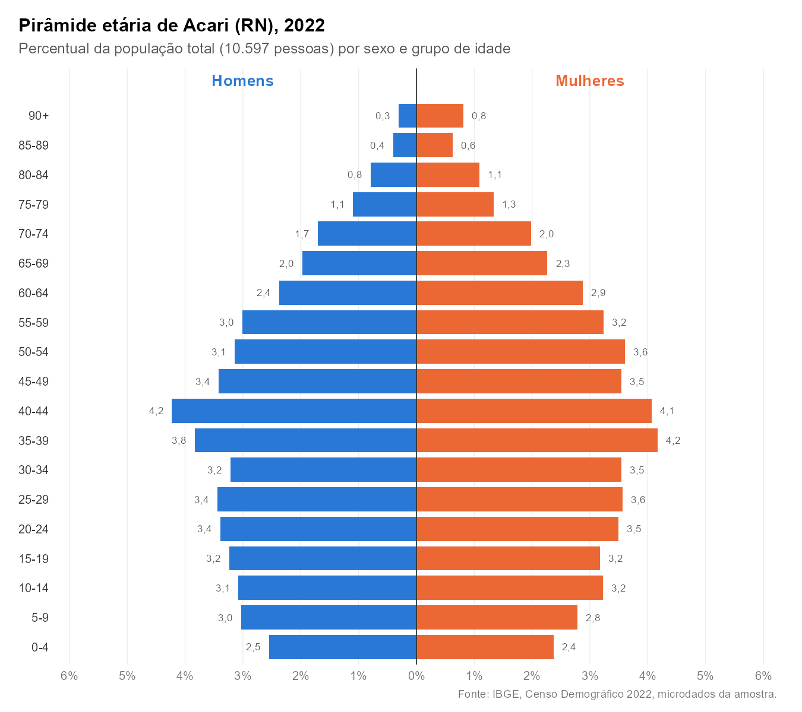

# Acari (RN)

Resultados do Censo Demográfico 2022 (microdados da amostra). Gerado por `R/05_readmes.R`; veja a [página dos municípios](../README.md) e o [README principal](../../../../README.md).

População: **10.597** pessoas (2.124 registros na amostra).

## Estrutura etária

| Indicador | Acari | RN |
|---|--:|--:|
| Razão de dependência jovem | 24,8 | 28,5 |
| Razão de dependência idosa | 21,0 | 15,1 |
| Razão de dependência total | 45,8 | 43,6 |
| Índice de envelhecimento | 84,5 | 52,9 |

Valores por 100 pessoas.

## Migração

Chegadas e saídas: mudanças de município nos últimos 10 anos.

| Indicador | Valor |
|---|--:|
| Nascidos no próprio município | 77,7% |
| Nascidos em outro município do Rio Grande do Norte | 17,2% |
| Nascidos em outra UF | 5,0% |
| Nascidos no exterior | 0,0% |
| Chegaram de outro município do Rio Grande do Norte | 866 |
| Chegaram de outra UF | 369 |
| Saíram para outro município da UF | 972 |
| Saíram para outra UF | 520 |
| Saldo migratório | -258 |
| Saldo por 1.000 habitantes | -24,3 |
| Chegaram do exterior | 0 |

Principais origens de quem chegou e destinos de quem saiu:

| Origem | Chegaram | Destino | Saíram |
|---|--:|---|--:|
| Natal (RN) | 290 | Natal (RN) | 182 |
| Currais Novos (RN) | 118 | Currais Novos (RN) | 139 |
| Caicó (RN) | 64 | Parnamirim (RN) | 135 |
| Parnamirim (RN) | 52 | Carnaúba dos Dantas (RN) | 84 |
| São Vicente (RN) | 41 | Sumaré (SP) | 64 |

## Mortalidade

Óbitos de agosto de 2021 a julho de 2022 informados no Censo.

| Indicador | Acari | RN |
|---|--:|--:|
| Óbitos no período | 76 | 22.488 |
| Registros de óbito na amostra | 15 |  |
| Taxa bruta de mortalidade (por mil) | 7,2 | 6,8 |
| Taxa padronizada por idade (por mil) | 5,7 | 6,8 |

Com poucos óbitos na amostra, as taxas deste município variam muito por acaso; por isso não há tábua de vida. Sem correção do sub-registro de óbitos do Censo.
