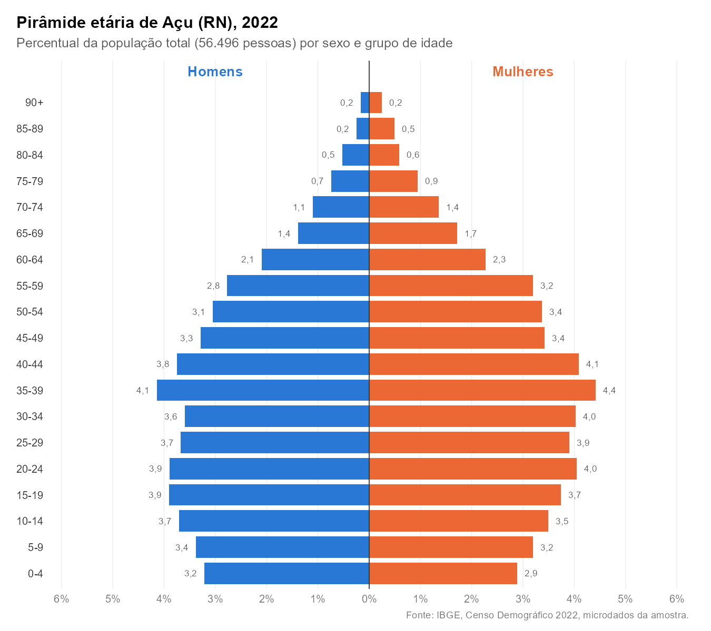

# Açu (RN)

Resultados do Censo Demográfico 2022 (microdados da amostra). Gerado por `R/05_readmes.R`; veja a [página dos municípios](../README.md) e o [README principal](../../../../README.md).

População: **56.496** pessoas (5.566 registros na amostra).

## Estrutura etária

| Indicador | Açu | RN |
|---|--:|--:|
| Razão de dependência jovem | 28,1 | 28,5 |
| Razão de dependência idosa | 13,4 | 15,1 |
| Razão de dependência total | 41,6 | 43,6 |
| Índice de envelhecimento | 47,8 | 52,9 |

Valores por 100 pessoas.

## Migração

Chegadas e saídas: mudanças de município nos últimos 10 anos.

| Indicador | Valor |
|---|--:|
| Nascidos no próprio município | 76,3% |
| Nascidos em outro município do Rio Grande do Norte | 19,4% |
| Nascidos em outra UF | 4,3% |
| Nascidos no exterior | 0,0% |
| Chegaram de outro município do Rio Grande do Norte | 4.785 |
| Chegaram de outra UF | 1.616 |
| Saíram para outro município da UF | 4.809 |
| Saíram para outra UF | 1.349 |
| Saldo migratório | +243 |
| Saldo por 1.000 habitantes | +4,3 |
| Chegaram do exterior | 0 |

Principais origens de quem chegou e destinos de quem saiu:

| Origem | Chegaram | Destino | Saíram |
|---|--:|---|--:|
| Natal (RN) | 1.249 | Mossoró (RN) | 951 |
| Mossoró (RN) | 1.006 | Natal (RN) | 857 |
| Ipanguaçu (RN) | 401 | Parnamirim (RN) | 393 |
| Itajá (RN) | 214 | Itajá (RN) | 272 |
| São Paulo (SP) | 176 | Ipanguaçu (RN) | 212 |

## Mortalidade

Óbitos de agosto de 2021 a julho de 2022 informados no Censo.

| Indicador | Açu | RN |
|---|--:|--:|
| Óbitos no período | 433 | 22.488 |
| Registros de óbito na amostra | 42 |  |
| Taxa bruta de mortalidade (por mil) | 7,7 | 6,8 |
| Taxa padronizada por idade (por mil) | 7,9 | 6,8 |

Com poucos óbitos na amostra, as taxas deste município variam muito por acaso; por isso não há tábua de vida. Sem correção do sub-registro de óbitos do Censo.
