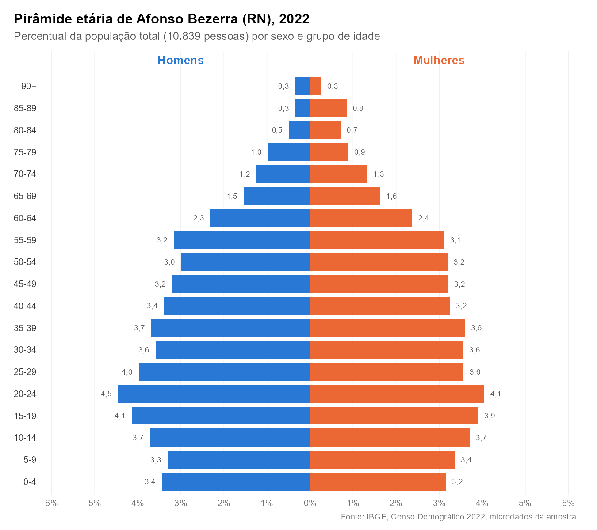

# Afonso Bezerra (RN)

Resultados do Censo Demográfico 2022 (microdados da amostra). Gerado por `R/05_readmes.R`; veja a [página dos municípios](../README.md) e o [README principal](../../../../README.md).

População: **10.839** pessoas (2.164 registros na amostra).

## Estrutura etária

| Indicador | Afonso Bezerra | RN |
|---|--:|--:|
| Razão de dependência jovem | 30,1 | 28,5 |
| Razão de dependência idosa | 15,4 | 15,1 |
| Razão de dependência total | 45,5 | 43,6 |
| Índice de envelhecimento | 51,2 | 52,9 |

Valores por 100 pessoas.

## Migração

Chegadas e saídas: mudanças de município nos últimos 10 anos.

| Indicador | Valor |
|---|--:|
| Nascidos no próprio município | 73,7% |
| Nascidos em outro município do Rio Grande do Norte | 24,8% |
| Nascidos em outra UF | 1,5% |
| Nascidos no exterior | 0,0% |
| Chegaram de outro município do Rio Grande do Norte | 1.399 |
| Chegaram de outra UF | 89 |
| Saíram para outro município da UF | 1.088 |
| Saíram para outra UF | 3 |
| Saldo migratório | +397 |
| Saldo por 1.000 habitantes | +36,6 |
| Chegaram do exterior | 0 |

Principais origens de quem chegou e destinos de quem saiu:

| Origem | Chegaram | Destino | Saíram |
|---|--:|---|--:|
| Natal (RN) | 374 | Natal (RN) | 295 |
| Mossoró (RN) | 152 | Ipanguaçu (RN) | 129 |
| Ipanguaçu (RN) | 137 | Pedro Avelino (RN) | 91 |
| Açu (RN) | 114 | Açu (RN) | 73 |
| Pedro Avelino (RN) | 88 | Macau (RN) | 68 |

## Mortalidade

Óbitos de agosto de 2021 a julho de 2022 informados no Censo.

| Indicador | Afonso Bezerra | RN |
|---|--:|--:|
| Óbitos no período | 119 | 22.488 |
| Registros de óbito na amostra | 23 |  |
| Taxa bruta de mortalidade (por mil) | 11,0 | 6,8 |
| Taxa padronizada por idade (por mil) | 10,7 | 6,8 |

Com poucos óbitos na amostra, as taxas deste município variam muito por acaso; por isso não há tábua de vida. Sem correção do sub-registro de óbitos do Censo.
