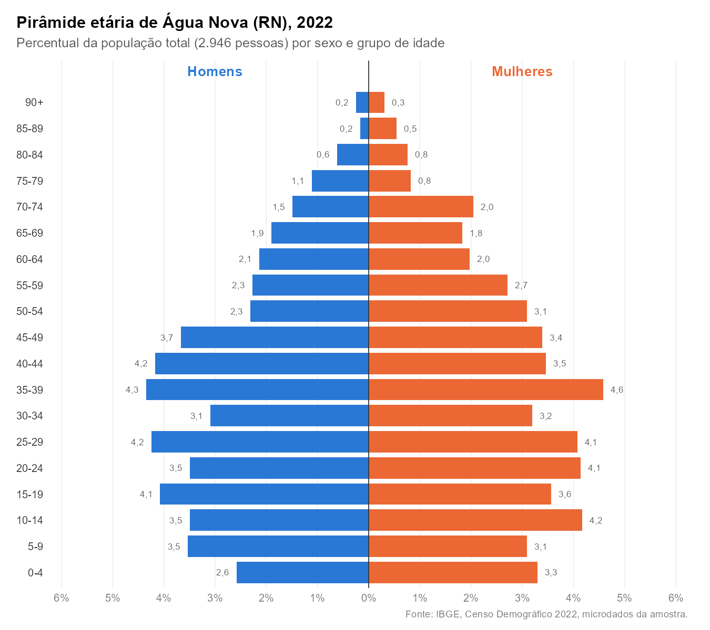

# Água Nova (RN)

Resultados do Censo Demográfico 2022 (microdados da amostra). Gerado por `R/05_readmes.R`; veja a [página dos municípios](../README.md) e o [README principal](../../../../README.md).

População: **2.946** pessoas (966 registros na amostra).

## Estrutura etária

| Indicador | Água Nova | RN |
|---|--:|--:|
| Razão de dependência jovem | 29,7 | 28,5 |
| Razão de dependência idosa | 17,4 | 15,1 |
| Razão de dependência total | 47,1 | 43,6 |
| Índice de envelhecimento | 58,8 | 52,9 |

Valores por 100 pessoas.

## Migração

Chegadas e saídas: mudanças de município nos últimos 10 anos.

| Indicador | Valor |
|---|--:|
| Nascidos no próprio município | 70,7% |
| Nascidos em outro município do Rio Grande do Norte | 20,9% |
| Nascidos em outra UF | 8,4% |
| Nascidos no exterior | 0,0% |
| Chegaram de outro município do Rio Grande do Norte | 243 |
| Chegaram de outra UF | 218 |
| Saíram para outro município da UF | 270 |
| Saíram para outra UF | 52 |
| Saldo migratório | +138 |
| Saldo por 1.000 habitantes | +46,9 |
| Chegaram do exterior | 0 |

Principais origens de quem chegou e destinos de quem saiu:

| Origem | Chegaram | Destino | Saíram |
|---|--:|---|--:|
| São Paulo (SP) | 62 | Encanto (RN) | 62 |
| Rafael Fernandes (RN) | 45 | Pau dos Ferros (RN) | 61 |
| Pau dos Ferros (RN) | 40 | Rafael Fernandes (RN) | 44 |
| Riacho de Santana (RN) | 27 | Riacho de Santana (RN) | 35 |
| Natal (RN) | 25 | Ribeirão Preto (SP) | 23 |

## Mortalidade

Óbitos de agosto de 2021 a julho de 2022 informados no Censo.

| Indicador | Água Nova | RN |
|---|--:|--:|
| Óbitos no período | 21 | 22.488 |
| Registros de óbito na amostra | 7 |  |
| Taxa bruta de mortalidade (por mil) | 7,1 | 6,8 |
| Taxa padronizada por idade (por mil) | 6,6 | 6,8 |

Com poucos óbitos na amostra, as taxas deste município variam muito por acaso; por isso não há tábua de vida. Sem correção do sub-registro de óbitos do Censo.
