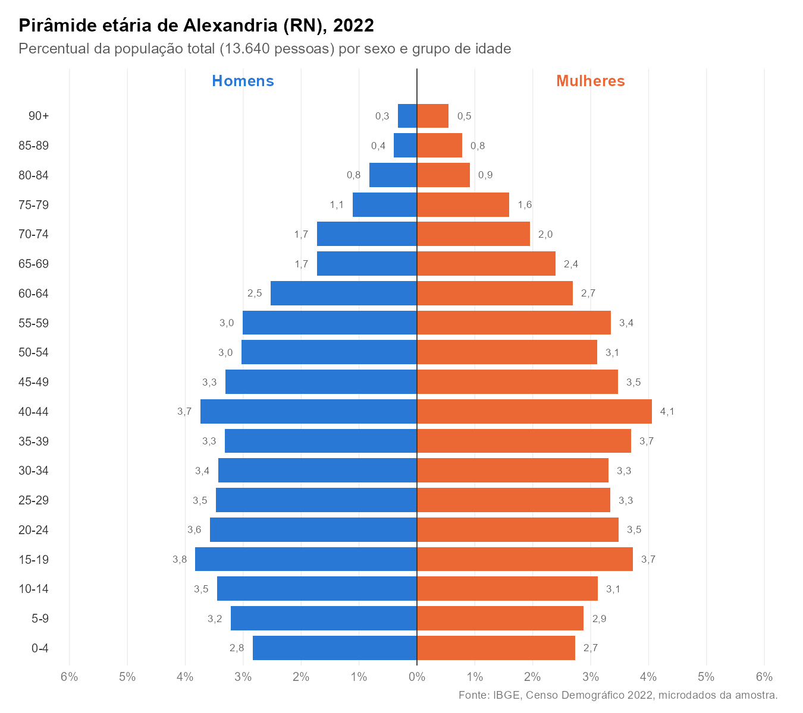

# Alexandria (RN)

Resultados do Censo Demográfico 2022 (microdados da amostra). Gerado por `R/05_readmes.R`; veja a [página dos municípios](../README.md) e o [README principal](../../../../README.md).

População: **13.640** pessoas (2.744 registros na amostra).

## Estrutura etária

| Indicador | Alexandria | RN |
|---|--:|--:|
| Razão de dependência jovem | 27,0 | 28,5 |
| Razão de dependência idosa | 21,2 | 15,1 |
| Razão de dependência total | 48,2 | 43,6 |
| Índice de envelhecimento | 78,2 | 52,9 |

Valores por 100 pessoas.

## Migração

Chegadas e saídas: mudanças de município nos últimos 10 anos.

| Indicador | Valor |
|---|--:|
| Nascidos no próprio município | 78,8% |
| Nascidos em outro município do Rio Grande do Norte | 8,9% |
| Nascidos em outra UF | 12,3% |
| Nascidos no exterior | 0,0% |
| Chegaram de outro município do Rio Grande do Norte | 777 |
| Chegaram de outra UF | 942 |
| Saíram para outro município da UF | 1.323 |
| Saíram para outra UF | 1.005 |
| Saldo migratório | -608 |
| Saldo por 1.000 habitantes | -44,6 |
| Chegaram do exterior | 2 |

Principais origens de quem chegou e destinos de quem saiu:

| Origem | Chegaram | Destino | Saíram |
|---|--:|---|--:|
| Natal (RN) | 187 | Natal (RN) | 202 |
| São Paulo (SP) | 182 | Mossoró (RN) | 174 |
| Mossoró (RN) | 162 | Pau dos Ferros (RN) | 126 |
| Bom Sucesso (PB) | 122 | Bom Sucesso (PB) | 118 |
| Baraúna (RN) | 68 | Catolé do Rocha (PB) | 98 |

## Mortalidade

Óbitos de agosto de 2021 a julho de 2022 informados no Censo.

| Indicador | Alexandria | RN |
|---|--:|--:|
| Óbitos no período | 82 | 22.488 |
| Registros de óbito na amostra | 18 |  |
| Taxa bruta de mortalidade (por mil) | 6,0 | 6,8 |
| Taxa padronizada por idade (por mil) | 4,9 | 6,8 |

Com poucos óbitos na amostra, as taxas deste município variam muito por acaso; por isso não há tábua de vida. Sem correção do sub-registro de óbitos do Censo.
