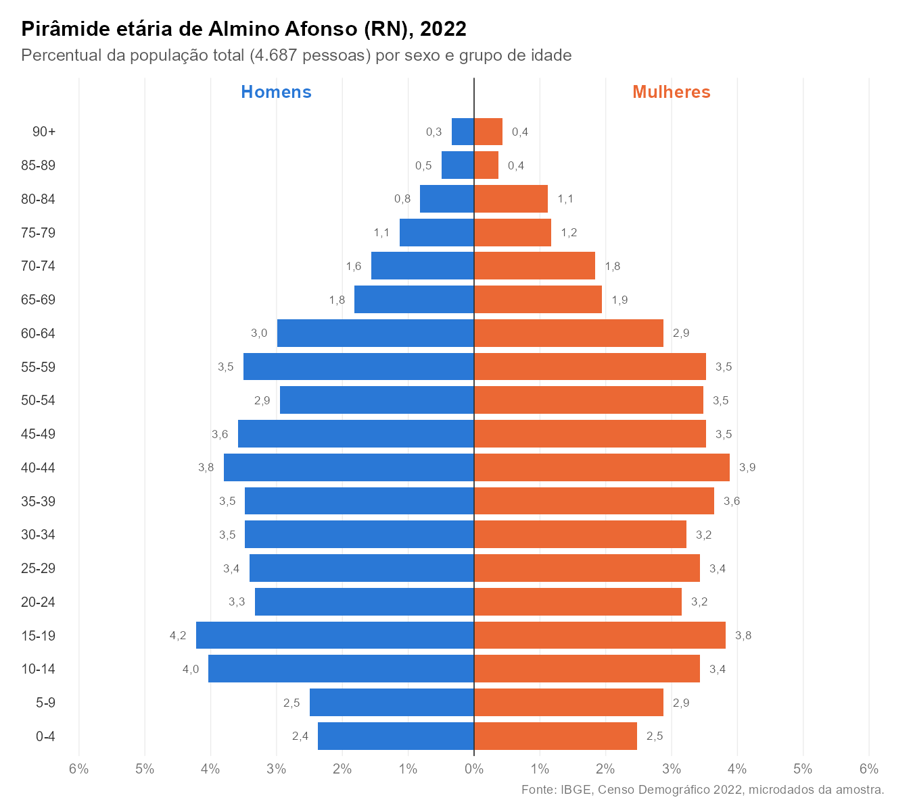

# Almino Afonso (RN)

Resultados do Censo Demográfico 2022 (microdados da amostra). Gerado por `R/05_readmes.R`; veja a [página dos municípios](../README.md) e o [README principal](../../../../README.md).

População: **4.687** pessoas (1.525 registros na amostra).

## Estrutura etária

| Indicador | Almino Afonso | RN |
|---|--:|--:|
| Razão de dependência jovem | 25,5 | 28,5 |
| Razão de dependência idosa | 18,8 | 15,1 |
| Razão de dependência total | 44,3 | 43,6 |
| Índice de envelhecimento | 73,6 | 52,9 |

Valores por 100 pessoas.

## Migração

Chegadas e saídas: mudanças de município nos últimos 10 anos.

| Indicador | Valor |
|---|--:|
| Nascidos no próprio município | 71,2% |
| Nascidos em outro município do Rio Grande do Norte | 19,3% |
| Nascidos em outra UF | 9,5% |
| Nascidos no exterior | 0,0% |
| Chegaram de outro município do Rio Grande do Norte | 578 |
| Chegaram de outra UF | 157 |
| Saíram para outro município da UF | 650 |
| Saíram para outra UF | 135 |
| Saldo migratório | -50 |
| Saldo por 1.000 habitantes | -10,6 |
| Chegaram do exterior | 5 |

Principais origens de quem chegou e destinos de quem saiu:

| Origem | Chegaram | Destino | Saíram |
|---|--:|---|--:|
| Mossoró (RN) | 149 | Mossoró (RN) | 180 |
| Natal (RN) | 87 | Patu (RN) | 81 |
| Patu (RN) | 56 | Rafael Godeiro (RN) | 61 |
| Lucrécia (RN) | 51 | Catolé do Rocha (PB) | 60 |
| Frutuoso Gomes (RN) | 40 | Natal (RN) | 40 |

## Mortalidade

Óbitos de agosto de 2021 a julho de 2022 informados no Censo.

| Indicador | Almino Afonso | RN |
|---|--:|--:|
| Óbitos no período | 45 | 22.488 |
| Registros de óbito na amostra | 13 |  |
| Taxa bruta de mortalidade (por mil) | 9,6 | 6,8 |
| Taxa padronizada por idade (por mil) | 8,6 | 6,8 |

Com poucos óbitos na amostra, as taxas deste município variam muito por acaso; por isso não há tábua de vida. Sem correção do sub-registro de óbitos do Censo.
