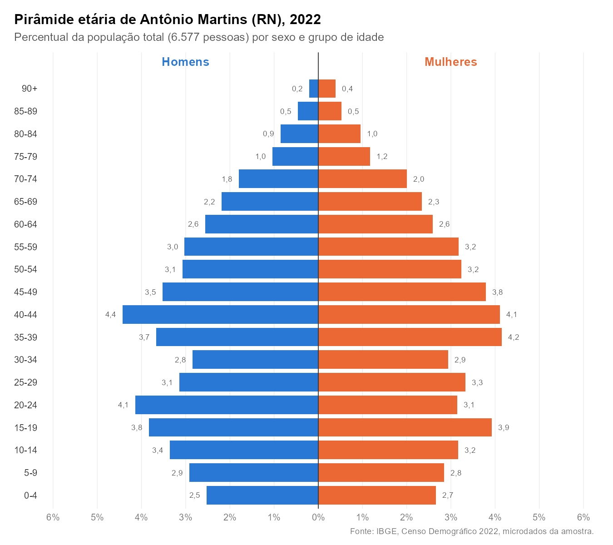

# Antônio Martins (RN)

Resultados do Censo Demográfico 2022 (microdados da amostra). Gerado por `R/05_readmes.R`; veja a [página dos municípios](../README.md) e o [README principal](../../../../README.md).

População: **6.577** pessoas (2.215 registros na amostra).

## Estrutura etária

| Indicador | Antônio Martins | RN |
|---|--:|--:|
| Razão de dependência jovem | 25,5 | 28,5 |
| Razão de dependência idosa | 20,3 | 15,1 |
| Razão de dependência total | 45,8 | 43,6 |
| Índice de envelhecimento | 79,7 | 52,9 |

Valores por 100 pessoas.

## Migração

Chegadas e saídas: mudanças de município nos últimos 10 anos.

| Indicador | Valor |
|---|--:|
| Nascidos no próprio município | 83,3% |
| Nascidos em outro município do Rio Grande do Norte | 12,4% |
| Nascidos em outra UF | 4,3% |
| Nascidos no exterior | 0,0% |
| Chegaram de outro município do Rio Grande do Norte | 509 |
| Chegaram de outra UF | 223 |
| Saíram para outro município da UF | 810 |
| Saíram para outra UF | 211 |
| Saldo migratório | -289 |
| Saldo por 1.000 habitantes | -43,9 |
| Chegaram do exterior | 0 |

Principais origens de quem chegou e destinos de quem saiu:

| Origem | Chegaram | Destino | Saíram |
|---|--:|---|--:|
| São Paulo (SP) | 127 | Mossoró (RN) | 162 |
| Mossoró (RN) | 92 | Pau dos Ferros (RN) | 132 |
| Natal (RN) | 62 | Natal (RN) | 103 |
| João Dias (RN) | 55 | Martins (RN) | 76 |
| Alexandria (RN) | 49 | João Dias (RN) | 49 |

## Mortalidade

Óbitos de agosto de 2021 a julho de 2022 informados no Censo.

| Indicador | Antônio Martins | RN |
|---|--:|--:|
| Óbitos no período | 68 | 22.488 |
| Registros de óbito na amostra | 22 |  |
| Taxa bruta de mortalidade (por mil) | 10,3 | 6,8 |
| Taxa padronizada por idade (por mil) | 8,6 | 6,8 |

Com poucos óbitos na amostra, as taxas deste município variam muito por acaso; por isso não há tábua de vida. Sem correção do sub-registro de óbitos do Censo.
