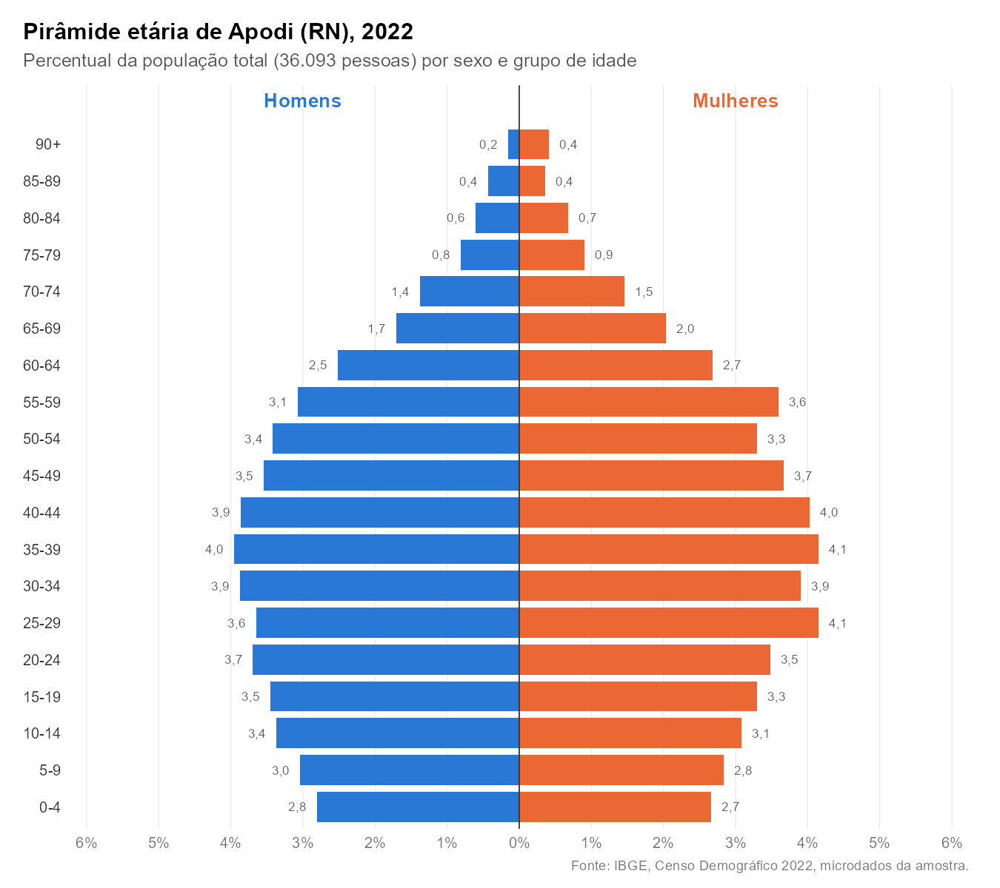

# Apodi (RN)

Resultados do Censo Demográfico 2022 (microdados da amostra). Gerado por `R/05_readmes.R`; veja a [página dos municípios](../README.md) e o [README principal](../../../../README.md).

População: **36.093** pessoas (3.539 registros na amostra).

## Estrutura etária

| Indicador | Apodi | RN |
|---|--:|--:|
| Razão de dependência jovem | 25,0 | 28,5 |
| Razão de dependência idosa | 15,3 | 15,1 |
| Razão de dependência total | 40,3 | 43,6 |
| Índice de envelhecimento | 61,5 | 52,9 |

Valores por 100 pessoas.

## Migração

Chegadas e saídas: mudanças de município nos últimos 10 anos.

| Indicador | Valor |
|---|--:|
| Nascidos no próprio município | 82,1% |
| Nascidos em outro município do Rio Grande do Norte | 12,8% |
| Nascidos em outra UF | 5,1% |
| Nascidos no exterior | 0,1% |
| Chegaram de outro município do Rio Grande do Norte | 2.643 |
| Chegaram de outra UF | 1.105 |
| Saíram para outro município da UF | 2.042 |
| Saíram para outra UF | 1.027 |
| Saldo migratório | +679 |
| Saldo por 1.000 habitantes | +18,8 |
| Chegaram do exterior | 0 |

Principais origens de quem chegou e destinos de quem saiu:

| Origem | Chegaram | Destino | Saíram |
|---|--:|---|--:|
| Mossoró (RN) | 938 | Mossoró (RN) | 678 |
| Natal (RN) | 319 | Natal (RN) | 268 |
| Severiano Melo (RN) | 207 | Felipe Guerra (RN) | 152 |
| Fortaleza (CE) | 175 | Fortaleza (CE) | 124 |
| Tabuleiro do Norte (CE) | 160 | Caraúbas (RN) | 106 |

## Mortalidade

Óbitos de agosto de 2021 a julho de 2022 informados no Censo.

| Indicador | Apodi | RN |
|---|--:|--:|
| Óbitos no período | 192 | 22.488 |
| Registros de óbito na amostra | 20 |  |
| Taxa bruta de mortalidade (por mil) | 5,3 | 6,8 |
| Taxa padronizada por idade (por mil) | 5,1 | 6,8 |

Com poucos óbitos na amostra, as taxas deste município variam muito por acaso; por isso não há tábua de vida. Sem correção do sub-registro de óbitos do Censo.
