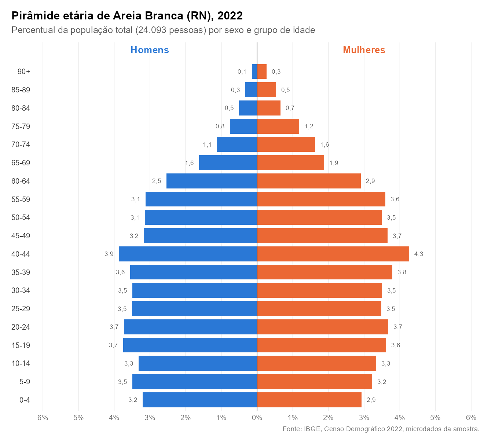

# Areia Branca (RN)

Resultados do Censo Demográfico 2022 (microdados da amostra). Gerado por `R/05_readmes.R`; veja a [página dos municípios](../README.md) e o [README principal](../../../../README.md).

População: **24.093** pessoas (2.260 registros na amostra).

## Estrutura etária

| Indicador | Areia Branca | RN |
|---|--:|--:|
| Razão de dependência jovem | 27,9 | 28,5 |
| Razão de dependência idosa | 15,2 | 15,1 |
| Razão de dependência total | 43,1 | 43,6 |
| Índice de envelhecimento | 54,5 | 52,9 |

Valores por 100 pessoas.

## Migração

Chegadas e saídas: mudanças de município nos últimos 10 anos.

| Indicador | Valor |
|---|--:|
| Nascidos no próprio município | 75,4% |
| Nascidos em outro município do Rio Grande do Norte | 19,1% |
| Nascidos em outra UF | 5,5% |
| Nascidos no exterior | 0,0% |
| Chegaram de outro município do Rio Grande do Norte | 1.534 |
| Chegaram de outra UF | 502 |
| Saíram para outro município da UF | 1.645 |
| Saíram para outra UF | 1.044 |
| Saldo migratório | -654 |
| Saldo por 1.000 habitantes | -27,1 |
| Chegaram do exterior | 0 |

Principais origens de quem chegou e destinos de quem saiu:

| Origem | Chegaram | Destino | Saíram |
|---|--:|---|--:|
| Mossoró (RN) | 503 | Mossoró (RN) | 546 |
| Natal (RN) | 407 | Natal (RN) | 326 |
| Açu (RN) | 93 | Fortaleza (CE) | 158 |
| Fortaleza (CE) | 71 | Parnamirim (RN) | 145 |
| Porto do Mangue (RN) | 66 | Grossos (RN) | 112 |

## Mortalidade

Óbitos de agosto de 2021 a julho de 2022 informados no Censo.

| Indicador | Areia Branca | RN |
|---|--:|--:|
| Óbitos no período | 223 | 22.488 |
| Registros de óbito na amostra | 20 |  |
| Taxa bruta de mortalidade (por mil) | 9,3 | 6,8 |
| Taxa padronizada por idade (por mil) | 9,1 | 6,8 |

Com poucos óbitos na amostra, as taxas deste município variam muito por acaso; por isso não há tábua de vida. Sem correção do sub-registro de óbitos do Censo.
