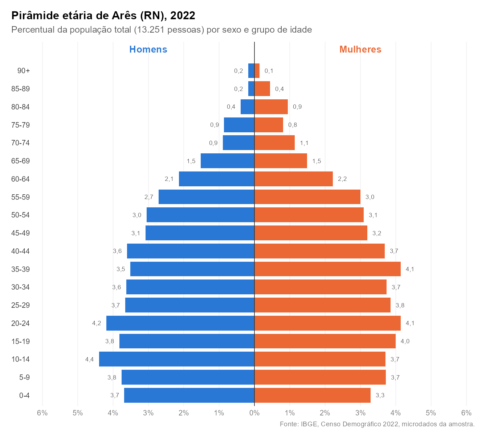

# Arês (RN)

Resultados do Censo Demográfico 2022 (microdados da amostra). Gerado por `R/05_readmes.R`; veja a [página dos municípios](../README.md) e o [README principal](../../../../README.md).

População: **13.251** pessoas (2.664 registros na amostra).

## Estrutura etária

| Indicador | Arês | RN |
|---|--:|--:|
| Razão de dependência jovem | 32,9 | 28,5 |
| Razão de dependência idosa | 13,1 | 15,1 |
| Razão de dependência total | 46,1 | 43,6 |
| Índice de envelhecimento | 39,9 | 52,9 |

Valores por 100 pessoas.

## Migração

Chegadas e saídas: mudanças de município nos últimos 10 anos.

| Indicador | Valor |
|---|--:|
| Nascidos no próprio município | 78,3% |
| Nascidos em outro município do Rio Grande do Norte | 18,5% |
| Nascidos em outra UF | 3,1% |
| Nascidos no exterior | 0,0% |
| Chegaram de outro município do Rio Grande do Norte | 1.389 |
| Chegaram de outra UF | 394 |
| Saíram para outro município da UF | 1.386 |
| Saíram para outra UF | 217 |
| Saldo migratório | +180 |
| Saldo por 1.000 habitantes | +13,6 |
| Chegaram do exterior | 12 |

Principais origens de quem chegou e destinos de quem saiu:

| Origem | Chegaram | Destino | Saíram |
|---|--:|---|--:|
| Natal (RN) | 484 | Natal (RN) | 252 |
| Goianinha (RN) | 162 | Parnamirim (RN) | 201 |
| Parnamirim (RN) | 157 | Goianinha (RN) | 183 |
| Senador Georgino Avelino (RN) | 125 | São José de Mipibu (RN) | 131 |
| São José de Mipibu (RN) | 119 | Canguaretama (RN) | 130 |

## Mortalidade

Óbitos de agosto de 2021 a julho de 2022 informados no Censo.

| Indicador | Arês | RN |
|---|--:|--:|
| Óbitos no período | 122 | 22.488 |
| Registros de óbito na amostra | 23 |  |
| Taxa bruta de mortalidade (por mil) | 9,2 | 6,8 |
| Taxa padronizada por idade (por mil) | 10,3 | 6,8 |

Com poucos óbitos na amostra, as taxas deste município variam muito por acaso; por isso não há tábua de vida. Sem correção do sub-registro de óbitos do Censo.
