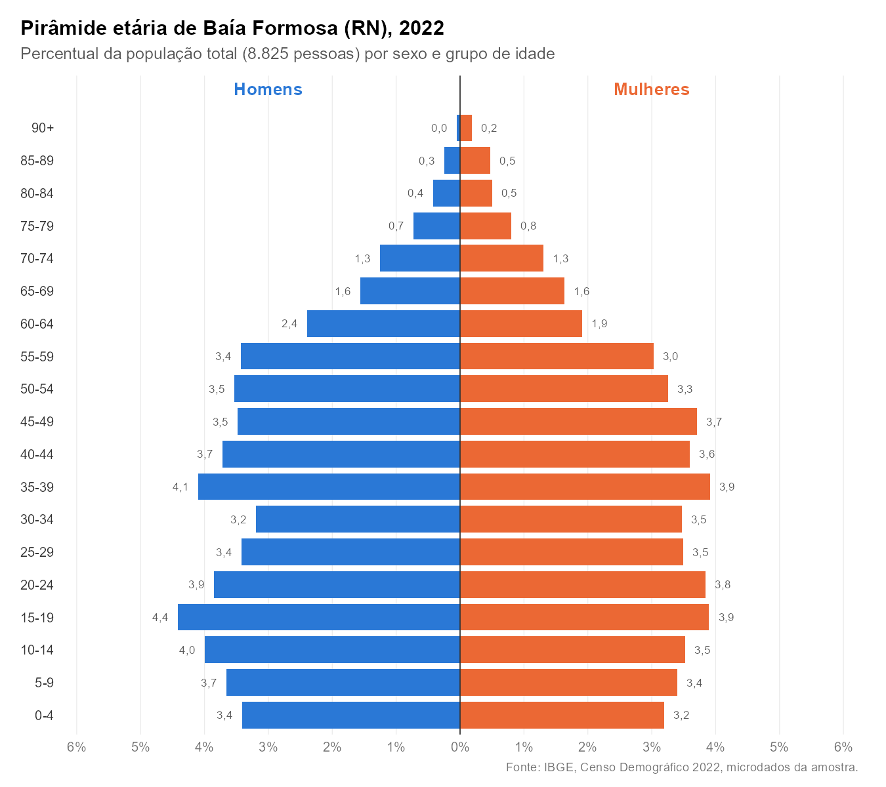

# Baía Formosa (RN)

Resultados do Censo Demográfico 2022 (microdados da amostra). Gerado por `R/05_readmes.R`; veja a [página dos municípios](../README.md) e o [README principal](../../../../README.md).

População: **8.825** pessoas (1.804 registros na amostra).

## Estrutura etária

| Indicador | Baía Formosa | RN |
|---|--:|--:|
| Razão de dependência jovem | 30,4 | 28,5 |
| Razão de dependência idosa | 13,2 | 15,1 |
| Razão de dependência total | 43,6 | 43,6 |
| Índice de envelhecimento | 43,3 | 52,9 |

Valores por 100 pessoas.

## Migração

Chegadas e saídas: mudanças de município nos últimos 10 anos.

| Indicador | Valor |
|---|--:|
| Nascidos no próprio município | 65,7% |
| Nascidos em outro município do Rio Grande do Norte | 16,8% |
| Nascidos em outra UF | 17,3% |
| Nascidos no exterior | 0,2% |
| Chegaram de outro município do Rio Grande do Norte | 647 |
| Chegaram de outra UF | 891 |
| Saíram para outro município da UF | 813 |
| Saíram para outra UF | 498 |
| Saldo migratório | +227 |
| Saldo por 1.000 habitantes | +25,7 |
| Chegaram do exterior | 8 |

Principais origens de quem chegou e destinos de quem saiu:

| Origem | Chegaram | Destino | Saíram |
|---|--:|---|--:|
| Natal (RN) | 161 | Natal (RN) | 173 |
| Rio de Janeiro (RJ) | 149 | Tibau do Sul (RN) | 113 |
| Recife (PE) | 102 | Canguaretama (RN) | 99 |
| Parnamirim (RN) | 82 | Mataraca (PB) | 95 |
| Rio Verde (GO) | 80 | Pedro Velho (RN) | 62 |

## Mortalidade

Óbitos de agosto de 2021 a julho de 2022 informados no Censo.

| Indicador | Baía Formosa | RN |
|---|--:|--:|
| Óbitos no período | 98 | 22.488 |
| Registros de óbito na amostra | 20 |  |
| Taxa bruta de mortalidade (por mil) | 11,1 | 6,8 |
| Taxa padronizada por idade (por mil) | 13,1 | 6,8 |

Com poucos óbitos na amostra, as taxas deste município variam muito por acaso; por isso não há tábua de vida. Sem correção do sub-registro de óbitos do Censo.
