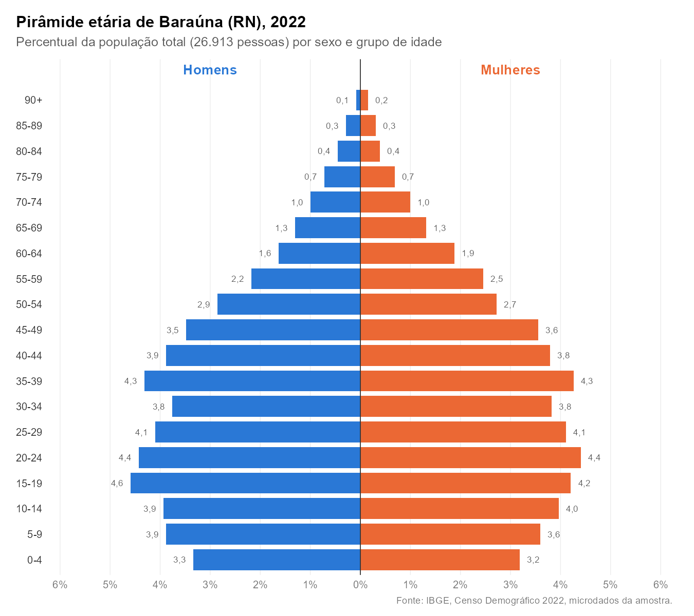

# Baraúna (RN)

Resultados do Censo Demográfico 2022 (microdados da amostra). Gerado por `R/05_readmes.R`; veja a [página dos municípios](../README.md) e o [README principal](../../../../README.md).

População: **26.913** pessoas (2.603 registros na amostra).

## Estrutura etária

| Indicador | Baraúna | RN |
|---|--:|--:|
| Razão de dependência jovem | 31,1 | 28,5 |
| Razão de dependência idosa | 10,9 | 15,1 |
| Razão de dependência total | 42,0 | 43,6 |
| Índice de envelhecimento | 35,1 | 52,9 |

Valores por 100 pessoas.

## Migração

Chegadas e saídas: mudanças de município nos últimos 10 anos.

| Indicador | Valor |
|---|--:|
| Nascidos no próprio município | 65,8% |
| Nascidos em outro município do Rio Grande do Norte | 23,8% |
| Nascidos em outra UF | 10,4% |
| Nascidos no exterior | 0,0% |
| Chegaram de outro município do Rio Grande do Norte | 1.341 |
| Chegaram de outra UF | 1.217 |
| Saíram para outro município da UF | 1.181 |
| Saíram para outra UF | 893 |
| Saldo migratório | +485 |
| Saldo por 1.000 habitantes | +18,0 |
| Chegaram do exterior | 0 |

Principais origens de quem chegou e destinos de quem saiu:

| Origem | Chegaram | Destino | Saíram |
|---|--:|---|--:|
| Mossoró (RN) | 540 | Mossoró (RN) | 571 |
| Jaguaruana (CE) | 182 | Quixeré (CE) | 193 |
| Açu (RN) | 146 | Jaguaruana (CE) | 144 |
| Natal (RN) | 145 | Governador Dix-Sept Rosado (RN) | 105 |
| Fortaleza (CE) | 142 | Aracati (CE) | 95 |

## Mortalidade

Óbitos de agosto de 2021 a julho de 2022 informados no Censo.

| Indicador | Baraúna | RN |
|---|--:|--:|
| Óbitos no período | 63 | 22.488 |
| Registros de óbito na amostra | 6 |  |
| Taxa bruta de mortalidade (por mil) | 2,3 | 6,8 |
| Taxa padronizada por idade (por mil) | 3,1 | 6,8 |

Com poucos óbitos na amostra, as taxas deste município variam muito por acaso; por isso não há tábua de vida. Sem correção do sub-registro de óbitos do Censo.
