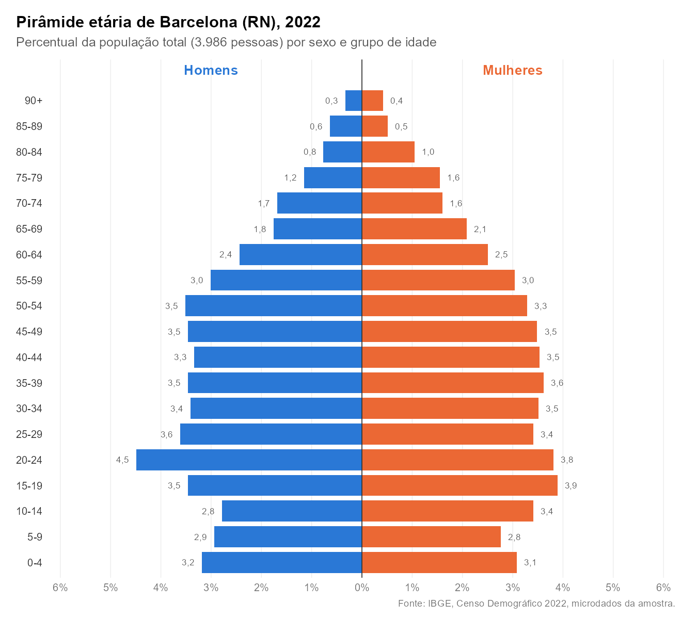

# Barcelona (RN)

Resultados do Censo Demográfico 2022 (microdados da amostra). Gerado por `R/05_readmes.R`; veja a [página dos municípios](../README.md) e o [README principal](../../../../README.md).

População: **3.986** pessoas (1.303 registros na amostra).

## Estrutura etária

| Indicador | Barcelona | RN |
|---|--:|--:|
| Razão de dependência jovem | 26,6 | 28,5 |
| Razão de dependência idosa | 19,8 | 15,1 |
| Razão de dependência total | 46,4 | 43,6 |
| Índice de envelhecimento | 74,6 | 52,9 |

Valores por 100 pessoas.

## Migração

Chegadas e saídas: mudanças de município nos últimos 10 anos.

| Indicador | Valor |
|---|--:|
| Nascidos no próprio município | 73,5% |
| Nascidos em outro município do Rio Grande do Norte | 23,0% |
| Nascidos em outra UF | 3,6% |
| Nascidos no exterior | 0,0% |
| Chegaram de outro município do Rio Grande do Norte | 599 |
| Chegaram de outra UF | 53 |
| Saíram para outro município da UF | 565 |
| Saíram para outra UF | 57 |
| Saldo migratório | +30 |
| Saldo por 1.000 habitantes | +7,5 |
| Chegaram do exterior | 0 |

Principais origens de quem chegou e destinos de quem saiu:

| Origem | Chegaram | Destino | Saíram |
|---|--:|---|--:|
| Natal (RN) | 188 | Natal (RN) | 116 |
| São Paulo do Potengi (RN) | 78 | Parnamirim (RN) | 103 |
| Parnamirim (RN) | 57 | Lagoa de Velhos (RN) | 45 |
| São Tomé (RN) | 43 | São Tomé (RN) | 39 |
| Ruy Barbosa (RN) | 29 | São Paulo do Potengi (RN) | 33 |

## Mortalidade

Óbitos de agosto de 2021 a julho de 2022 informados no Censo.

| Indicador | Barcelona | RN |
|---|--:|--:|
| Óbitos no período | 21 | 22.488 |
| Registros de óbito na amostra | 8 |  |
| Taxa bruta de mortalidade (por mil) | 5,3 | 6,8 |
| Taxa padronizada por idade (por mil) | 4,7 | 6,8 |

Com poucos óbitos na amostra, as taxas deste município variam muito por acaso; por isso não há tábua de vida. Sem correção do sub-registro de óbitos do Censo.
