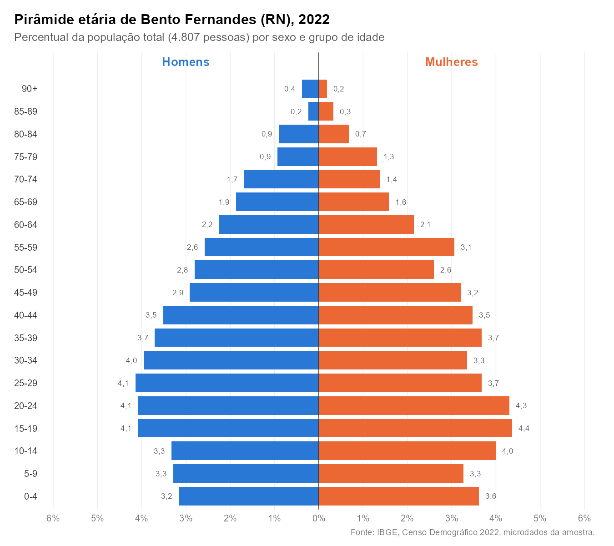

# Bento Fernandes (RN)

Resultados do Censo Demográfico 2022 (microdados da amostra). Gerado por `R/05_readmes.R`; veja a [página dos municípios](../README.md) e o [README principal](../../../../README.md).

População: **4.807** pessoas (1.588 registros na amostra).

## Estrutura etária

| Indicador | Bento Fernandes | RN |
|---|--:|--:|
| Razão de dependência jovem | 30,4 | 28,5 |
| Razão de dependência idosa | 16,9 | 15,1 |
| Razão de dependência total | 47,3 | 43,6 |
| Índice de envelhecimento | 55,5 | 52,9 |

Valores por 100 pessoas.

## Migração

Chegadas e saídas: mudanças de município nos últimos 10 anos.

| Indicador | Valor |
|---|--:|
| Nascidos no próprio município | 57,5% |
| Nascidos em outro município do Rio Grande do Norte | 39,9% |
| Nascidos em outra UF | 2,6% |
| Nascidos no exterior | 0,0% |
| Chegaram de outro município do Rio Grande do Norte | 686 |
| Chegaram de outra UF | 64 |
| Saíram para outro município da UF | 715 |
| Saíram para outra UF | 49 |
| Saldo migratório | -14 |
| Saldo por 1.000 habitantes | -2,9 |
| Chegaram do exterior | 0 |

Principais origens de quem chegou e destinos de quem saiu:

| Origem | Chegaram | Destino | Saíram |
|---|--:|---|--:|
| João Câmara (RN) | 166 | Natal (RN) | 208 |
| Natal (RN) | 152 | João Câmara (RN) | 115 |
| Ceará-Mirim (RN) | 55 | Parnamirim (RN) | 60 |
| Parnamirim (RN) | 52 | Riachuelo (RN) | 47 |
| Touros (RN) | 51 | Poço Branco (RN) | 38 |

## Mortalidade

Óbitos de agosto de 2021 a julho de 2022 informados no Censo.

| Indicador | Bento Fernandes | RN |
|---|--:|--:|
| Óbitos no período | 6 | 22.488 |
| Registros de óbito na amostra | 2 |  |
| Taxa bruta de mortalidade (por mil) | 1,2 | 6,8 |
| Taxa padronizada por idade (por mil) | 1,0 | 6,8 |

Com poucos óbitos na amostra, as taxas deste município variam muito por acaso; por isso não há tábua de vida. Sem correção do sub-registro de óbitos do Censo.
