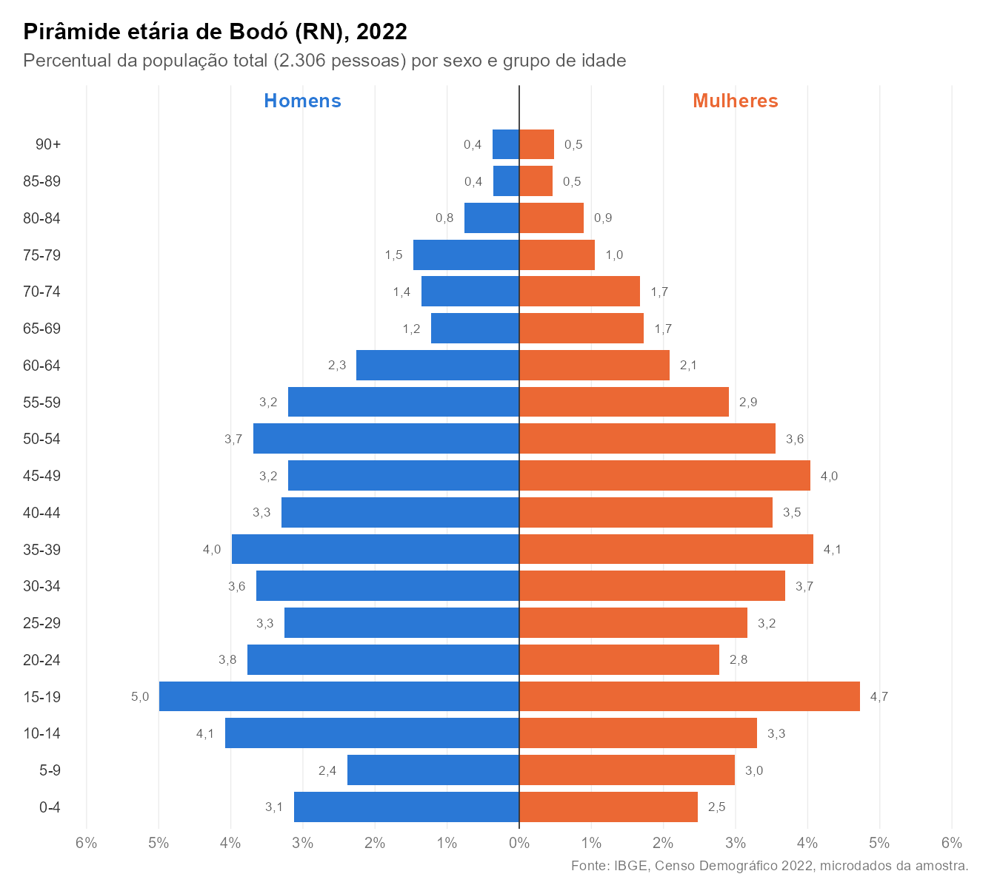

# Bodó (RN)

Resultados do Censo Demográfico 2022 (microdados da amostra). Gerado por `R/05_readmes.R`; veja a [página dos municípios](../README.md) e o [README principal](../../../../README.md).

População: **2.306** pessoas (1.140 registros na amostra).

## Estrutura etária

| Indicador | Bodó | RN |
|---|--:|--:|
| Razão de dependência jovem | 26,3 | 28,5 |
| Razão de dependência idosa | 17,0 | 15,1 |
| Razão de dependência total | 43,2 | 43,6 |
| Índice de envelhecimento | 64,5 | 52,9 |

Valores por 100 pessoas.

## Migração

Chegadas e saídas: mudanças de município nos últimos 10 anos.

| Indicador | Valor |
|---|--:|
| Nascidos no próprio município | 38,4% |
| Nascidos em outro município do Rio Grande do Norte | 58,7% |
| Nascidos em outra UF | 2,9% |
| Nascidos no exterior | 0,1% |
| Chegaram de outro município do Rio Grande do Norte | 225 |
| Chegaram de outra UF | 25 |
| Saíram para outro município da UF | 375 |
| Saíram para outra UF | 22 |
| Saldo migratório | -148 |
| Saldo por 1.000 habitantes | -64,2 |
| Chegaram do exterior | 4 |

Principais origens de quem chegou e destinos de quem saiu:

| Origem | Chegaram | Destino | Saíram |
|---|--:|---|--:|
| Lagoa Nova (RN) | 51 | Lagoa Nova (RN) | 110 |
| Cerro Corá (RN) | 50 | Cerro Corá (RN) | 58 |
| Santana do Matos (RN) | 49 | Natal (RN) | 57 |
| Natal (RN) | 22 | Currais Novos (RN) | 47 |
| Currais Novos (RN) | 20 | Tenente Laurentino Cruz (RN) | 22 |

## Mortalidade

Óbitos de agosto de 2021 a julho de 2022 informados no Censo.

| Indicador | Bodó | RN |
|---|--:|--:|
| Óbitos no período | 11 | 22.488 |
| Registros de óbito na amostra | 4 |  |
| Taxa bruta de mortalidade (por mil) | 4,6 | 6,8 |
| Taxa padronizada por idade (por mil) | 4,1 | 6,8 |

Com poucos óbitos na amostra, as taxas deste município variam muito por acaso; por isso não há tábua de vida. Sem correção do sub-registro de óbitos do Censo.
