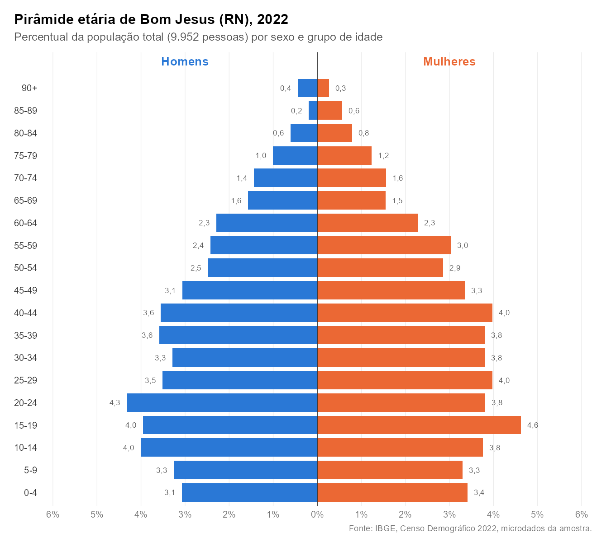

# Bom Jesus (RN)

Resultados do Censo Demográfico 2022 (microdados da amostra). Gerado por `R/05_readmes.R`; veja a [página dos municípios](../README.md) e o [README principal](../../../../README.md).

População: **9.952** pessoas (1.992 registros na amostra).

## Estrutura etária

| Indicador | Bom Jesus | RN |
|---|--:|--:|
| Razão de dependência jovem | 30,6 | 28,5 |
| Razão de dependência idosa | 16,5 | 15,1 |
| Razão de dependência total | 47,1 | 43,6 |
| Índice de envelhecimento | 53,9 | 52,9 |

Valores por 100 pessoas.

## Migração

Chegadas e saídas: mudanças de município nos últimos 10 anos.

| Indicador | Valor |
|---|--:|
| Nascidos no próprio município | 50,4% |
| Nascidos em outro município do Rio Grande do Norte | 43,1% |
| Nascidos em outra UF | 6,5% |
| Nascidos no exterior | 0,0% |
| Chegaram de outro município do Rio Grande do Norte | 1.481 |
| Chegaram de outra UF | 384 |
| Saíram para outro município da UF | 1.265 |
| Saíram para outra UF | 189 |
| Saldo migratório | +411 |
| Saldo por 1.000 habitantes | +41,3 |
| Chegaram do exterior | 0 |

Principais origens de quem chegou e destinos de quem saiu:

| Origem | Chegaram | Destino | Saíram |
|---|--:|---|--:|
| Natal (RN) | 431 | Natal (RN) | 364 |
| Macaíba (RN) | 225 | Macaíba (RN) | 159 |
| São Paulo (SP) | 177 | Parnamirim (RN) | 153 |
| São Pedro (RN) | 105 | São Paulo (SP) | 66 |
| Parnamirim (RN) | 89 | Ceará-Mirim (RN) | 63 |

## Mortalidade

Óbitos de agosto de 2021 a julho de 2022 informados no Censo.

| Indicador | Bom Jesus | RN |
|---|--:|--:|
| Óbitos no período | 102 | 22.488 |
| Registros de óbito na amostra | 17 |  |
| Taxa bruta de mortalidade (por mil) | 10,2 | 6,8 |
| Taxa padronizada por idade (por mil) | 9,5 | 6,8 |

Com poucos óbitos na amostra, as taxas deste município variam muito por acaso; por isso não há tábua de vida. Sem correção do sub-registro de óbitos do Censo.
