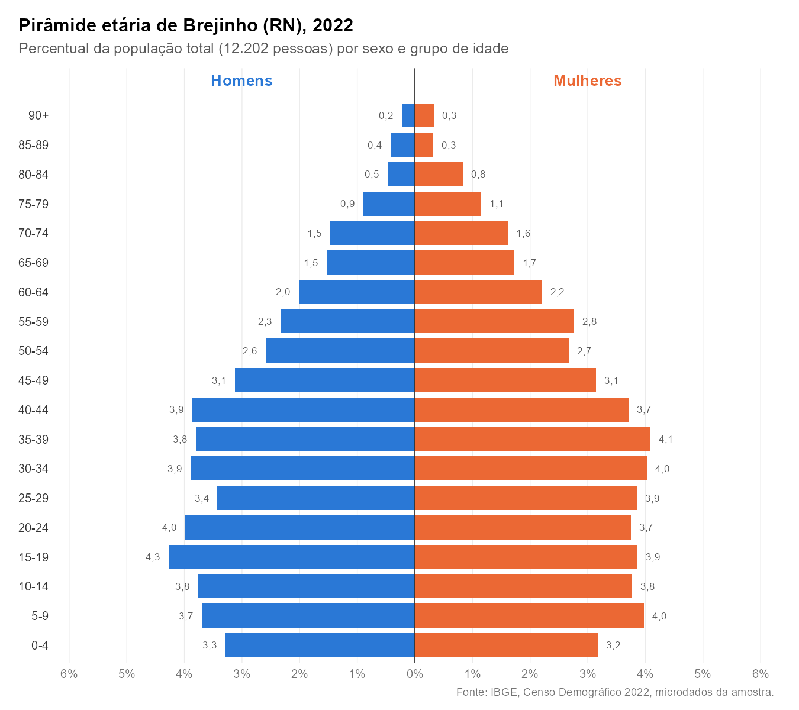

# Brejinho (RN)

Resultados do Censo Demográfico 2022 (microdados da amostra). Gerado por `R/05_readmes.R`; veja a [página dos municípios](../README.md) e o [README principal](../../../../README.md).

População: **12.202** pessoas (2.424 registros na amostra).

## Estrutura etária

| Indicador | Brejinho | RN |
|---|--:|--:|
| Razão de dependência jovem | 32,2 | 28,5 |
| Razão de dependência idosa | 16,3 | 15,1 |
| Razão de dependência total | 48,4 | 43,6 |
| Índice de envelhecimento | 50,7 | 52,9 |

Valores por 100 pessoas.

## Migração

Chegadas e saídas: mudanças de município nos últimos 10 anos.

| Indicador | Valor |
|---|--:|
| Nascidos no próprio município | 63,6% |
| Nascidos em outro município do Rio Grande do Norte | 30,4% |
| Nascidos em outra UF | 6,0% |
| Nascidos no exterior | 0,0% |
| Chegaram de outro município do Rio Grande do Norte | 1.475 |
| Chegaram de outra UF | 259 |
| Saíram para outro município da UF | 1.386 |
| Saíram para outra UF | 447 |
| Saldo migratório | -99 |
| Saldo por 1.000 habitantes | -8,1 |
| Chegaram do exterior | 0 |

Principais origens de quem chegou e destinos de quem saiu:

| Origem | Chegaram | Destino | Saíram |
|---|--:|---|--:|
| Natal (RN) | 452 | Parnamirim (RN) | 346 |
| Parnamirim (RN) | 160 | Natal (RN) | 198 |
| Santo Antônio (RN) | 130 | Monte Alegre (RN) | 184 |
| Monte Alegre (RN) | 128 | São José de Mipibu (RN) | 180 |
| São José de Mipibu (RN) | 118 | Uberlândia (MG) | 163 |

## Mortalidade

Óbitos de agosto de 2021 a julho de 2022 informados no Censo.

| Indicador | Brejinho | RN |
|---|--:|--:|
| Óbitos no período | 60 | 22.488 |
| Registros de óbito na amostra | 12 |  |
| Taxa bruta de mortalidade (por mil) | 4,9 | 6,8 |
| Taxa padronizada por idade (por mil) | 4,7 | 6,8 |

Com poucos óbitos na amostra, as taxas deste município variam muito por acaso; por isso não há tábua de vida. Sem correção do sub-registro de óbitos do Censo.
