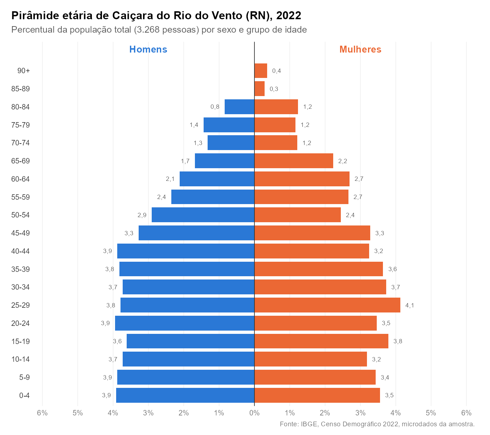

# Caiçara do Rio do Vento (RN)

Resultados do Censo Demográfico 2022 (microdados da amostra). Gerado por `R/05_readmes.R`; veja a [página dos municípios](../README.md) e o [README principal](../../../../README.md).

População: **3.268** pessoas (1.066 registros na amostra).

## Estrutura etária

| Indicador | Caiçara do Rio do Vento | RN |
|---|--:|--:|
| Razão de dependência jovem | 32,6 | 28,5 |
| Razão de dependência idosa | 17,7 | 15,1 |
| Razão de dependência total | 50,3 | 43,6 |
| Índice de envelhecimento | 54,3 | 52,9 |

Valores por 100 pessoas.

## Migração

Chegadas e saídas: mudanças de município nos últimos 10 anos.

| Indicador | Valor |
|---|--:|
| Nascidos no próprio município | 58,9% |
| Nascidos em outro município do Rio Grande do Norte | 39,3% |
| Nascidos em outra UF | 1,8% |
| Nascidos no exterior | 0,0% |
| Chegaram de outro município do Rio Grande do Norte | 441 |
| Chegaram de outra UF | 38 |
| Saíram para outro município da UF | 460 |
| Saíram para outra UF | 72 |
| Saldo migratório | -53 |
| Saldo por 1.000 habitantes | -16,2 |
| Chegaram do exterior | 0 |

Principais origens de quem chegou e destinos de quem saiu:

| Origem | Chegaram | Destino | Saíram |
|---|--:|---|--:|
| Natal (RN) | 93 | Natal (RN) | 105 |
| Lajes (RN) | 64 | Parnamirim (RN) | 72 |
| Parnamirim (RN) | 31 | Lajes (RN) | 57 |
| Macaíba (RN) | 27 | Riachuelo (RN) | 46 |
| Ceará-Mirim (RN) | 25 | Santa Maria (RN) | 29 |

## Mortalidade

Óbitos de agosto de 2021 a julho de 2022 informados no Censo.

| Indicador | Caiçara do Rio do Vento | RN |
|---|--:|--:|
| Óbitos no período | 21 | 22.488 |
| Registros de óbito na amostra | 5 |  |
| Taxa bruta de mortalidade (por mil) | 6,4 | 6,8 |
| Taxa padronizada por idade (por mil) | 5,7 | 6,8 |

Com poucos óbitos na amostra, as taxas deste município variam muito por acaso; por isso não há tábua de vida. Sem correção do sub-registro de óbitos do Censo.
