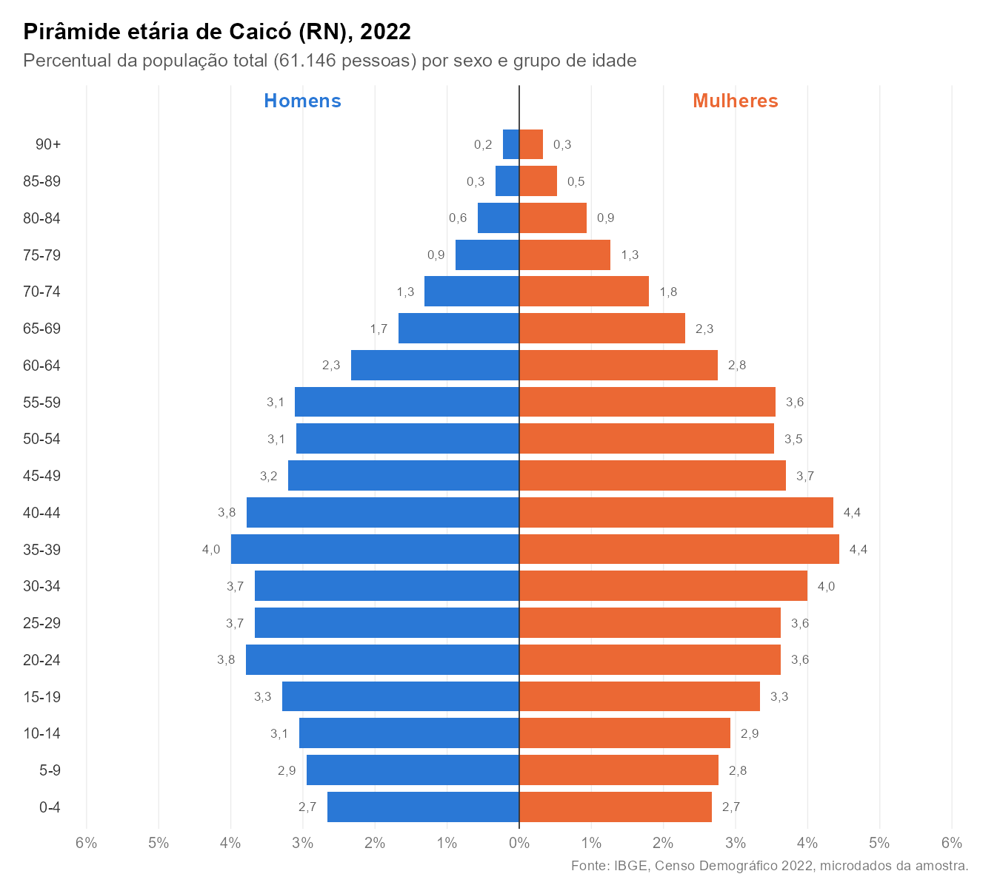

# Caicó (RN)

Resultados do Censo Demográfico 2022 (microdados da amostra). Gerado por `R/05_readmes.R`; veja a [página dos municípios](../README.md) e o [README principal](../../../../README.md).

População: **61.146** pessoas (5.885 registros na amostra).

## Estrutura etária

| Indicador | Caicó | RN |
|---|--:|--:|
| Razão de dependência jovem | 24,0 | 28,5 |
| Razão de dependência idosa | 17,1 | 15,1 |
| Razão de dependência total | 41,2 | 43,6 |
| Índice de envelhecimento | 71,3 | 52,9 |

Valores por 100 pessoas.

## Migração

Chegadas e saídas: mudanças de município nos últimos 10 anos.

| Indicador | Valor |
|---|--:|
| Nascidos no próprio município | 72,3% |
| Nascidos em outro município do Rio Grande do Norte | 18,7% |
| Nascidos em outra UF | 8,9% |
| Nascidos no exterior | 0,1% |
| Chegaram de outro município do Rio Grande do Norte | 4.721 |
| Chegaram de outra UF | 2.033 |
| Saíram para outro município da UF | 5.612 |
| Saíram para outra UF | 2.658 |
| Saldo migratório | -1.517 |
| Saldo por 1.000 habitantes | -24,8 |
| Chegaram do exterior | 48 |

Principais origens de quem chegou e destinos de quem saiu:

| Origem | Chegaram | Destino | Saíram |
|---|--:|---|--:|
| Natal (RN) | 1.574 | Natal (RN) | 1.128 |
| Jucurutu (RN) | 330 | Parnamirim (RN) | 562 |
| Currais Novos (RN) | 310 | Jardim de Piranhas (RN) | 386 |
| Jardim de Piranhas (RN) | 225 | Mossoró (RN) | 369 |
| Mossoró (RN) | 206 | João Pessoa (PB) | 362 |

## Mortalidade

Óbitos de agosto de 2021 a julho de 2022 informados no Censo.

| Indicador | Caicó | RN |
|---|--:|--:|
| Óbitos no período | 299 | 22.488 |
| Registros de óbito na amostra | 32 |  |
| Taxa bruta de mortalidade (por mil) | 4,9 | 6,8 |
| Taxa padronizada por idade (por mil) | 4,4 | 6,8 |

Com poucos óbitos na amostra, as taxas deste município variam muito por acaso; por isso não há tábua de vida. Sem correção do sub-registro de óbitos do Censo.
