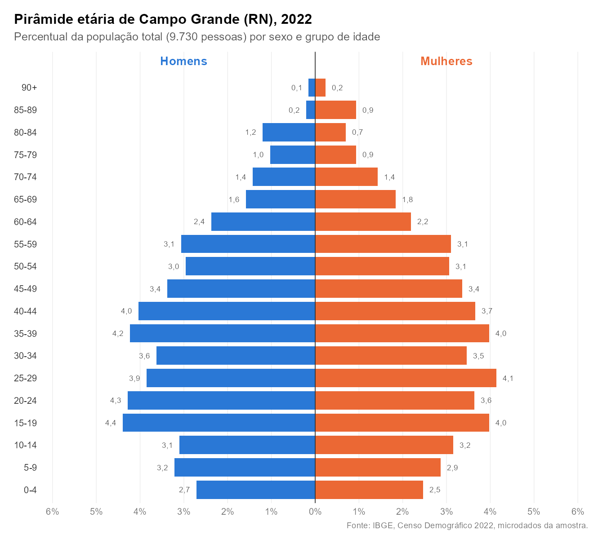

# Campo Grande (RN)

Resultados do Censo Demográfico 2022 (microdados da amostra). Gerado por `R/05_readmes.R`; veja a [página dos municípios](../README.md) e o [README principal](../../../../README.md).

População: **9.730** pessoas (1.917 registros na amostra).

## Estrutura etária

| Indicador | Campo Grande | RN |
|---|--:|--:|
| Razão de dependência jovem | 24,8 | 28,5 |
| Razão de dependência idosa | 16,5 | 15,1 |
| Razão de dependência total | 41,3 | 43,6 |
| Índice de envelhecimento | 66,7 | 52,9 |

Valores por 100 pessoas.

## Migração

Chegadas e saídas: mudanças de município nos últimos 10 anos.

| Indicador | Valor |
|---|--:|
| Nascidos no próprio município | 81,9% |
| Nascidos em outro município do Rio Grande do Norte | 16,2% |
| Nascidos em outra UF | 1,8% |
| Nascidos no exterior | 0,1% |
| Chegaram de outro município do Rio Grande do Norte | 829 |
| Chegaram de outra UF | 132 |
| Saíram para outro município da UF | 729 |
| Saíram para outra UF | 41 |
| Saldo migratório | +192 |
| Saldo por 1.000 habitantes | +19,7 |
| Chegaram do exterior | 11 |

Principais origens de quem chegou e destinos de quem saiu:

| Origem | Chegaram | Destino | Saíram |
|---|--:|---|--:|
| Natal (RN) | 223 | Upanema (RN) | 164 |
| Mossoró (RN) | 215 | Mossoró (RN) | 156 |
| Upanema (RN) | 82 | Natal (RN) | 56 |
| Triunfo Potiguar (RN) | 58 | Janduís (RN) | 46 |
| Caraúbas (RN) | 44 | Açu (RN) | 45 |

## Mortalidade

Óbitos de agosto de 2021 a julho de 2022 informados no Censo.

| Indicador | Campo Grande | RN |
|---|--:|--:|
| Óbitos no período | 75 | 22.488 |
| Registros de óbito na amostra | 14 |  |
| Taxa bruta de mortalidade (por mil) | 7,7 | 6,8 |
| Taxa padronizada por idade (por mil) | 6,3 | 6,8 |

Com poucos óbitos na amostra, as taxas deste município variam muito por acaso; por isso não há tábua de vida. Sem correção do sub-registro de óbitos do Censo.
