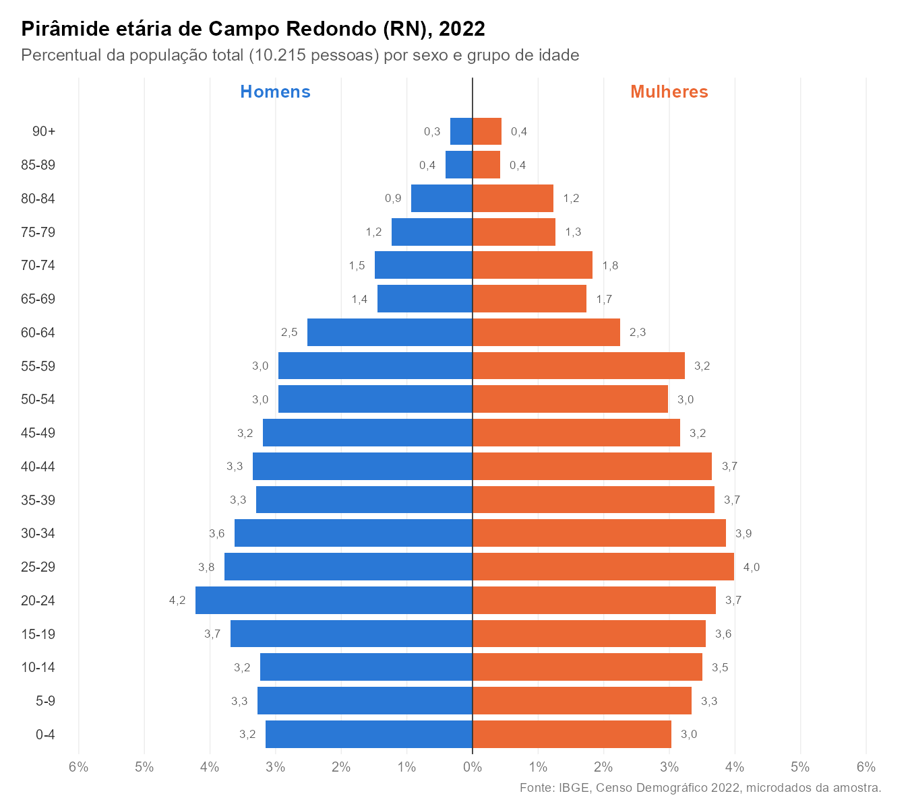

# Campo Redondo (RN)

Resultados do Censo Demográfico 2022 (microdados da amostra). Gerado por `R/05_readmes.R`; veja a [página dos municípios](../README.md) e o [README principal](../../../../README.md).

População: **10.215** pessoas (2.022 registros na amostra).

## Estrutura etária

| Indicador | Campo Redondo | RN |
|---|--:|--:|
| Razão de dependência jovem | 28,9 | 28,5 |
| Razão de dependência idosa | 18,9 | 15,1 |
| Razão de dependência total | 47,8 | 43,6 |
| Índice de envelhecimento | 65,4 | 52,9 |

Valores por 100 pessoas.

## Migração

Chegadas e saídas: mudanças de município nos últimos 10 anos.

| Indicador | Valor |
|---|--:|
| Nascidos no próprio município | 81,8% |
| Nascidos em outro município do Rio Grande do Norte | 14,1% |
| Nascidos em outra UF | 4,2% |
| Nascidos no exterior | 0,0% |
| Chegaram de outro município do Rio Grande do Norte | 775 |
| Chegaram de outra UF | 310 |
| Saíram para outro município da UF | 1.005 |
| Saíram para outra UF | 389 |
| Saldo migratório | -310 |
| Saldo por 1.000 habitantes | -30,3 |
| Chegaram do exterior | 0 |

Principais origens de quem chegou e destinos de quem saiu:

| Origem | Chegaram | Destino | Saíram |
|---|--:|---|--:|
| Natal (RN) | 408 | Natal (RN) | 199 |
| Santa Cruz (RN) | 96 | Parnamirim (RN) | 196 |
| Parnamirim (RN) | 60 | Santa Cruz (RN) | 132 |
| Lajes Pintadas (RN) | 51 | Currais Novos (RN) | 125 |
| Picuí (PB) | 44 | Picuí (PB) | 62 |

## Mortalidade

Óbitos de agosto de 2021 a julho de 2022 informados no Censo.

| Indicador | Campo Redondo | RN |
|---|--:|--:|
| Óbitos no período | 58 | 22.488 |
| Registros de óbito na amostra | 13 |  |
| Taxa bruta de mortalidade (por mil) | 5,7 | 6,8 |
| Taxa padronizada por idade (por mil) | 4,9 | 6,8 |

Com poucos óbitos na amostra, as taxas deste município variam muito por acaso; por isso não há tábua de vida. Sem correção do sub-registro de óbitos do Censo.
