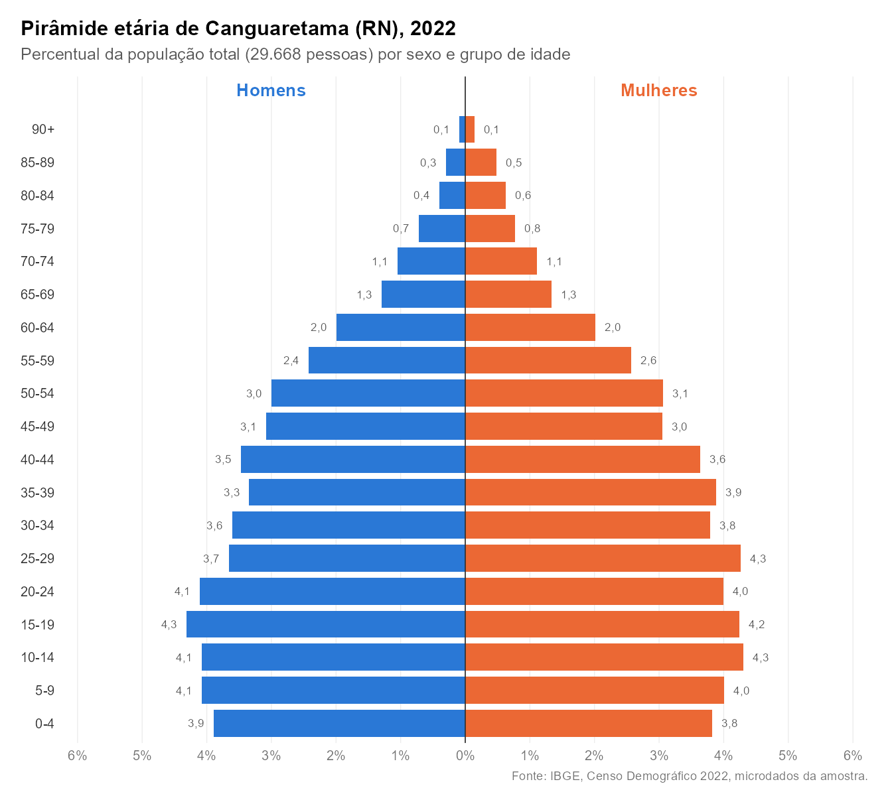

# Canguaretama (RN)

Resultados do Censo Demográfico 2022 (microdados da amostra). Gerado por `R/05_readmes.R`; veja a [página dos municípios](../README.md) e o [README principal](../../../../README.md).

População: **29.668** pessoas (2.966 registros na amostra).

## Estrutura etária

| Indicador | Canguaretama | RN |
|---|--:|--:|
| Razão de dependência jovem | 35,8 | 28,5 |
| Razão de dependência idosa | 12,3 | 15,1 |
| Razão de dependência total | 48,2 | 43,6 |
| Índice de envelhecimento | 34,4 | 52,9 |

Valores por 100 pessoas.

## Migração

Chegadas e saídas: mudanças de município nos últimos 10 anos.

| Indicador | Valor |
|---|--:|
| Nascidos no próprio município | 76,2% |
| Nascidos em outro município do Rio Grande do Norte | 15,0% |
| Nascidos em outra UF | 8,7% |
| Nascidos no exterior | 0,0% |
| Chegaram de outro município do Rio Grande do Norte | 1.686 |
| Chegaram de outra UF | 1.243 |
| Saíram para outro município da UF | 2.413 |
| Saíram para outra UF | 1.655 |
| Saldo migratório | -1.140 |
| Saldo por 1.000 habitantes | -38,4 |
| Chegaram do exterior | 0 |

Principais origens de quem chegou e destinos de quem saiu:

| Origem | Chegaram | Destino | Saíram |
|---|--:|---|--:|
| Natal (RN) | 443 | Parnamirim (RN) | 245 |
| Pedro Velho (RN) | 205 | Rio de Janeiro (RJ) | 232 |
| Mataraca (PB) | 161 | Pedro Velho (RN) | 230 |
| Parnamirim (RN) | 140 | Nísia Floresta (RN) | 209 |
| Arês (RN) | 130 | Goianinha (RN) | 207 |

## Mortalidade

Óbitos de agosto de 2021 a julho de 2022 informados no Censo.

| Indicador | Canguaretama | RN |
|---|--:|--:|
| Óbitos no período | 246 | 22.488 |
| Registros de óbito na amostra | 24 |  |
| Taxa bruta de mortalidade (por mil) | 8,3 | 6,8 |
| Taxa padronizada por idade (por mil) | 9,8 | 6,8 |

Com poucos óbitos na amostra, as taxas deste município variam muito por acaso; por isso não há tábua de vida. Sem correção do sub-registro de óbitos do Censo.
