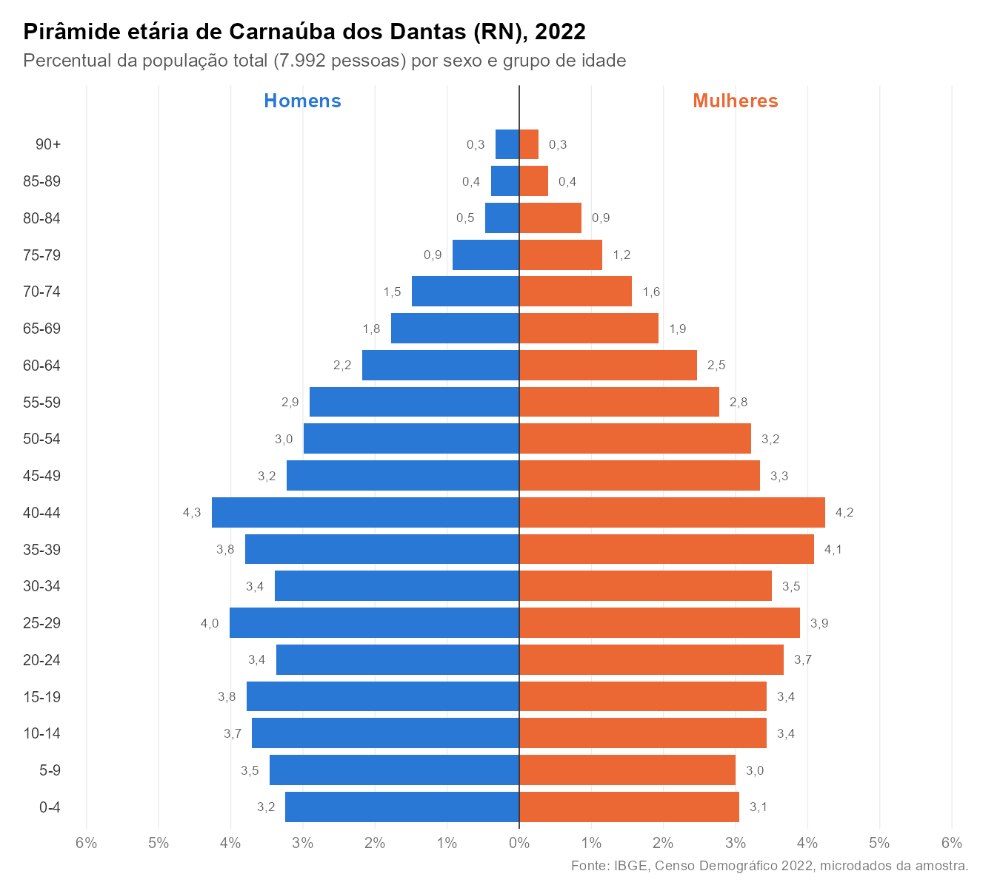

# Carnaúba dos Dantas (RN)

Resultados do Censo Demográfico 2022 (microdados da amostra). Gerado por `R/05_readmes.R`; veja a [página dos municípios](../README.md) e o [README principal](../../../../README.md).

População: **7.992** pessoas (1.566 registros na amostra).

## Estrutura etária

| Indicador | Carnaúba dos Dantas | RN |
|---|--:|--:|
| Razão de dependência jovem | 29,0 | 28,5 |
| Razão de dependência idosa | 16,9 | 15,1 |
| Razão de dependência total | 45,9 | 43,6 |
| Índice de envelhecimento | 58,1 | 52,9 |

Valores por 100 pessoas.

## Migração

Chegadas e saídas: mudanças de município nos últimos 10 anos.

| Indicador | Valor |
|---|--:|
| Nascidos no próprio município | 70,9% |
| Nascidos em outro município do Rio Grande do Norte | 16,3% |
| Nascidos em outra UF | 12,7% |
| Nascidos no exterior | 0,1% |
| Chegaram de outro município do Rio Grande do Norte | 619 |
| Chegaram de outra UF | 436 |
| Saíram para outro município da UF | 466 |
| Saíram para outra UF | 261 |
| Saldo migratório | +328 |
| Saldo por 1.000 habitantes | +41,1 |
| Chegaram do exterior | 7 |

Principais origens de quem chegou e destinos de quem saiu:

| Origem | Chegaram | Destino | Saíram |
|---|--:|---|--:|
| Natal (RN) | 187 | Parelhas (RN) | 161 |
| Picuí (PB) | 92 | Santa Cruz (RN) | 73 |
| Acari (RN) | 84 | Jardim do Seridó (RN) | 40 |
| Parelhas (RN) | 58 | Recife (PE) | 33 |
| João Pessoa (PB) | 42 | Princesa Isabel (PB) | 32 |

## Mortalidade

Óbitos de agosto de 2021 a julho de 2022 informados no Censo.

| Indicador | Carnaúba dos Dantas | RN |
|---|--:|--:|
| Óbitos no período | 59 | 22.488 |
| Registros de óbito na amostra | 12 |  |
| Taxa bruta de mortalidade (por mil) | 7,4 | 6,8 |
| Taxa padronizada por idade (por mil) | 6,8 | 6,8 |

Com poucos óbitos na amostra, as taxas deste município variam muito por acaso; por isso não há tábua de vida. Sem correção do sub-registro de óbitos do Censo.
