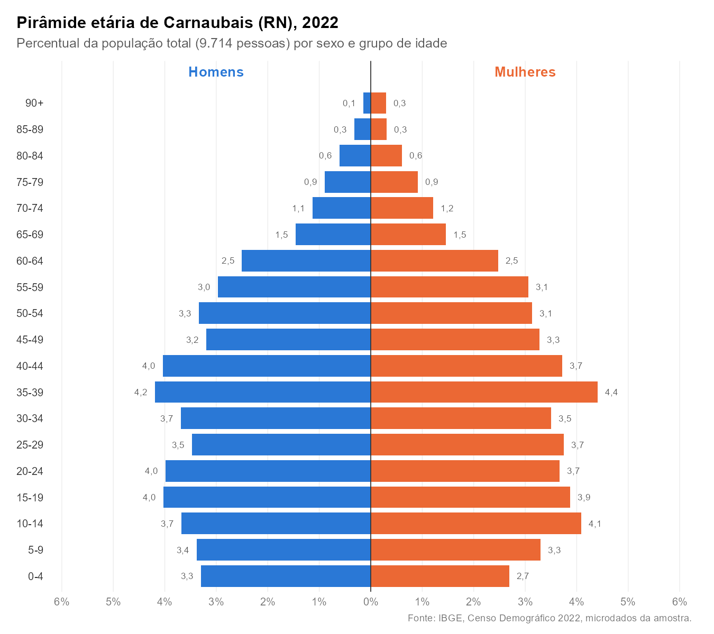

# Carnaubais (RN)

Resultados do Censo Demográfico 2022 (microdados da amostra). Gerado por `R/05_readmes.R`; veja a [página dos municípios](../README.md) e o [README principal](../../../../README.md).

População: **9.714** pessoas (1.979 registros na amostra).

## Estrutura etária

| Indicador | Carnaubais | RN |
|---|--:|--:|
| Razão de dependência jovem | 29,1 | 28,5 |
| Razão de dependência idosa | 13,3 | 15,1 |
| Razão de dependência total | 42,4 | 43,6 |
| Índice de envelhecimento | 45,9 | 52,9 |

Valores por 100 pessoas.

## Migração

Chegadas e saídas: mudanças de município nos últimos 10 anos.

| Indicador | Valor |
|---|--:|
| Nascidos no próprio município | 75,8% |
| Nascidos em outro município do Rio Grande do Norte | 22,0% |
| Nascidos em outra UF | 2,1% |
| Nascidos no exterior | 0,0% |
| Chegaram de outro município do Rio Grande do Norte | 940 |
| Chegaram de outra UF | 108 |
| Saíram para outro município da UF | 894 |
| Saíram para outra UF | 177 |
| Saldo migratório | -23 |
| Saldo por 1.000 habitantes | -2,3 |
| Chegaram do exterior | 3 |

Principais origens de quem chegou e destinos de quem saiu:

| Origem | Chegaram | Destino | Saíram |
|---|--:|---|--:|
| Açu (RN) | 154 | Alto do Rodrigues (RN) | 120 |
| Natal (RN) | 140 | Mossoró (RN) | 103 |
| Alto do Rodrigues (RN) | 92 | Serra do Mel (RN) | 99 |
| Mossoró (RN) | 90 | Açu (RN) | 78 |
| Paraú (RN) | 57 | Parnamirim (RN) | 77 |

## Mortalidade

Óbitos de agosto de 2021 a julho de 2022 informados no Censo.

| Indicador | Carnaubais | RN |
|---|--:|--:|
| Óbitos no período | 94 | 22.488 |
| Registros de óbito na amostra | 17 |  |
| Taxa bruta de mortalidade (por mil) | 9,6 | 6,8 |
| Taxa padronizada por idade (por mil) | 10,0 | 6,8 |

Com poucos óbitos na amostra, as taxas deste município variam muito por acaso; por isso não há tábua de vida. Sem correção do sub-registro de óbitos do Censo.
