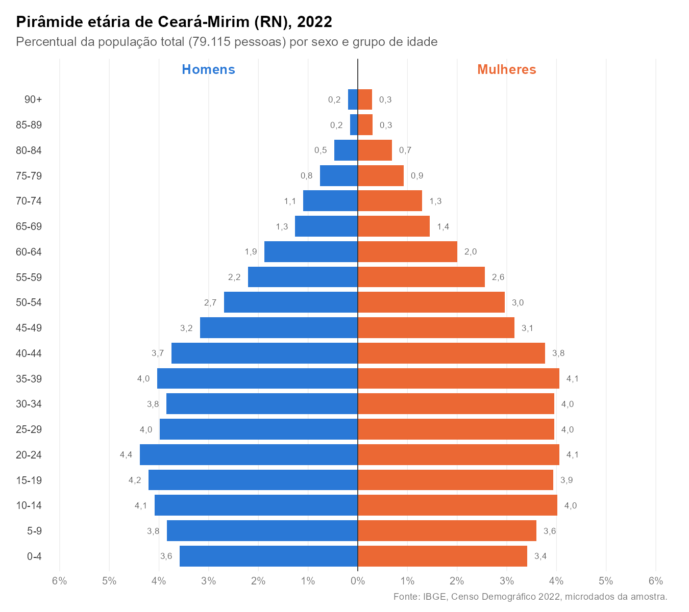

# Ceará-Mirim (RN)

Resultados do Censo Demográfico 2022 (microdados da amostra). Gerado por `R/05_readmes.R`; veja a [página dos municípios](../README.md) e o [README principal](../../../../README.md).

População: **79.115** pessoas (7.678 registros na amostra).

## Estrutura etária

| Indicador | Ceará-Mirim | RN |
|---|--:|--:|
| Razão de dependência jovem | 32,9 | 28,5 |
| Razão de dependência idosa | 13,0 | 15,1 |
| Razão de dependência total | 45,8 | 43,6 |
| Índice de envelhecimento | 39,4 | 52,9 |

Valores por 100 pessoas.

## Migração

Chegadas e saídas: mudanças de município nos últimos 10 anos.

| Indicador | Valor |
|---|--:|
| Nascidos no próprio município | 70,1% |
| Nascidos em outro município do Rio Grande do Norte | 25,6% |
| Nascidos em outra UF | 4,2% |
| Nascidos no exterior | 0,0% |
| Chegaram de outro município do Rio Grande do Norte | 10.149 |
| Chegaram de outra UF | 1.563 |
| Saíram para outro município da UF | 6.083 |
| Saíram para outra UF | 1.071 |
| Saldo migratório | +4.558 |
| Saldo por 1.000 habitantes | +57,6 |
| Chegaram do exterior | 20 |

Principais origens de quem chegou e destinos de quem saiu:

| Origem | Chegaram | Destino | Saíram |
|---|--:|---|--:|
| Natal (RN) | 5.157 | Natal (RN) | 1.985 |
| São Gonçalo do Amarante (RN) | 558 | Parnamirim (RN) | 601 |
| Parnamirim (RN) | 440 | São Gonçalo do Amarante (RN) | 549 |
| João Câmara (RN) | 426 | Extremoz (RN) | 469 |
| Taipu (RN) | 393 | Maxaranguape (RN) | 303 |

## Mortalidade

Óbitos de agosto de 2021 a julho de 2022 informados no Censo.

| Indicador | Ceará-Mirim | RN |
|---|--:|--:|
| Óbitos no período | 383 | 22.488 |
| Registros de óbito na amostra | 37 |  |
| Taxa bruta de mortalidade (por mil) | 4,8 | 6,8 |
| Taxa padronizada por idade (por mil) | 5,4 | 6,8 |

Com poucos óbitos na amostra, as taxas deste município variam muito por acaso; por isso não há tábua de vida. Sem correção do sub-registro de óbitos do Censo.
