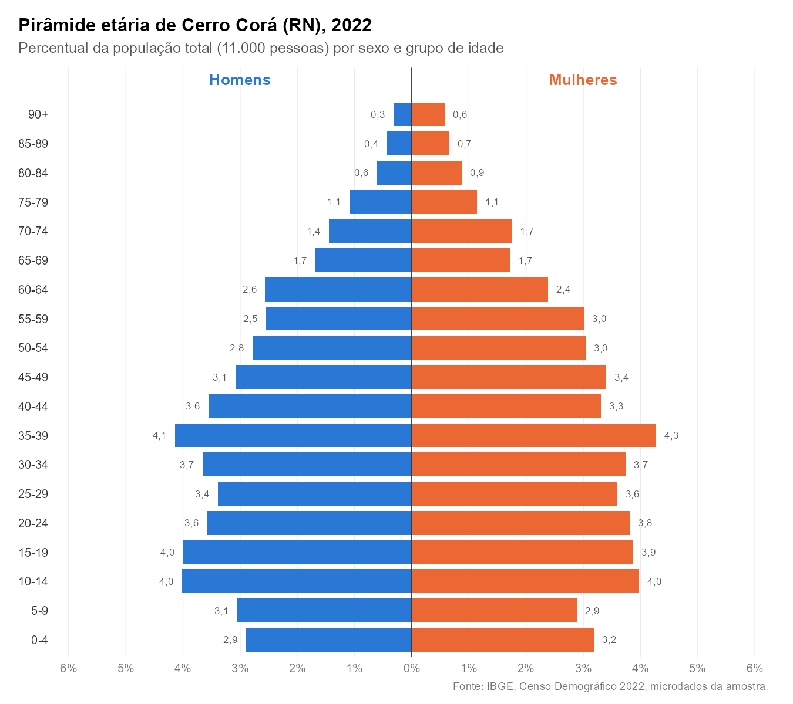

# Cerro Corá (RN)

Resultados do Censo Demográfico 2022 (microdados da amostra). Gerado por `R/05_readmes.R`; veja a [página dos municípios](../README.md) e o [README principal](../../../../README.md).

População: **11.000** pessoas (2.108 registros na amostra).

## Estrutura etária

| Indicador | Cerro Corá | RN |
|---|--:|--:|
| Razão de dependência jovem | 29,6 | 28,5 |
| Razão de dependência idosa | 18,1 | 15,1 |
| Razão de dependência total | 47,7 | 43,6 |
| Índice de envelhecimento | 61,4 | 52,9 |

Valores por 100 pessoas.

## Migração

Chegadas e saídas: mudanças de município nos últimos 10 anos.

| Indicador | Valor |
|---|--:|
| Nascidos no próprio município | 71,3% |
| Nascidos em outro município do Rio Grande do Norte | 25,7% |
| Nascidos em outra UF | 3,0% |
| Nascidos no exterior | 0,0% |
| Chegaram de outro município do Rio Grande do Norte | 1.100 |
| Chegaram de outra UF | 251 |
| Saíram para outro município da UF | 962 |
| Saíram para outra UF | 200 |
| Saldo migratório | +189 |
| Saldo por 1.000 habitantes | +17,2 |
| Chegaram do exterior | 5 |

Principais origens de quem chegou e destinos de quem saiu:

| Origem | Chegaram | Destino | Saíram |
|---|--:|---|--:|
| Natal (RN) | 387 | Lagoa Nova (RN) | 133 |
| Currais Novos (RN) | 147 | Currais Novos (RN) | 118 |
| Lagoa Nova (RN) | 119 | Parnamirim (RN) | 111 |
| São Tomé (RN) | 71 | Baraúna (RN) | 106 |
| Bodó (RN) | 58 | Natal (RN) | 104 |

## Mortalidade

Óbitos de agosto de 2021 a julho de 2022 informados no Censo.

| Indicador | Cerro Corá | RN |
|---|--:|--:|
| Óbitos no período | 128 | 22.488 |
| Registros de óbito na amostra | 25 |  |
| Taxa bruta de mortalidade (por mil) | 11,6 | 6,8 |
| Taxa padronizada por idade (por mil) | 9,8 | 6,8 |

Com poucos óbitos na amostra, as taxas deste município variam muito por acaso; por isso não há tábua de vida. Sem correção do sub-registro de óbitos do Censo.
