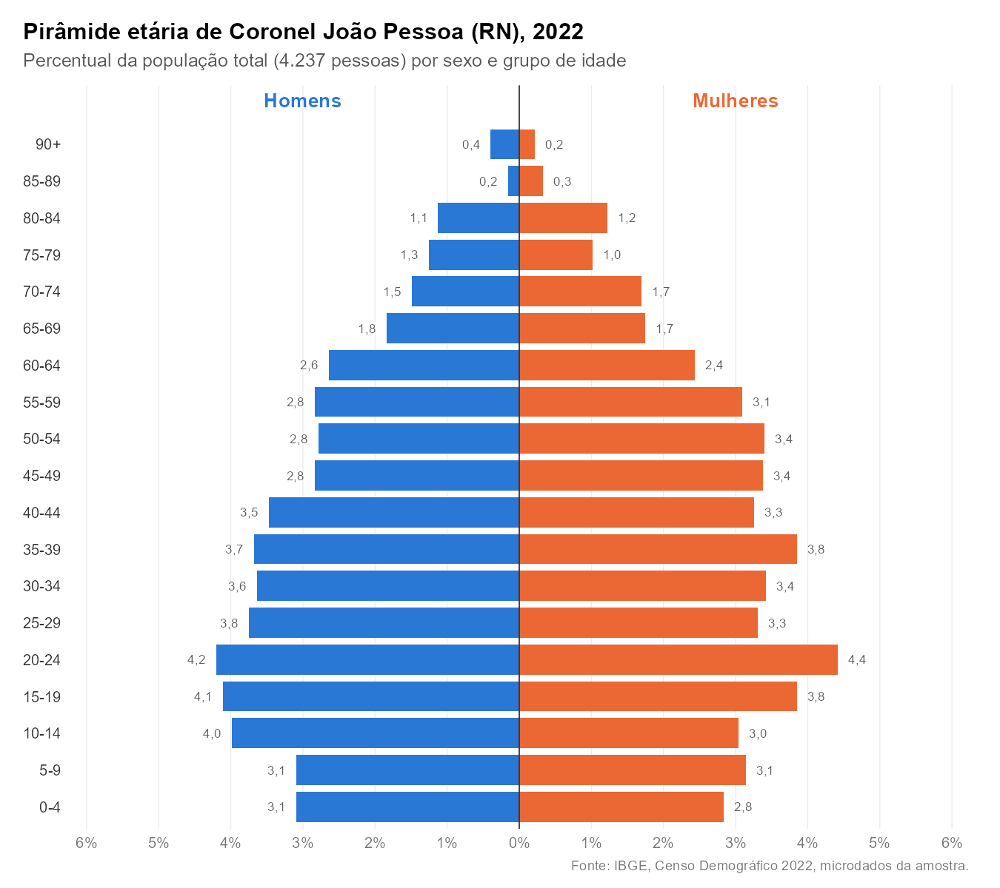

# Coronel João Pessoa (RN)

Resultados do Censo Demográfico 2022 (microdados da amostra). Gerado por `R/05_readmes.R`; veja a [página dos municípios](../README.md) e o [README principal](../../../../README.md).

População: **4.237** pessoas (1.441 registros na amostra).

## Estrutura etária

| Indicador | Coronel João Pessoa | RN |
|---|--:|--:|
| Razão de dependência jovem | 28,1 | 28,5 |
| Razão de dependência idosa | 18,3 | 15,1 |
| Razão de dependência total | 46,4 | 43,6 |
| Índice de envelhecimento | 65,1 | 52,9 |

Valores por 100 pessoas.

## Migração

Chegadas e saídas: mudanças de município nos últimos 10 anos.

| Indicador | Valor |
|---|--:|
| Nascidos no próprio município | 77,0% |
| Nascidos em outro município do Rio Grande do Norte | 14,8% |
| Nascidos em outra UF | 8,1% |
| Nascidos no exterior | 0,1% |
| Chegaram de outro município do Rio Grande do Norte | 206 |
| Chegaram de outra UF | 138 |
| Saíram para outro município da UF | 316 |
| Saíram para outra UF | 88 |
| Saldo migratório | -60 |
| Saldo por 1.000 habitantes | -14,2 |
| Chegaram do exterior | 0 |

Principais origens de quem chegou e destinos de quem saiu:

| Origem | Chegaram | Destino | Saíram |
|---|--:|---|--:|
| São Miguel (RN) | 105 | São Miguel (RN) | 98 |
| Natal (RN) | 35 | Natal (RN) | 65 |
| Brasília (DF) | 32 | Venha-Ver (RN) | 44 |
| São Paulo (SP) | 15 | Tenente Ananias (RN) | 32 |
| Hidrolândia (GO) | 13 | Icó (CE) | 27 |

## Mortalidade

Óbitos de agosto de 2021 a julho de 2022 informados no Censo.

| Indicador | Coronel João Pessoa | RN |
|---|--:|--:|
| Óbitos no período | 19 | 22.488 |
| Registros de óbito na amostra | 7 |  |
| Taxa bruta de mortalidade (por mil) | 4,5 | 6,8 |
| Taxa padronizada por idade (por mil) | 4,9 | 6,8 |

Com poucos óbitos na amostra, as taxas deste município variam muito por acaso; por isso não há tábua de vida. Sem correção do sub-registro de óbitos do Censo.
