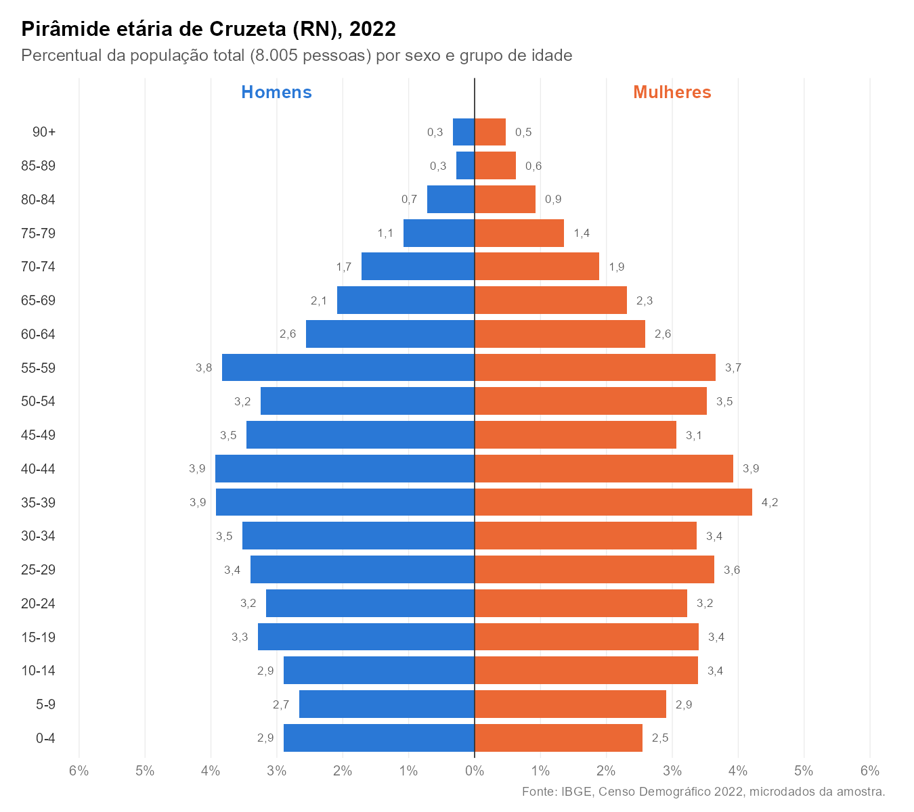

# Cruzeta (RN)

Resultados do Censo Demográfico 2022 (microdados da amostra). Gerado por `R/05_readmes.R`; veja a [página dos municípios](../README.md) e o [README principal](../../../../README.md).

População: **8.005** pessoas (2.688 registros na amostra).

## Estrutura etária

| Indicador | Cruzeta | RN |
|---|--:|--:|
| Razão de dependência jovem | 25,1 | 28,5 |
| Razão de dependência idosa | 20,0 | 15,1 |
| Razão de dependência total | 45,1 | 43,6 |
| Índice de envelhecimento | 79,6 | 52,9 |

Valores por 100 pessoas.

## Migração

Chegadas e saídas: mudanças de município nos últimos 10 anos.

| Indicador | Valor |
|---|--:|
| Nascidos no próprio município | 72,3% |
| Nascidos em outro município do Rio Grande do Norte | 22,6% |
| Nascidos em outra UF | 5,0% |
| Nascidos no exterior | 0,0% |
| Chegaram de outro município do Rio Grande do Norte | 808 |
| Chegaram de outra UF | 234 |
| Saíram para outro município da UF | 764 |
| Saíram para outra UF | 413 |
| Saldo migratório | -135 |
| Saldo por 1.000 habitantes | -16,8 |
| Chegaram do exterior | 0 |

Principais origens de quem chegou e destinos de quem saiu:

| Origem | Chegaram | Destino | Saíram |
|---|--:|---|--:|
| Natal (RN) | 279 | Uberlândia (MG) | 274 |
| São José do Seridó (RN) | 131 | Caicó (RN) | 164 |
| Caicó (RN) | 86 | Natal (RN) | 100 |
| Currais Novos (RN) | 82 | São José do Seridó (RN) | 82 |
| Acari (RN) | 55 | Florânia (RN) | 53 |

## Mortalidade

Óbitos de agosto de 2021 a julho de 2022 informados no Censo.

| Indicador | Cruzeta | RN |
|---|--:|--:|
| Óbitos no período | 65 | 22.488 |
| Registros de óbito na amostra | 22 |  |
| Taxa bruta de mortalidade (por mil) | 8,1 | 6,8 |
| Taxa padronizada por idade (por mil) | 6,5 | 6,8 |

Com poucos óbitos na amostra, as taxas deste município variam muito por acaso; por isso não há tábua de vida. Sem correção do sub-registro de óbitos do Censo.
