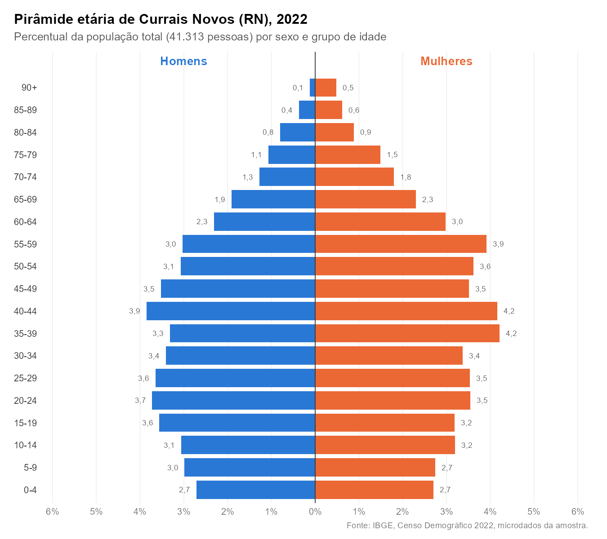

# Currais Novos (RN)

Resultados do Censo Demográfico 2022 (microdados da amostra). Gerado por `R/05_readmes.R`; veja a [página dos municípios](../README.md) e o [README principal](../../../../README.md).

População: **41.313** pessoas (4.076 registros na amostra).

## Estrutura etária

| Indicador | Currais Novos | RN |
|---|--:|--:|
| Razão de dependência jovem | 25,0 | 28,5 |
| Razão de dependência idosa | 18,9 | 15,1 |
| Razão de dependência total | 43,9 | 43,6 |
| Índice de envelhecimento | 75,4 | 52,9 |

Valores por 100 pessoas.

## Migração

Chegadas e saídas: mudanças de município nos últimos 10 anos.

| Indicador | Valor |
|---|--:|
| Nascidos no próprio município | 69,9% |
| Nascidos em outro município do Rio Grande do Norte | 22,5% |
| Nascidos em outra UF | 7,5% |
| Nascidos no exterior | 0,1% |
| Chegaram de outro município do Rio Grande do Norte | 3.606 |
| Chegaram de outra UF | 1.685 |
| Saíram para outro município da UF | 4.284 |
| Saíram para outra UF | 2.296 |
| Saldo migratório | -1.288 |
| Saldo por 1.000 habitantes | -31,2 |
| Chegaram do exterior | 18 |

Principais origens de quem chegou e destinos de quem saiu:

| Origem | Chegaram | Destino | Saíram |
|---|--:|---|--:|
| Natal (RN) | 1.059 | Natal (RN) | 986 |
| Lagoa Nova (RN) | 315 | Parnamirim (RN) | 546 |
| Caicó (RN) | 260 | Lagoa Nova (RN) | 382 |
| São Vicente (RN) | 166 | Caicó (RN) | 310 |
| Santa Cruz (RN) | 155 | Santa Cruz (RN) | 223 |

## Mortalidade

Óbitos de agosto de 2021 a julho de 2022 informados no Censo.

| Indicador | Currais Novos | RN |
|---|--:|--:|
| Óbitos no período | 303 | 22.488 |
| Registros de óbito na amostra | 32 |  |
| Taxa bruta de mortalidade (por mil) | 7,3 | 6,8 |
| Taxa padronizada por idade (por mil) | 6,1 | 6,8 |

Com poucos óbitos na amostra, as taxas deste município variam muito por acaso; por isso não há tábua de vida. Sem correção do sub-registro de óbitos do Censo.
