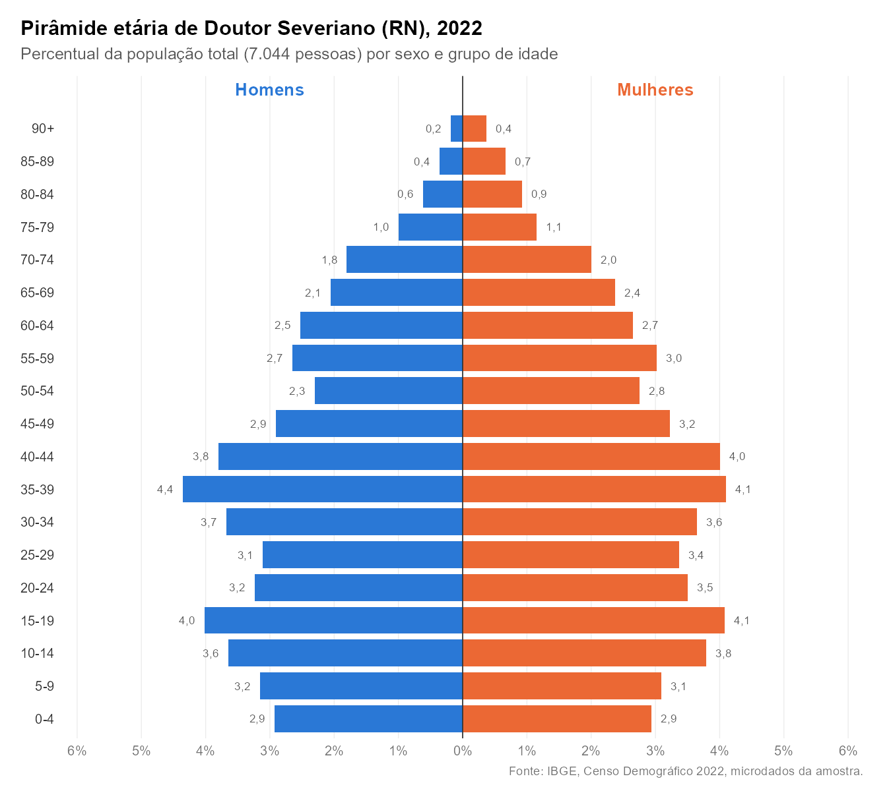

# Doutor Severiano (RN)

Resultados do Censo Demográfico 2022 (microdados da amostra). Gerado por `R/05_readmes.R`; veja a [página dos municípios](../README.md) e o [README principal](../../../../README.md).

População: **7.044** pessoas (2.413 registros na amostra).

## Estrutura etária

| Indicador | Doutor Severiano | RN |
|---|--:|--:|
| Razão de dependência jovem | 29,2 | 28,5 |
| Razão de dependência idosa | 20,2 | 15,1 |
| Razão de dependência total | 49,4 | 43,6 |
| Índice de envelhecimento | 69,1 | 52,9 |

Valores por 100 pessoas.

## Migração

Chegadas e saídas: mudanças de município nos últimos 10 anos.

| Indicador | Valor |
|---|--:|
| Nascidos no próprio município | 82,6% |
| Nascidos em outro município do Rio Grande do Norte | 9,0% |
| Nascidos em outra UF | 8,3% |
| Nascidos no exterior | 0,0% |
| Chegaram de outro município do Rio Grande do Norte | 269 |
| Chegaram de outra UF | 354 |
| Saíram para outro município da UF | 282 |
| Saíram para outra UF | 336 |
| Saldo migratório | +5 |
| Saldo por 1.000 habitantes | +0,8 |
| Chegaram do exterior | 3 |

Principais origens de quem chegou e destinos de quem saiu:

| Origem | Chegaram | Destino | Saíram |
|---|--:|---|--:|
| Pau dos Ferros (RN) | 92 | Pau dos Ferros (RN) | 83 |
| São Paulo (SP) | 83 | Floriano (PI) | 60 |
| Brasília (DF) | 58 | São Miguel (RN) | 59 |
| São Miguel (RN) | 56 | Encanto (RN) | 54 |
| Pereiro (CE) | 47 | Campo Grande (MS) | 49 |

## Mortalidade

Óbitos de agosto de 2021 a julho de 2022 informados no Censo.

| Indicador | Doutor Severiano | RN |
|---|--:|--:|
| Óbitos no período | 47 | 22.488 |
| Registros de óbito na amostra | 16 |  |
| Taxa bruta de mortalidade (por mil) | 6,7 | 6,8 |
| Taxa padronizada por idade (por mil) | 5,8 | 6,8 |

Com poucos óbitos na amostra, as taxas deste município variam muito por acaso; por isso não há tábua de vida. Sem correção do sub-registro de óbitos do Censo.
