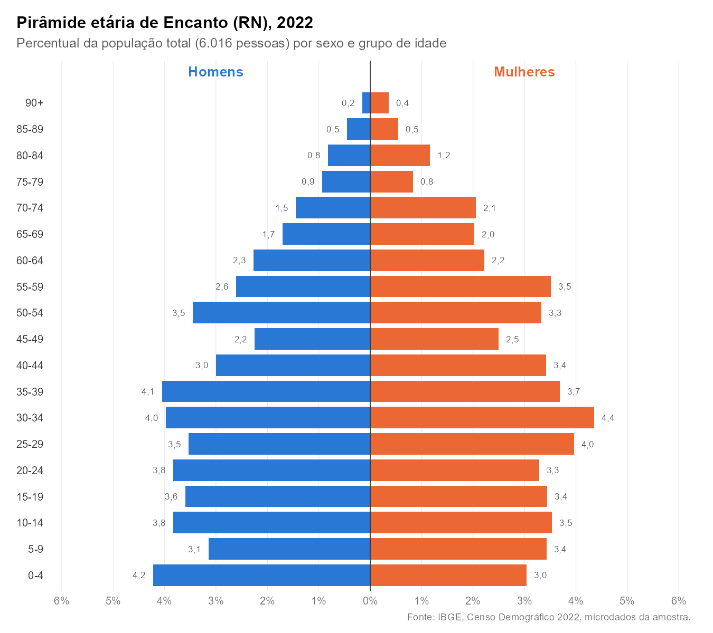

# Encanto (RN)

Resultados do Censo Demográfico 2022 (microdados da amostra). Gerado por `R/05_readmes.R`; veja a [página dos municípios](../README.md) e o [README principal](../../../../README.md).

População: **6.016** pessoas (1.961 registros na amostra).

## Estrutura etária

| Indicador | Encanto | RN |
|---|--:|--:|
| Razão de dependência jovem | 32,0 | 28,5 |
| Razão de dependência idosa | 18,9 | 15,1 |
| Razão de dependência total | 50,8 | 43,6 |
| Índice de envelhecimento | 59,1 | 52,9 |

Valores por 100 pessoas.

## Migração

Chegadas e saídas: mudanças de município nos últimos 10 anos.

| Indicador | Valor |
|---|--:|
| Nascidos no próprio município | 67,4% |
| Nascidos em outro município do Rio Grande do Norte | 21,3% |
| Nascidos em outra UF | 11,3% |
| Nascidos no exterior | 0,0% |
| Chegaram de outro município do Rio Grande do Norte | 622 |
| Chegaram de outra UF | 392 |
| Saíram para outro município da UF | 439 |
| Saíram para outra UF | 224 |
| Saldo migratório | +351 |
| Saldo por 1.000 habitantes | +58,4 |
| Chegaram do exterior | 0 |

Principais origens de quem chegou e destinos de quem saiu:

| Origem | Chegaram | Destino | Saíram |
|---|--:|---|--:|
| Pau dos Ferros (RN) | 236 | Pau dos Ferros (RN) | 219 |
| São Paulo (SP) | 101 | Brasília (DF) | 61 |
| Água Nova (RN) | 62 | Doutor Severiano (RN) | 32 |
| Doutor Severiano (RN) | 54 | Jaguaribe (CE) | 31 |
| Natal (RN) | 52 | Água Nova (RN) | 24 |

## Mortalidade

Óbitos de agosto de 2021 a julho de 2022 informados no Censo.

| Indicador | Encanto | RN |
|---|--:|--:|
| Óbitos no período | 60 | 22.488 |
| Registros de óbito na amostra | 20 |  |
| Taxa bruta de mortalidade (por mil) | 9,9 | 6,8 |
| Taxa padronizada por idade (por mil) | 9,4 | 6,8 |

Com poucos óbitos na amostra, as taxas deste município variam muito por acaso; por isso não há tábua de vida. Sem correção do sub-registro de óbitos do Censo.
