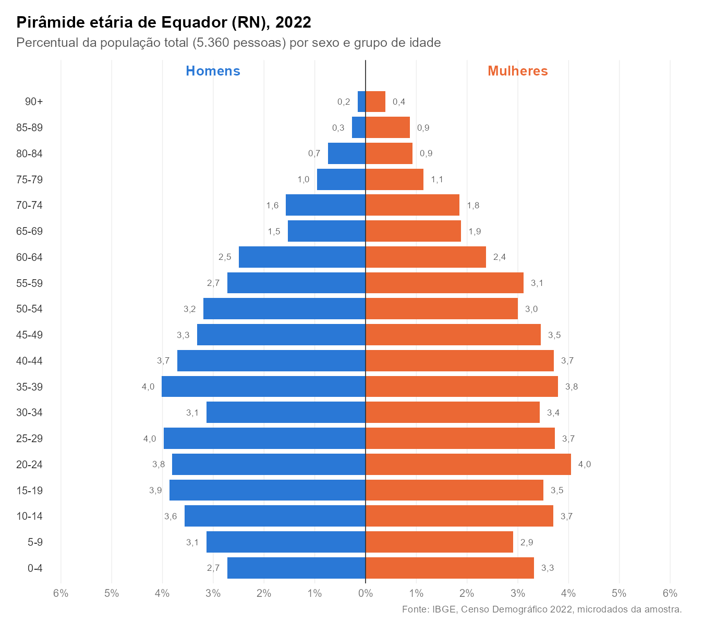

# Equador (RN)

Resultados do Censo Demográfico 2022 (microdados da amostra). Gerado por `R/05_readmes.R`; veja a [página dos municípios](../README.md) e o [README principal](../../../../README.md).

População: **5.360** pessoas (1.767 registros na amostra).

## Estrutura etária

| Indicador | Equador | RN |
|---|--:|--:|
| Razão de dependência jovem | 28,3 | 28,5 |
| Razão de dependência idosa | 17,9 | 15,1 |
| Razão de dependência total | 46,2 | 43,6 |
| Índice de envelhecimento | 63,4 | 52,9 |

Valores por 100 pessoas.

## Migração

Chegadas e saídas: mudanças de município nos últimos 10 anos.

| Indicador | Valor |
|---|--:|
| Nascidos no próprio município | 73,0% |
| Nascidos em outro município do Rio Grande do Norte | 7,8% |
| Nascidos em outra UF | 19,1% |
| Nascidos no exterior | 0,0% |
| Chegaram de outro município do Rio Grande do Norte | 293 |
| Chegaram de outra UF | 425 |
| Saíram para outro município da UF | 152 |
| Saíram para outra UF | 838 |
| Saldo migratório | -272 |
| Saldo por 1.000 habitantes | -50,8 |
| Chegaram do exterior | 0 |

Principais origens de quem chegou e destinos de quem saiu:

| Origem | Chegaram | Destino | Saíram |
|---|--:|---|--:|
| Natal (RN) | 143 | Brasília (DF) | 189 |
| Parelhas (RN) | 84 | Junco do Seridó (PB) | 141 |
| Tenório (PB) | 73 | Campina Grande (PB) | 110 |
| Junco do Seridó (PB) | 73 | Tenório (PB) | 61 |
| Santa Luzia (PB) | 35 | Fortaleza (CE) | 60 |

## Mortalidade

Óbitos de agosto de 2021 a julho de 2022 informados no Censo.

| Indicador | Equador | RN |
|---|--:|--:|
| Óbitos no período | 47 | 22.488 |
| Registros de óbito na amostra | 16 |  |
| Taxa bruta de mortalidade (por mil) | 8,8 | 6,8 |
| Taxa padronizada por idade (por mil) | 8,5 | 6,8 |

Com poucos óbitos na amostra, as taxas deste município variam muito por acaso; por isso não há tábua de vida. Sem correção do sub-registro de óbitos do Censo.
