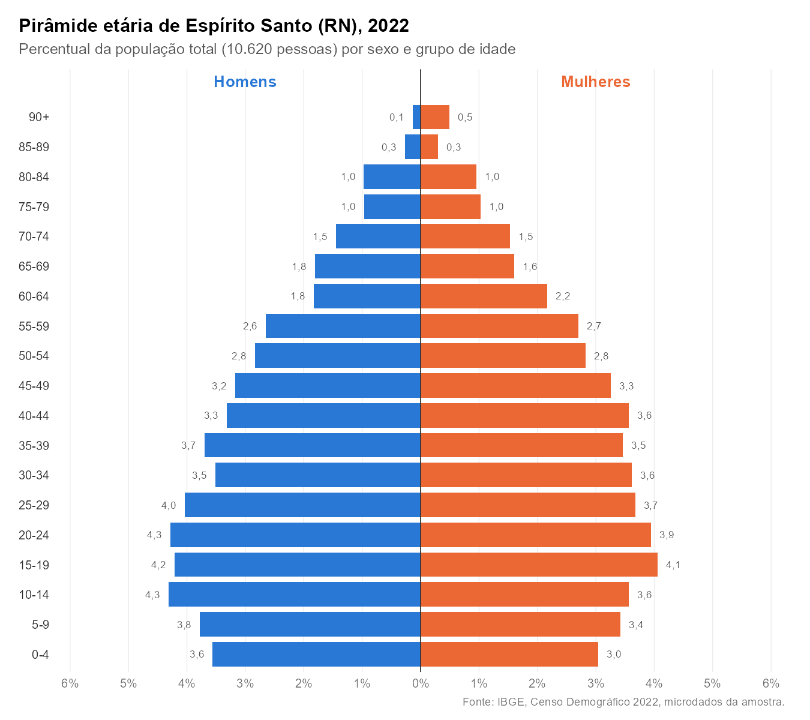

# Espírito Santo (RN)

Resultados do Censo Demográfico 2022 (microdados da amostra). Gerado por `R/05_readmes.R`; veja a [página dos municípios](../README.md) e o [README principal](../../../../README.md).

População: **10.620** pessoas (2.073 registros na amostra).

## Estrutura etária

| Indicador | Espírito Santo | RN |
|---|--:|--:|
| Razão de dependência jovem | 32,4 | 28,5 |
| Razão de dependência idosa | 17,2 | 15,1 |
| Razão de dependência total | 49,7 | 43,6 |
| Índice de envelhecimento | 53,1 | 52,9 |

Valores por 100 pessoas.

## Migração

Chegadas e saídas: mudanças de município nos últimos 10 anos.

| Indicador | Valor |
|---|--:|
| Nascidos no próprio município | 54,4% |
| Nascidos em outro município do Rio Grande do Norte | 40,1% |
| Nascidos em outra UF | 5,5% |
| Nascidos no exterior | 0,0% |
| Chegaram de outro município do Rio Grande do Norte | 851 |
| Chegaram de outra UF | 358 |
| Saíram para outro município da UF | 766 |
| Saíram para outra UF | 119 |
| Saldo migratório | +323 |
| Saldo por 1.000 habitantes | +30,4 |
| Chegaram do exterior | 0 |

Principais origens de quem chegou e destinos de quem saiu:

| Origem | Chegaram | Destino | Saíram |
|---|--:|---|--:|
| Rio de Janeiro (RJ) | 221 | Natal (RN) | 186 |
| Natal (RN) | 195 | Goianinha (RN) | 122 |
| Goianinha (RN) | 138 | Parnamirim (RN) | 93 |
| Parnamirim (RN) | 125 | Várzea (RN) | 87 |
| Várzea (RN) | 81 | Tibau do Sul (RN) | 55 |

## Mortalidade

Óbitos de agosto de 2021 a julho de 2022 informados no Censo.

| Indicador | Espírito Santo | RN |
|---|--:|--:|
| Óbitos no período | 59 | 22.488 |
| Registros de óbito na amostra | 12 |  |
| Taxa bruta de mortalidade (por mil) | 5,6 | 6,8 |
| Taxa padronizada por idade (por mil) | 5,4 | 6,8 |

Com poucos óbitos na amostra, as taxas deste município variam muito por acaso; por isso não há tábua de vida. Sem correção do sub-registro de óbitos do Censo.
