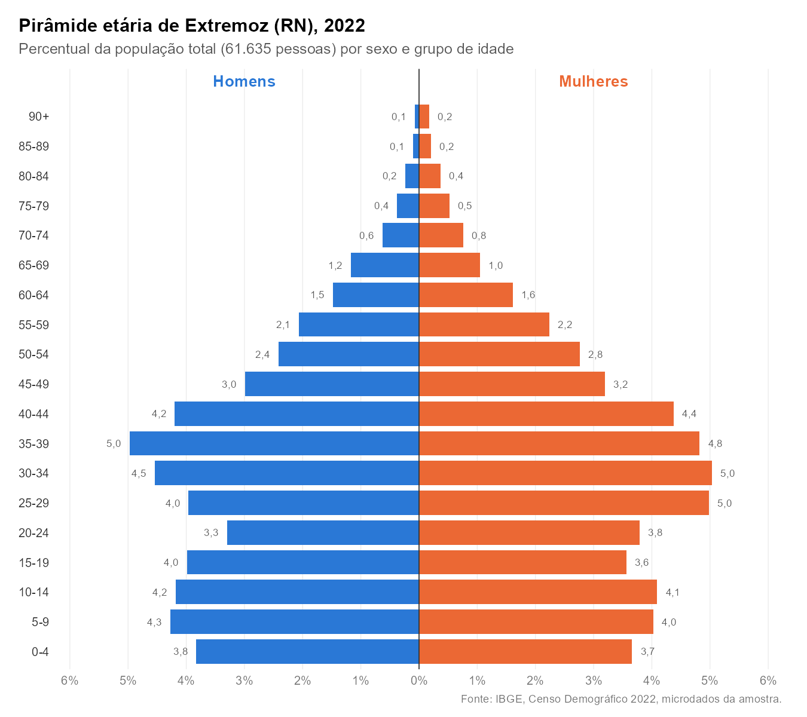

# Extremoz (RN)

Resultados do Censo Demográfico 2022 (microdados da amostra). Gerado por `R/05_readmes.R`; veja a [página dos municípios](../README.md) e o [README principal](../../../../README.md).

População: **61.635** pessoas (5.969 registros na amostra).

## Estrutura etária

| Indicador | Extremoz | RN |
|---|--:|--:|
| Razão de dependência jovem | 34,2 | 28,5 |
| Razão de dependência idosa | 8,1 | 15,1 |
| Razão de dependência total | 42,3 | 43,6 |
| Índice de envelhecimento | 23,5 | 52,9 |

Valores por 100 pessoas.

## Migração

Chegadas e saídas: mudanças de município nos últimos 10 anos.

| Indicador | Valor |
|---|--:|
| Nascidos no próprio município | 37,4% |
| Nascidos em outro município do Rio Grande do Norte | 53,7% |
| Nascidos em outra UF | 8,8% |
| Nascidos no exterior | 0,0% |
| Chegaram de outro município do Rio Grande do Norte | 24.668 |
| Chegaram de outra UF | 1.696 |
| Saíram para outro município da UF | 3.694 |
| Saíram para outra UF | 322 |
| Saldo migratório | +22.348 |
| Saldo por 1.000 habitantes | +362,6 |
| Chegaram do exterior | 6 |

Principais origens de quem chegou e destinos de quem saiu:

| Origem | Chegaram | Destino | Saíram |
|---|--:|---|--:|
| Natal (RN) | 20.029 | Natal (RN) | 1.732 |
| São Gonçalo do Amarante (RN) | 1.470 | São Gonçalo do Amarante (RN) | 669 |
| Parnamirim (RN) | 583 | Parnamirim (RN) | 433 |
| Ceará-Mirim (RN) | 469 | Ceará-Mirim (RN) | 193 |
| Touros (RN) | 282 | Maxaranguape (RN) | 62 |

## Mortalidade

Óbitos de agosto de 2021 a julho de 2022 informados no Censo.

| Indicador | Extremoz | RN |
|---|--:|--:|
| Óbitos no período | 284 | 22.488 |
| Registros de óbito na amostra | 26 |  |
| Taxa bruta de mortalidade (por mil) | 4,6 | 6,8 |
| Taxa padronizada por idade (por mil) | 7,7 | 6,8 |

Com poucos óbitos na amostra, as taxas deste município variam muito por acaso; por isso não há tábua de vida. Sem correção do sub-registro de óbitos do Censo.
