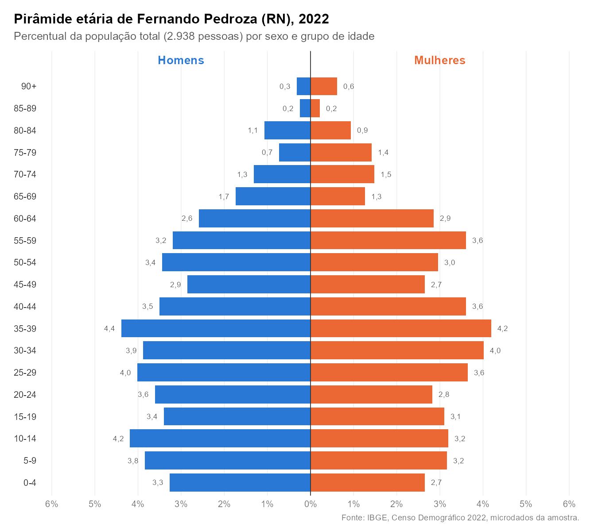

# Fernando Pedroza (RN)

Resultados do Censo Demográfico 2022 (microdados da amostra). Gerado por `R/05_readmes.R`; veja a [página dos municípios](../README.md) e o [README principal](../../../../README.md).

População: **2.938** pessoas (942 registros na amostra).

## Estrutura etária

| Indicador | Fernando Pedroza | RN |
|---|--:|--:|
| Razão de dependência jovem | 29,7 | 28,5 |
| Razão de dependência idosa | 16,6 | 15,1 |
| Razão de dependência total | 46,3 | 43,6 |
| Índice de envelhecimento | 55,8 | 52,9 |

Valores por 100 pessoas.

## Migração

Chegadas e saídas: mudanças de município nos últimos 10 anos.

| Indicador | Valor |
|---|--:|
| Nascidos no próprio município | 49,4% |
| Nascidos em outro município do Rio Grande do Norte | 47,6% |
| Nascidos em outra UF | 3,0% |
| Nascidos no exterior | 0,0% |
| Chegaram de outro município do Rio Grande do Norte | 399 |
| Chegaram de outra UF | 69 |
| Saíram para outro município da UF | 275 |
| Saíram para outra UF | 21 |
| Saldo migratório | +173 |
| Saldo por 1.000 habitantes | +58,9 |
| Chegaram do exterior | 3 |

Principais origens de quem chegou e destinos de quem saiu:

| Origem | Chegaram | Destino | Saíram |
|---|--:|---|--:|
| Natal (RN) | 137 | Mossoró (RN) | 53 |
| Angicos (RN) | 86 | São Miguel do Gostoso (RN) | 51 |
| Santana do Matos (RN) | 44 | Angicos (RN) | 44 |
| Parnamirim (RN) | 28 | Natal (RN) | 27 |
| Fortaleza (CE) | 26 | Lajes (RN) | 25 |

## Mortalidade

Óbitos de agosto de 2021 a julho de 2022 informados no Censo.

| Indicador | Fernando Pedroza | RN |
|---|--:|--:|
| Óbitos no período | 18 | 22.488 |
| Registros de óbito na amostra | 6 |  |
| Taxa bruta de mortalidade (por mil) | 6,1 | 6,8 |
| Taxa padronizada por idade (por mil) | 6,5 | 6,8 |

Com poucos óbitos na amostra, as taxas deste município variam muito por acaso; por isso não há tábua de vida. Sem correção do sub-registro de óbitos do Censo.
