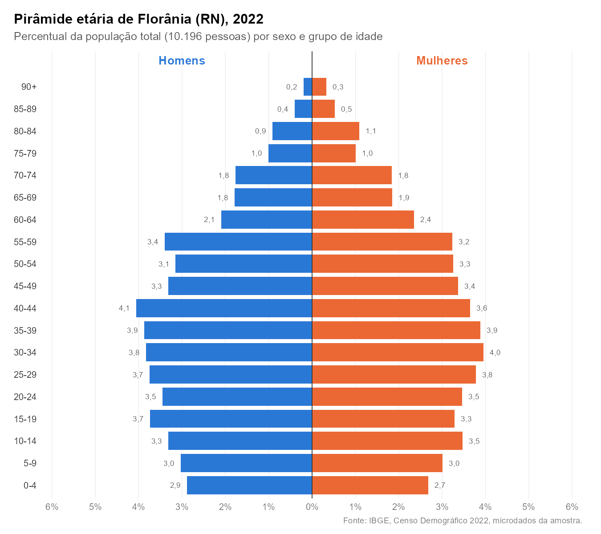

# Florânia (RN)

Resultados do Censo Demográfico 2022 (microdados da amostra). Gerado por `R/05_readmes.R`; veja a [página dos municípios](../README.md) e o [README principal](../../../../README.md).

População: **10.196** pessoas (1.924 registros na amostra).

## Estrutura etária

| Indicador | Florânia | RN |
|---|--:|--:|
| Razão de dependência jovem | 26,7 | 28,5 |
| Razão de dependência idosa | 18,4 | 15,1 |
| Razão de dependência total | 45,1 | 43,6 |
| Índice de envelhecimento | 69,1 | 52,9 |

Valores por 100 pessoas.

## Migração

Chegadas e saídas: mudanças de município nos últimos 10 anos.

| Indicador | Valor |
|---|--:|
| Nascidos no próprio município | 76,4% |
| Nascidos em outro município do Rio Grande do Norte | 19,7% |
| Nascidos em outra UF | 3,8% |
| Nascidos no exterior | 0,0% |
| Chegaram de outro município do Rio Grande do Norte | 1.085 |
| Chegaram de outra UF | 293 |
| Saíram para outro município da UF | 903 |
| Saíram para outra UF | 275 |
| Saldo migratório | +200 |
| Saldo por 1.000 habitantes | +19,6 |
| Chegaram do exterior | 25 |

Principais origens de quem chegou e destinos de quem saiu:

| Origem | Chegaram | Destino | Saíram |
|---|--:|---|--:|
| Natal (RN) | 332 | Parnamirim (RN) | 136 |
| Currais Novos (RN) | 159 | Tenente Laurentino Cruz (RN) | 120 |
| Tenente Laurentino Cruz (RN) | 91 | São Vicente (RN) | 108 |
| Caicó (RN) | 66 | Caicó (RN) | 66 |
| Jucurutu (RN) | 65 | Jucurutu (RN) | 59 |

## Mortalidade

Óbitos de agosto de 2021 a julho de 2022 informados no Censo.

| Indicador | Florânia | RN |
|---|--:|--:|
| Óbitos no período | 74 | 22.488 |
| Registros de óbito na amostra | 13 |  |
| Taxa bruta de mortalidade (por mil) | 7,3 | 6,8 |
| Taxa padronizada por idade (por mil) | 6,3 | 6,8 |

Com poucos óbitos na amostra, as taxas deste município variam muito por acaso; por isso não há tábua de vida. Sem correção do sub-registro de óbitos do Censo.
