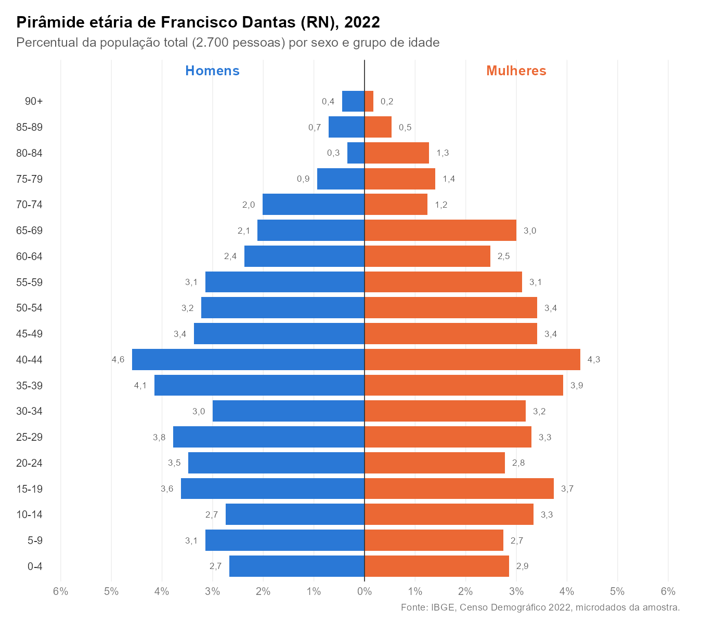

# Francisco Dantas (RN)

Resultados do Censo Demográfico 2022 (microdados da amostra). Gerado por `R/05_readmes.R`; veja a [página dos municípios](../README.md) e o [README principal](../../../../README.md).

População: **2.700** pessoas (874 registros na amostra).

## Estrutura etária

| Indicador | Francisco Dantas | RN |
|---|--:|--:|
| Razão de dependência jovem | 25,6 | 28,5 |
| Razão de dependência idosa | 20,8 | 15,1 |
| Razão de dependência total | 46,3 | 43,6 |
| Índice de envelhecimento | 81,1 | 52,9 |

Valores por 100 pessoas.

## Migração

Chegadas e saídas: mudanças de município nos últimos 10 anos.

| Indicador | Valor |
|---|--:|
| Nascidos no próprio município | 62,9% |
| Nascidos em outro município do Rio Grande do Norte | 28,9% |
| Nascidos em outra UF | 8,2% |
| Nascidos no exterior | 0,0% |
| Chegaram de outro município do Rio Grande do Norte | 357 |
| Chegaram de outra UF | 160 |
| Saíram para outro município da UF | 301 |
| Saíram para outra UF | 71 |
| Saldo migratório | +144 |
| Saldo por 1.000 habitantes | +53,4 |
| Chegaram do exterior | 0 |

Principais origens de quem chegou e destinos de quem saiu:

| Origem | Chegaram | Destino | Saíram |
|---|--:|---|--:|
| Pau dos Ferros (RN) | 128 | Pau dos Ferros (RN) | 70 |
| São Francisco do Oeste (RN) | 62 | Portalegre (RN) | 49 |
| Portalegre (RN) | 36 | São Francisco do Oeste (RN) | 39 |
| São Paulo (SP) | 35 | São Paulo (SP) | 24 |
| Brasília (DF) | 34 | Taboleiro Grande (RN) | 21 |

## Mortalidade

Óbitos de agosto de 2021 a julho de 2022 informados no Censo.

| Indicador | Francisco Dantas | RN |
|---|--:|--:|
| Óbitos no período | 23 | 22.488 |
| Registros de óbito na amostra | 9 |  |
| Taxa bruta de mortalidade (por mil) | 8,5 | 6,8 |
| Taxa padronizada por idade (por mil) | 6,4 | 6,8 |

Com poucos óbitos na amostra, as taxas deste município variam muito por acaso; por isso não há tábua de vida. Sem correção do sub-registro de óbitos do Censo.
