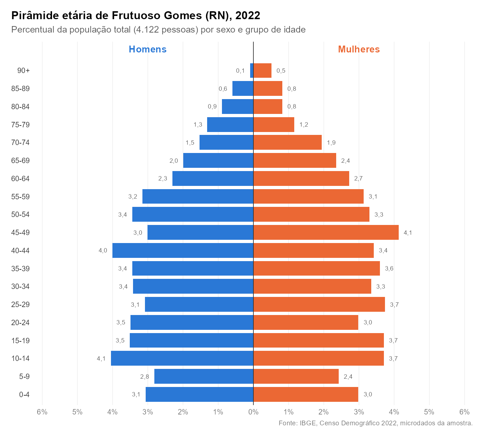

# Frutuoso Gomes (RN)

Resultados do Censo Demográfico 2022 (microdados da amostra). Gerado por `R/05_readmes.R`; veja a [página dos municípios](../README.md) e o [README principal](../../../../README.md).

População: **4.122** pessoas (1.367 registros na amostra).

## Estrutura etária

| Indicador | Frutuoso Gomes | RN |
|---|--:|--:|
| Razão de dependência jovem | 28,5 | 28,5 |
| Razão de dependência idosa | 20,9 | 15,1 |
| Razão de dependência total | 49,4 | 43,6 |
| Índice de envelhecimento | 73,6 | 52,9 |

Valores por 100 pessoas.

## Migração

Chegadas e saídas: mudanças de município nos últimos 10 anos.

| Indicador | Valor |
|---|--:|
| Nascidos no próprio município | 69,7% |
| Nascidos em outro município do Rio Grande do Norte | 22,9% |
| Nascidos em outra UF | 7,5% |
| Nascidos no exterior | 0,0% |
| Chegaram de outro município do Rio Grande do Norte | 460 |
| Chegaram de outra UF | 330 |
| Saíram para outro município da UF | 349 |
| Saíram para outra UF | 331 |
| Saldo migratório | +111 |
| Saldo por 1.000 habitantes | +26,9 |
| Chegaram do exterior | 0 |

Principais origens de quem chegou e destinos de quem saiu:

| Origem | Chegaram | Destino | Saíram |
|---|--:|---|--:|
| São Paulo (SP) | 189 | Itapecerica da Serra (SP) | 80 |
| Mossoró (RN) | 117 | São Paulo (SP) | 71 |
| Natal (RN) | 62 | Mossoró (RN) | 42 |
| Lucrécia (RN) | 47 | Almino Afonso (RN) | 40 |
| Almino Afonso (RN) | 32 | Pau dos Ferros (RN) | 40 |

## Mortalidade

Óbitos de agosto de 2021 a julho de 2022 informados no Censo.

| Indicador | Frutuoso Gomes | RN |
|---|--:|--:|
| Óbitos no período | 19 | 22.488 |
| Registros de óbito na amostra | 6 |  |
| Taxa bruta de mortalidade (por mil) | 4,6 | 6,8 |
| Taxa padronizada por idade (por mil) | 3,6 | 6,8 |

Com poucos óbitos na amostra, as taxas deste município variam muito por acaso; por isso não há tábua de vida. Sem correção do sub-registro de óbitos do Censo.
