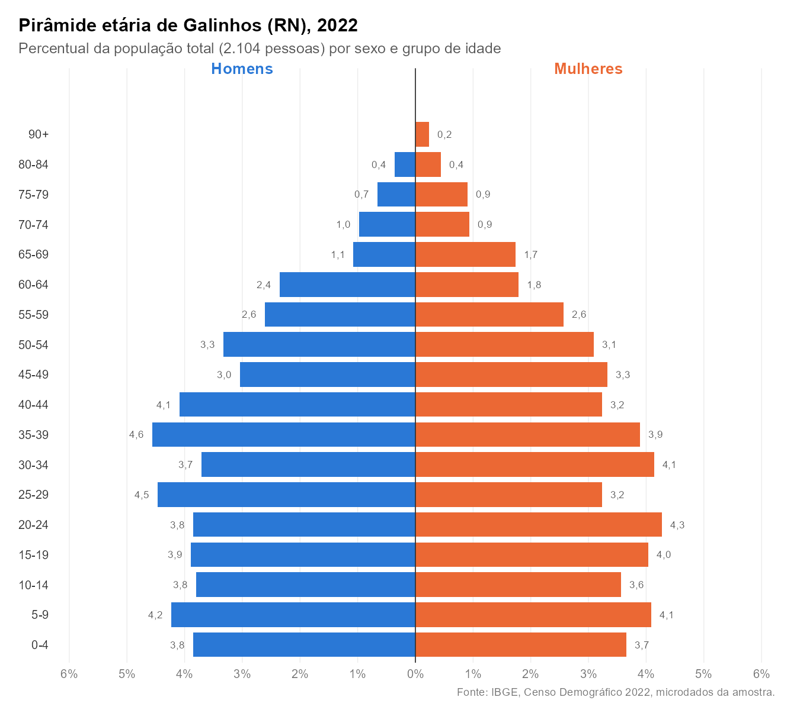

# Galinhos (RN)

Resultados do Censo Demográfico 2022 (microdados da amostra). Gerado por `R/05_readmes.R`; veja a [página dos municípios](../README.md) e o [README principal](../../../../README.md).

População: **2.104** pessoas (706 registros na amostra).

## Estrutura etária

| Indicador | Galinhos | RN |
|---|--:|--:|
| Razão de dependência jovem | 33,4 | 28,5 |
| Razão de dependência idosa | 10,5 | 15,1 |
| Razão de dependência total | 43,9 | 43,6 |
| Índice de envelhecimento | 31,6 | 52,9 |

Valores por 100 pessoas.

## Migração

Chegadas e saídas: mudanças de município nos últimos 10 anos.

| Indicador | Valor |
|---|--:|
| Nascidos no próprio município | 61,1% |
| Nascidos em outro município do Rio Grande do Norte | 35,2% |
| Nascidos em outra UF | 3,6% |
| Nascidos no exterior | 0,0% |
| Chegaram de outro município do Rio Grande do Norte | 262 |
| Chegaram de outra UF | 27 |
| Saíram para outro município da UF | 266 |
| Saíram para outra UF | 6 |
| Saldo migratório | +17 |
| Saldo por 1.000 habitantes | +8,2 |
| Chegaram do exterior | 0 |

Principais origens de quem chegou e destinos de quem saiu:

| Origem | Chegaram | Destino | Saíram |
|---|--:|---|--:|
| Natal (RN) | 83 | Macau (RN) | 71 |
| Ceará-Mirim (RN) | 27 | Natal (RN) | 37 |
| Macau (RN) | 22 | Jandaíra (RN) | 27 |
| Caiçara do Norte (RN) | 17 | Caiçara do Norte (RN) | 26 |
| Jandaíra (RN) | 14 | Parnamirim (RN) | 22 |

## Mortalidade

Óbitos de agosto de 2021 a julho de 2022 informados no Censo.

| Indicador | Galinhos | RN |
|---|--:|--:|
| Óbitos no período | 11 | 22.488 |
| Registros de óbito na amostra | 3 |  |
| Taxa bruta de mortalidade (por mil) | 5,2 | 6,8 |
| Taxa padronizada por idade (por mil) | 5,5 | 6,8 |

Com poucos óbitos na amostra, as taxas deste município variam muito por acaso; por isso não há tábua de vida. Sem correção do sub-registro de óbitos do Censo.
