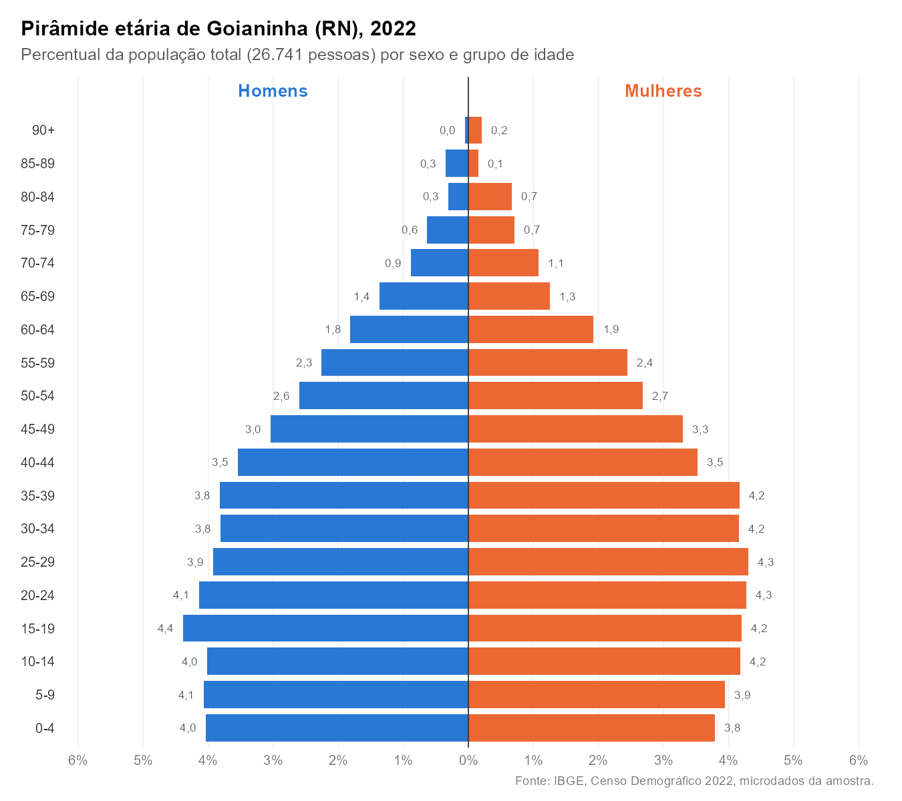

# Goianinha (RN)

Resultados do Censo Demográfico 2022 (microdados da amostra). Gerado por `R/05_readmes.R`; veja a [página dos municípios](../README.md) e o [README principal](../../../../README.md).

População: **26.741** pessoas (2.509 registros na amostra).

## Estrutura etária

| Indicador | Goianinha | RN |
|---|--:|--:|
| Razão de dependência jovem | 35,2 | 28,5 |
| Razão de dependência idosa | 11,2 | 15,1 |
| Razão de dependência total | 46,4 | 43,6 |
| Índice de envelhecimento | 31,9 | 52,9 |

Valores por 100 pessoas.

## Migração

Chegadas e saídas: mudanças de município nos últimos 10 anos.

| Indicador | Valor |
|---|--:|
| Nascidos no próprio município | 65,0% |
| Nascidos em outro município do Rio Grande do Norte | 26,5% |
| Nascidos em outra UF | 8,5% |
| Nascidos no exterior | 0,0% |
| Chegaram de outro município do Rio Grande do Norte | 2.020 |
| Chegaram de outra UF | 1.379 |
| Saíram para outro município da UF | 2.023 |
| Saíram para outra UF | 963 |
| Saldo migratório | +413 |
| Saldo por 1.000 habitantes | +15,5 |
| Chegaram do exterior | 0 |

Principais origens de quem chegou e destinos de quem saiu:

| Origem | Chegaram | Destino | Saíram |
|---|--:|---|--:|
| Natal (RN) | 481 | Natal (RN) | 419 |
| Canguaretama (RN) | 207 | Tibau do Sul (RN) | 231 |
| Arês (RN) | 183 | Parnamirim (RN) | 178 |
| São José de Mipibu (RN) | 169 | Arês (RN) | 162 |
| Tibau do Sul (RN) | 151 | Espírito Santo (RN) | 138 |

## Mortalidade

Óbitos de agosto de 2021 a julho de 2022 informados no Censo.

| Indicador | Goianinha | RN |
|---|--:|--:|
| Óbitos no período | 160 | 22.488 |
| Registros de óbito na amostra | 16 |  |
| Taxa bruta de mortalidade (por mil) | 6,0 | 6,8 |
| Taxa padronizada por idade (por mil) | 8,3 | 6,8 |

Com poucos óbitos na amostra, as taxas deste município variam muito por acaso; por isso não há tábua de vida. Sem correção do sub-registro de óbitos do Censo.
