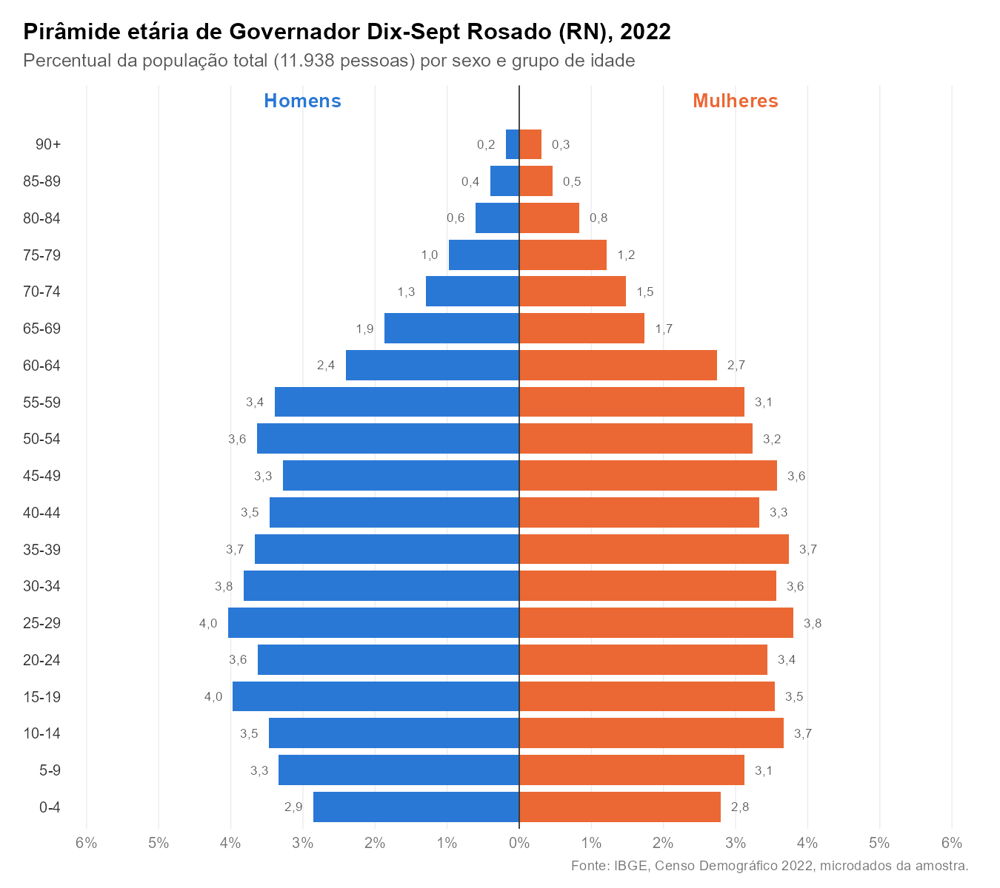

# Governador Dix-Sept Rosado (RN)

Resultados do Censo Demográfico 2022 (microdados da amostra). Gerado por `R/05_readmes.R`; veja a [página dos municípios](../README.md) e o [README principal](../../../../README.md).

População: **11.938** pessoas (2.268 registros na amostra).

## Estrutura etária

| Indicador | Governador Dix-Sept Rosado | RN |
|---|--:|--:|
| Razão de dependência jovem | 27,8 | 28,5 |
| Razão de dependência idosa | 16,4 | 15,1 |
| Razão de dependência total | 44,1 | 43,6 |
| Índice de envelhecimento | 59,0 | 52,9 |

Valores por 100 pessoas.

## Migração

Chegadas e saídas: mudanças de município nos últimos 10 anos.

| Indicador | Valor |
|---|--:|
| Nascidos no próprio município | 65,7% |
| Nascidos em outro município do Rio Grande do Norte | 29,5% |
| Nascidos em outra UF | 4,7% |
| Nascidos no exterior | 0,1% |
| Chegaram de outro município do Rio Grande do Norte | 1.354 |
| Chegaram de outra UF | 229 |
| Saíram para outro município da UF | 842 |
| Saíram para outra UF | 157 |
| Saldo migratório | +584 |
| Saldo por 1.000 habitantes | +48,9 |
| Chegaram do exterior | 0 |

Principais origens de quem chegou e destinos de quem saiu:

| Origem | Chegaram | Destino | Saíram |
|---|--:|---|--:|
| Mossoró (RN) | 677 | Mossoró (RN) | 462 |
| Baraúna (RN) | 105 | Caraúbas (RN) | 63 |
| Caraúbas (RN) | 76 | Natal (RN) | 46 |
| Fortaleza (CE) | 53 | Apodi (RN) | 45 |
| Felipe Guerra (RN) | 52 | Anápolis (GO) | 36 |

## Mortalidade

Óbitos de agosto de 2021 a julho de 2022 informados no Censo.

| Indicador | Governador Dix-Sept Rosado | RN |
|---|--:|--:|
| Óbitos no período | 70 | 22.488 |
| Registros de óbito na amostra | 13 |  |
| Taxa bruta de mortalidade (por mil) | 5,8 | 6,8 |
| Taxa padronizada por idade (por mil) | 5,2 | 6,8 |

Com poucos óbitos na amostra, as taxas deste município variam muito por acaso; por isso não há tábua de vida. Sem correção do sub-registro de óbitos do Censo.
