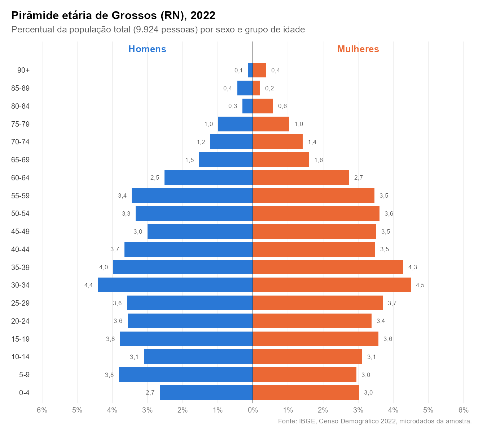

# Grossos (RN)

Resultados do Censo Demográfico 2022 (microdados da amostra). Gerado por `R/05_readmes.R`; veja a [página dos municípios](../README.md) e o [README principal](../../../../README.md).

População: **9.924** pessoas (1.972 registros na amostra).

## Estrutura etária

| Indicador | Grossos | RN |
|---|--:|--:|
| Razão de dependência jovem | 26,1 | 28,5 |
| Razão de dependência idosa | 13,7 | 15,1 |
| Razão de dependência total | 39,8 | 43,6 |
| Índice de envelhecimento | 52,7 | 52,9 |

Valores por 100 pessoas.

## Migração

Chegadas e saídas: mudanças de município nos últimos 10 anos.

| Indicador | Valor |
|---|--:|
| Nascidos no próprio município | 77,5% |
| Nascidos em outro município do Rio Grande do Norte | 18,2% |
| Nascidos em outra UF | 4,3% |
| Nascidos no exterior | 0,0% |
| Chegaram de outro município do Rio Grande do Norte | 639 |
| Chegaram de outra UF | 177 |
| Saíram para outro município da UF | 458 |
| Saíram para outra UF | 190 |
| Saldo migratório | +169 |
| Saldo por 1.000 habitantes | +17,0 |
| Chegaram do exterior | 0 |

Principais origens de quem chegou e destinos de quem saiu:

| Origem | Chegaram | Destino | Saíram |
|---|--:|---|--:|
| Mossoró (RN) | 295 | Mossoró (RN) | 228 |
| Areia Branca (RN) | 112 | Natal (RN) | 88 |
| Natal (RN) | 57 | Campo Grande (MS) | 52 |
| Fortaleza (CE) | 50 | Icapuí (CE) | 33 |
| Tibau (RN) | 48 | Tibau (RN) | 30 |

## Mortalidade

Óbitos de agosto de 2021 a julho de 2022 informados no Censo.

| Indicador | Grossos | RN |
|---|--:|--:|
| Óbitos no período | 69 | 22.488 |
| Registros de óbito na amostra | 13 |  |
| Taxa bruta de mortalidade (por mil) | 6,9 | 6,8 |
| Taxa padronizada por idade (por mil) | 7,8 | 6,8 |

Com poucos óbitos na amostra, as taxas deste município variam muito por acaso; por isso não há tábua de vida. Sem correção do sub-registro de óbitos do Censo.
