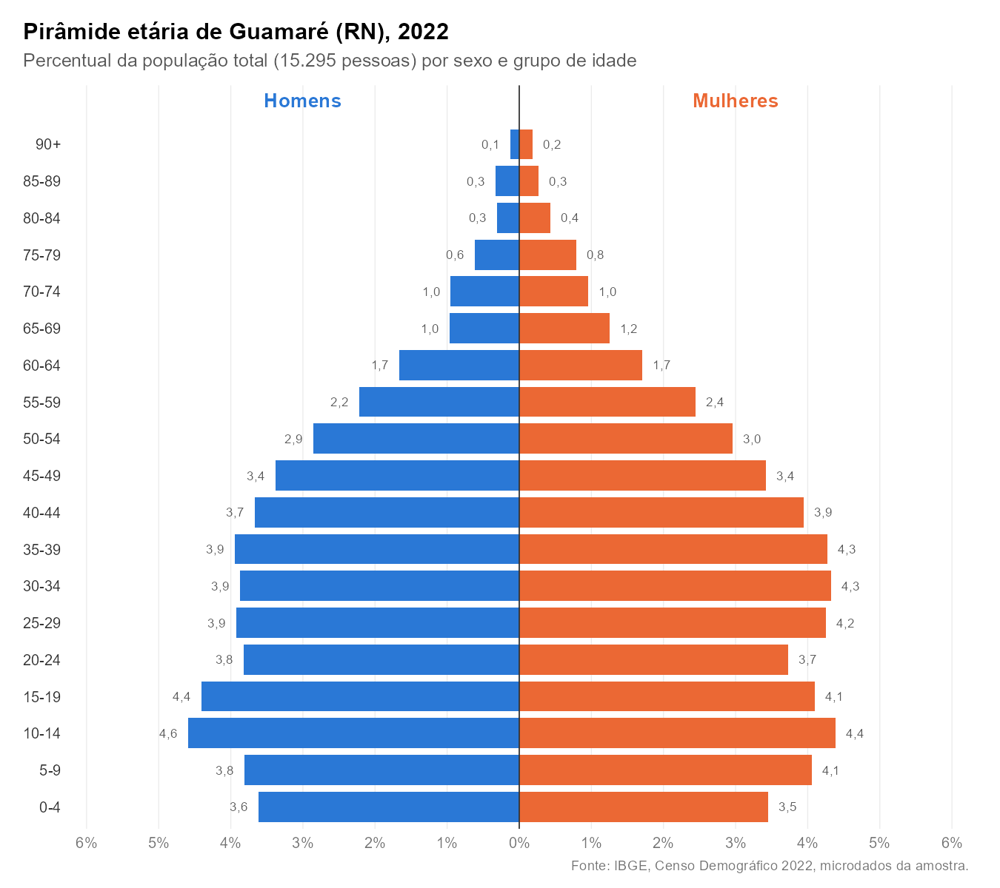

# Guamaré (RN)

Resultados do Censo Demográfico 2022 (microdados da amostra). Gerado por `R/05_readmes.R`; veja a [página dos municípios](../README.md) e o [README principal](../../../../README.md).

População: **15.295** pessoas (2.959 registros na amostra).

## Estrutura etária

| Indicador | Guamaré | RN |
|---|--:|--:|
| Razão de dependência jovem | 34,7 | 28,5 |
| Razão de dependência idosa | 10,4 | 15,1 |
| Razão de dependência total | 45,1 | 43,6 |
| Índice de envelhecimento | 30,0 | 52,9 |

Valores por 100 pessoas.

## Migração

Chegadas e saídas: mudanças de município nos últimos 10 anos.

| Indicador | Valor |
|---|--:|
| Nascidos no próprio município | 47,1% |
| Nascidos em outro município do Rio Grande do Norte | 48,6% |
| Nascidos em outra UF | 4,1% |
| Nascidos no exterior | 0,1% |
| Chegaram de outro município do Rio Grande do Norte | 1.865 |
| Chegaram de outra UF | 320 |
| Saíram para outro município da UF | 1.583 |
| Saíram para outra UF | 275 |
| Saldo migratório | +327 |
| Saldo por 1.000 habitantes | +21,4 |
| Chegaram do exterior | 4 |

Principais origens de quem chegou e destinos de quem saiu:

| Origem | Chegaram | Destino | Saíram |
|---|--:|---|--:|
| Natal (RN) | 525 | Natal (RN) | 364 |
| Macau (RN) | 270 | Macau (RN) | 150 |
| Pedro Avelino (RN) | 196 | Pedro Avelino (RN) | 113 |
| Fortaleza (CE) | 116 | Parnamirim (RN) | 98 |
| João Câmara (RN) | 101 | Santa Cruz (RN) | 89 |

## Mortalidade

Óbitos de agosto de 2021 a julho de 2022 informados no Censo.

| Indicador | Guamaré | RN |
|---|--:|--:|
| Óbitos no período | 76 | 22.488 |
| Registros de óbito na amostra | 15 |  |
| Taxa bruta de mortalidade (por mil) | 5,0 | 6,8 |
| Taxa padronizada por idade (por mil) | 6,8 | 6,8 |

Com poucos óbitos na amostra, as taxas deste município variam muito por acaso; por isso não há tábua de vida. Sem correção do sub-registro de óbitos do Censo.
