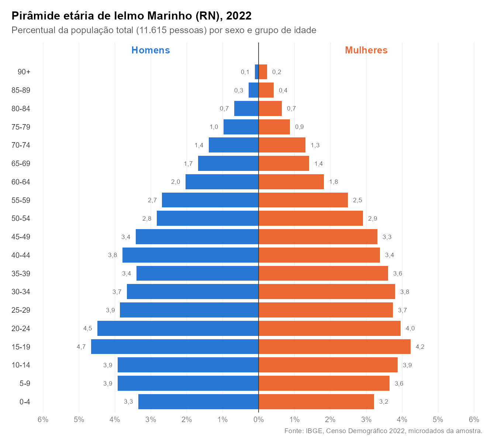

# Ielmo Marinho (RN)

Resultados do Censo Demográfico 2022 (microdados da amostra). Gerado por `R/05_readmes.R`; veja a [página dos municípios](../README.md) e o [README principal](../../../../README.md).

População: **11.615** pessoas (2.526 registros na amostra).

## Estrutura etária

| Indicador | Ielmo Marinho | RN |
|---|--:|--:|
| Razão de dependência jovem | 32,2 | 28,5 |
| Razão de dependência idosa | 14,7 | 15,1 |
| Razão de dependência total | 46,9 | 43,6 |
| Índice de envelhecimento | 45,6 | 52,9 |

Valores por 100 pessoas.

## Migração

Chegadas e saídas: mudanças de município nos últimos 10 anos.

| Indicador | Valor |
|---|--:|
| Nascidos no próprio município | 74,5% |
| Nascidos em outro município do Rio Grande do Norte | 23,2% |
| Nascidos em outra UF | 2,2% |
| Nascidos no exterior | 0,0% |
| Chegaram de outro município do Rio Grande do Norte | 1.115 |
| Chegaram de outra UF | 82 |
| Saíram para outro município da UF | 1.226 |
| Saíram para outra UF | 54 |
| Saldo migratório | -84 |
| Saldo por 1.000 habitantes | -7,2 |
| Chegaram do exterior | 0 |

Principais origens de quem chegou e destinos de quem saiu:

| Origem | Chegaram | Destino | Saíram |
|---|--:|---|--:|
| Natal (RN) | 311 | Ceará-Mirim (RN) | 368 |
| Ceará-Mirim (RN) | 169 | Natal (RN) | 248 |
| Macaíba (RN) | 116 | São Gonçalo do Amarante (RN) | 170 |
| Santa Maria (RN) | 80 | Macaíba (RN) | 89 |
| São Gonçalo do Amarante (RN) | 79 | Parnamirim (RN) | 71 |

## Mortalidade

Óbitos de agosto de 2021 a julho de 2022 informados no Censo.

| Indicador | Ielmo Marinho | RN |
|---|--:|--:|
| Óbitos no período | 89 | 22.488 |
| Registros de óbito na amostra | 17 |  |
| Taxa bruta de mortalidade (por mil) | 7,7 | 6,8 |
| Taxa padronizada por idade (por mil) | 7,8 | 6,8 |

Com poucos óbitos na amostra, as taxas deste município variam muito por acaso; por isso não há tábua de vida. Sem correção do sub-registro de óbitos do Censo.
