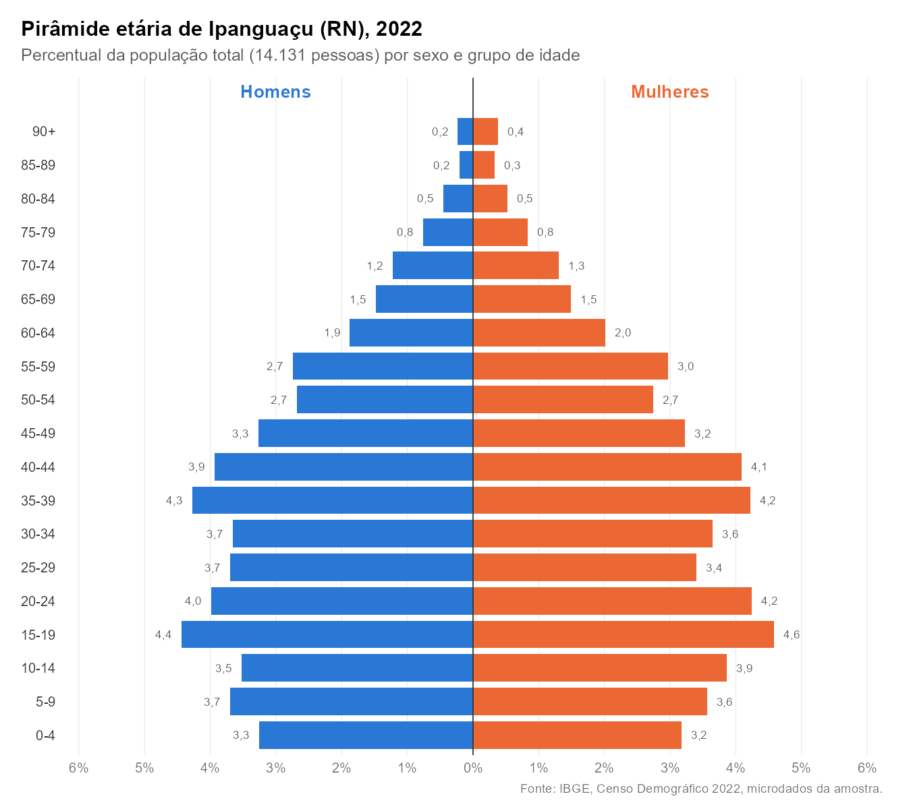

# Ipanguaçu (RN)

Resultados do Censo Demográfico 2022 (microdados da amostra). Gerado por `R/05_readmes.R`; veja a [página dos municípios](../README.md) e o [README principal](../../../../README.md).

População: **14.131** pessoas (2.749 registros na amostra).

## Estrutura etária

| Indicador | Ipanguaçu | RN |
|---|--:|--:|
| Razão de dependência jovem | 30,2 | 28,5 |
| Razão de dependência idosa | 13,2 | 15,1 |
| Razão de dependência total | 43,5 | 43,6 |
| Índice de envelhecimento | 43,8 | 52,9 |

Valores por 100 pessoas.

## Migração

Chegadas e saídas: mudanças de município nos últimos 10 anos.

| Indicador | Valor |
|---|--:|
| Nascidos no próprio município | 76,5% |
| Nascidos em outro município do Rio Grande do Norte | 22,2% |
| Nascidos em outra UF | 1,3% |
| Nascidos no exterior | 0,0% |
| Chegaram de outro município do Rio Grande do Norte | 1.095 |
| Chegaram de outra UF | 185 |
| Saíram para outro município da UF | 1.201 |
| Saíram para outra UF | 206 |
| Saldo migratório | -128 |
| Saldo por 1.000 habitantes | -9,1 |
| Chegaram do exterior | 5 |

Principais origens de quem chegou e destinos de quem saiu:

| Origem | Chegaram | Destino | Saíram |
|---|--:|---|--:|
| Açu (RN) | 212 | Açu (RN) | 401 |
| Natal (RN) | 187 | Afonso Bezerra (RN) | 137 |
| Afonso Bezerra (RN) | 129 | Natal (RN) | 87 |
| Itajá (RN) | 103 | Itajá (RN) | 86 |
| Alto do Rodrigues (RN) | 94 | Alto do Rodrigues (RN) | 79 |

## Mortalidade

Óbitos de agosto de 2021 a julho de 2022 informados no Censo.

| Indicador | Ipanguaçu | RN |
|---|--:|--:|
| Óbitos no período | 84 | 22.488 |
| Registros de óbito na amostra | 14 |  |
| Taxa bruta de mortalidade (por mil) | 5,9 | 6,8 |
| Taxa padronizada por idade (por mil) | 6,3 | 6,8 |

Com poucos óbitos na amostra, as taxas deste município variam muito por acaso; por isso não há tábua de vida. Sem correção do sub-registro de óbitos do Censo.
