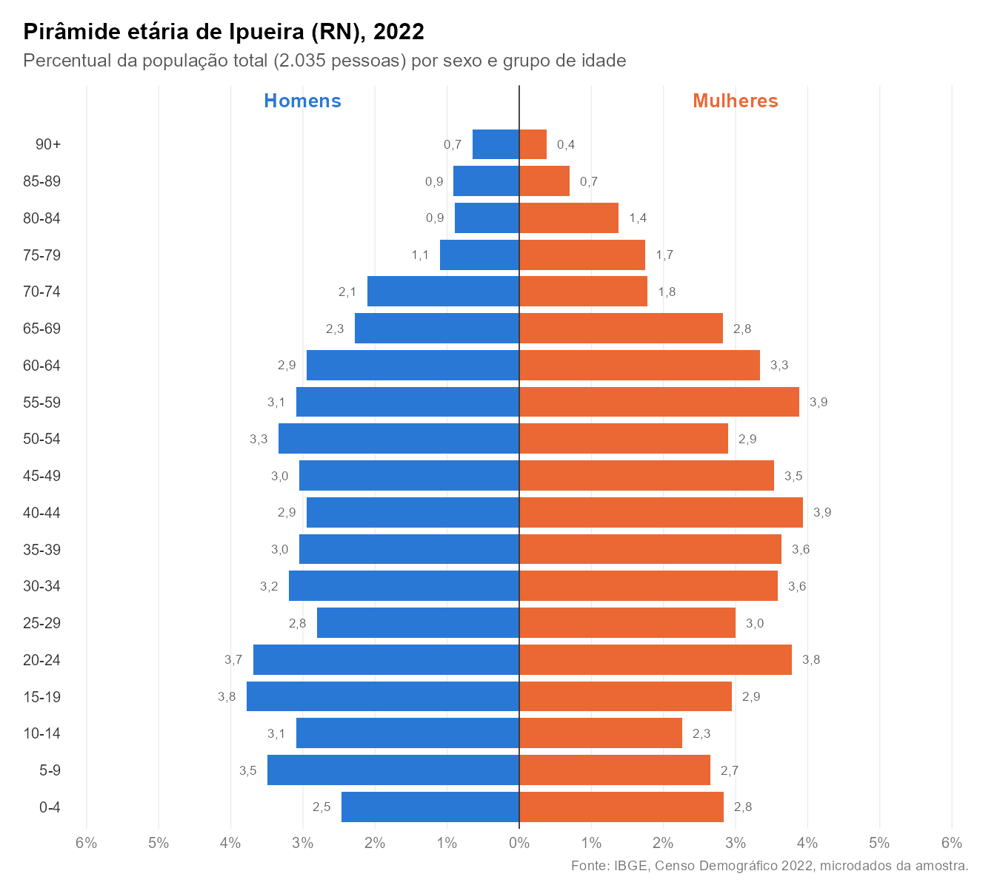

# Ipueira (RN)

Resultados do Censo Demográfico 2022 (microdados da amostra). Gerado por `R/05_readmes.R`; veja a [página dos municípios](../README.md) e o [README principal](../../../../README.md).

População: **2.035** pessoas (1.058 registros na amostra).

## Estrutura etária

| Indicador | Ipueira | RN |
|---|--:|--:|
| Razão de dependência jovem | 25,3 | 28,5 |
| Razão de dependência idosa | 25,2 | 15,1 |
| Razão de dependência total | 50,5 | 43,6 |
| Índice de envelhecimento | 99,7 | 52,9 |

Valores por 100 pessoas.

## Migração

Chegadas e saídas: mudanças de município nos últimos 10 anos.

| Indicador | Valor |
|---|--:|
| Nascidos no próprio município | 34,5% |
| Nascidos em outro município do Rio Grande do Norte | 25,9% |
| Nascidos em outra UF | 39,6% |
| Nascidos no exterior | 0,0% |
| Chegaram de outro município do Rio Grande do Norte | 156 |
| Chegaram de outra UF | 195 |
| Saíram para outro município da UF | 166 |
| Saíram para outra UF | 189 |
| Saldo migratório | -4 |
| Saldo por 1.000 habitantes | -2,1 |
| Chegaram do exterior | 0 |

Principais origens de quem chegou e destinos de quem saiu:

| Origem | Chegaram | Destino | Saíram |
|---|--:|---|--:|
| São João do Sabugi (RN) | 85 | São João do Sabugi (RN) | 68 |
| Caicó (RN) | 38 | Patos (PB) | 60 |
| São Mamede (PB) | 33 | Caicó (RN) | 58 |
| São José de Espinharas (PB) | 30 | Paulista (PE) | 29 |
| São Paulo (SP) | 23 | João Pessoa (PB) | 28 |

## Mortalidade

Óbitos de agosto de 2021 a julho de 2022 informados no Censo.

| Indicador | Ipueira | RN |
|---|--:|--:|
| Óbitos no período | 34 | 22.488 |
| Registros de óbito na amostra | 16 |  |
| Taxa bruta de mortalidade (por mil) | 16,8 | 6,8 |
| Taxa padronizada por idade (por mil) | 9,2 | 6,8 |

Com poucos óbitos na amostra, as taxas deste município variam muito por acaso; por isso não há tábua de vida. Sem correção do sub-registro de óbitos do Censo.
